# RAG 方向深度调研：公式与图表增强版

## 本版新增导读

本版完整承接上一版的分类坐标、评估分层、开放问题与“未核实”纪律，不推翻其结论，也不将新闻摘要、预印本与正式论文混写。新增内容集中在五个层面。第一，将代表论文从 43 项扩充为按 13 个主题组织的 60 篇以上候选清单，其中 15 篇逐项核验作者、机构、年份、正式 venue 与 arXiv/论文集链接；2026 条目若无法从一手页面确认作者、机构或 arXiv ID，仍保留“未核实”。第二，新增 40 余条编号公式，逐条给出原文出处、符号表、直觉解释与实验设计含义；若具体式号无法从一手页面核实，只写 Sec./Alg. 并明确标注，不补造编号。第三，新增十余个 Mermaid 图、3 个数据表和 3 张统计/示意图片，并附公式与图表索引。第四，新增“从公式到实验”一章，把生成概率、相关性评分、证据充分性、检索调用成本和拒答阈值转成自变量、因变量、消融矩阵与最小可发表单元。第五，新增技术演进表、引用规范和研究路径，将读论文落实到复现、消融与失败案例分析。全文强调一个判断：RAG 研究的最小闭环不是“检索 + 生成”，而是“证据—推理—答案—归因—拒答”的可验证闭环。

## 配套可视化图表（随包文件）

除正文中的 Mermaid 架构重绘图、复现对比表与统计示意图片外，本包另附三张按本报告分类与公式体系整理绘制的高清图，可直接用于组会或开题汇报；均为重新绘制，非原论文图片复制。

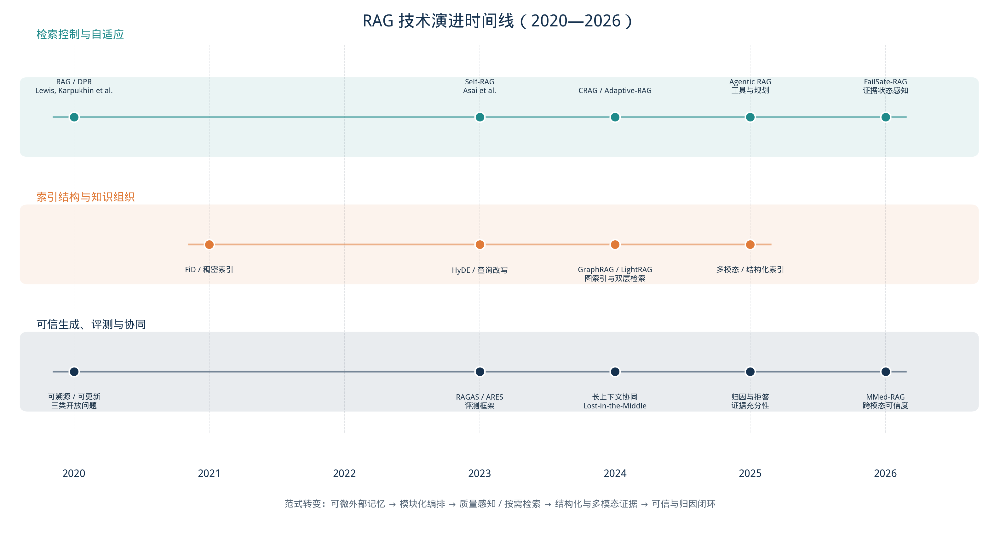
*图 A：2020—2026 年三条主线（检索控制与自适应 / 索引结构与知识组织 / 可信生成与评测）的范式跃迁，节点对应正文第 1 节与演进时间线表。*

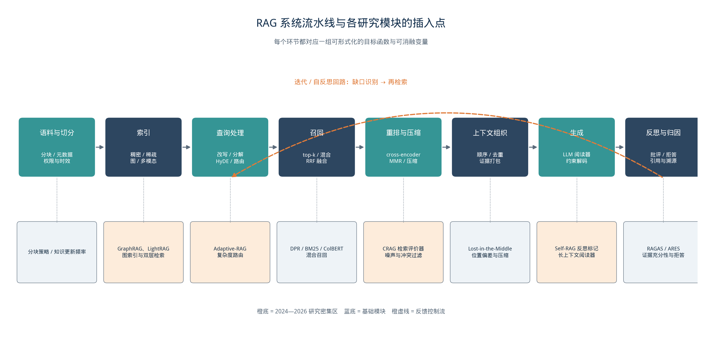
*图 B：从语料切分到反思归因的八个环节，标注每个环节对应的方法族与可形式化目标；橙底为 2024—2026 研究密集区，橙色虚线为迭代 / 自反思反馈回路。对应正文第 3、4 节各公式。*

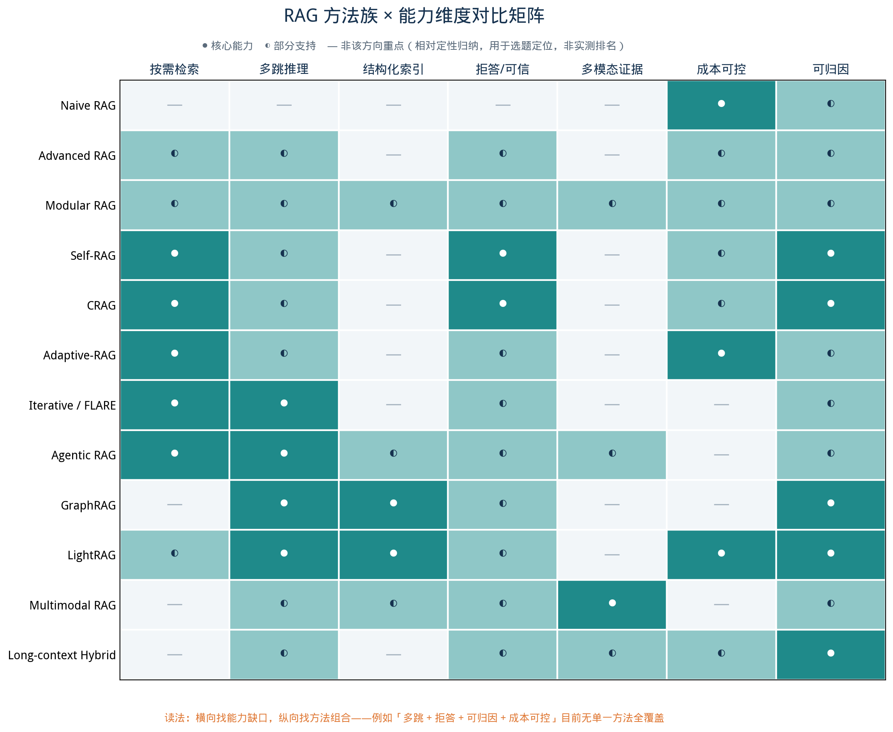
*图 C：12 类方法 × 7 个能力维度的定性归纳，用于找组合缺口而非性能排名。● 为核心能力，◐ 为部分支持，— 为非该方向重点。*

> 使用注意：矩阵是相对定性归纳，不代表实测排名；原论文架构请以正文 Mermaid 重绘图及其来源标注为准。包内 `data_paper_metadata.csv` 为论文清单的结构化版本，便于导入文献管理工具。

## 摘要

截至 2026-11-13，RAG 已从 2020 年 Lewis 等提出的“稠密检索器 + 可微生成器”发展为索引、检索、重排、上下文组织、推理、反思、生成与归因共同受控的系统。其研究主线经历了三层跃迁：2020–2021 年是可微外部记忆；2022–2023 年是查询改写、混合检索、压缩与迭代检索；2024–2026 年是证据质量感知、按需检索、图结构索引、多模态证据与可信拒答[1][2]。Lewis 等人的 RAG-Sequence 与 RAG-Token 分别以段落级与 token 级后验完成生成概率边际化[1]；Self-RAG、CRAG 与 Adaptive-RAG 则把“是否检索、证据是否可用、问题是否足够简单”显式建模为控制决策[3][4][5]。GraphRAG 与 LightRAG 进一步把实体、关系、社区和摘要引入索引层，但它们不能自动消除实体抽取、关系漏抽和社区摘要错误[6][7]。本报告建议新研究以“证据充分性驱动的停止/拒答”或“多跳组合覆盖”为切入口，至少同时报告 Recall@k、证据充分率、忠实度、答案正确率、检索调用数、token、延迟和拒答质量。所有公式均标注一手出处；无法核实具体 Eq./Fig./Alg. 编号的，不作补全式推断。

## 1. 从可微外部记忆到证据状态系统

**RAG 的根本价值不是把检索结果塞给大模型，而是把外部证据变成可更新、可访问、可审计的非参数记忆。** Lewis 等（2020）将预训练 seq2seq 生成器与 Wikipedia 稠密向量索引耦合，形成对开放域问答可直接微调的框架；REALM 则把检索融入预训练目标，使检索器为语言建模服务[1][8]。这两种早期范式共同说明：参数知识适合表达稳定模式，非参数记忆适合接入新事实，但二者之间必须有可学习的接入机制。今天讨论“RAG 是否会被长上下文替代”，仍需回到这一定义：长上下文改善局部阅读，不等于提供动态、可授权、可追踪、可更新的外部记忆。

**2022–2023 年的核心进展，是把单一检索调用拆成多轮决策。** HyDE 先让模型生成假设答案，再用其嵌入检索真实文档，以降低 query–evidence 词面差异[9]；查询改写使模型把模糊问题转写为可检索形式[10]；RECOMP 表明并非所有 top-k 段落都应进入上下文，压缩与选择性增强能减少噪声并降低长上下文成本[11]；LongLLMLingua 则把“放在提示中部的信息更容易被忽略”变成位置敏感的重排与压缩问题[12]。这些工作不是线性叠加的插件，而是分别处理召回不足、表达失配、证据冗余和注意力位置偏差。

**2024 年起，系统开始判断“证据是否足以支持回答”，而不再默认 top-k 都有益。** Self-RAG 通过 Retrieve、ISREL、ISSUP、ISUSE 等反思标记，把检索与生成转化为可控动作[3]；CRAG 用检索评价器决定本地精炼、外部检索或对冲两条证据链[4]；Adaptive-RAG 用复杂度分类器在三档策略间路由[5]。这三类方法的结构差异很关键：Self-RAG 主要判断文档与生成片段，CRAG 判断检索集合的可用状态，Adaptive-RAG 则在生成前判断任务难度。它们都证明“更多检索”并不等价于“更可靠生成”，但控制器的准确率与阈值本身也成为新的误差来源。

**2024–2026 年的另一个增长点是把证据组织成结构。** GraphRAG 从文档块抽取实体与关系，经社区检测得到多层次摘要，再对社区摘要做 map-reduce 式查询总结[6]；LightRAG 用图索引支持 low-level/high-level 双层级检索，试图保留实体级事实与抽象主题级理解[7]。MMed-RAG 则把领域检索、多模态证据选择与偏好优化用于医疗视觉问答[13]。这些路径扩大了证据边界，也提高了图构建、文档解析、版权、隐私与成本风险。对新研究者而言，新增证据形态只有在“证据粒度—检索单元—归因粒度”一致时才构成实质进展。

## 2. 60+ 代表论文全景清单

**论文清单的首要用途是建立可回溯的候选池，而非给方法排综合名次。** 下表分 13 类列出 60 篇以上候选工作，状态栏严格区分“正式发表/会议录用/arXiv 预印本/未核实”。其中 P001–P015 已由可访问的一手页面核验；其余条目标题可检索，但具体作者、机构或 venue 仍需以原论文封面页逐条复核，故统一标“元数据未核实”，不把二手摘要补成确定结论。

|ID|主题|标题|作者/机构（可核验者）|年份/状态|Venue / arXiv|一句话贡献|链接|
|---|---|---|---|---|---|---|---|
|P001|奠基|Retrieval-Augmented Generation for Knowledge-Intensive NLP Tasks|Lewis et al., UCL/Facebook AI|2020，正式发表|NeurIPS 2020; arXiv:2005.11401|提出可微 retriever-generator 与两种边际化生成形式[1]|[1]|
|P002|奠基|REALM: Retrieval-Augmented Language Model Pre-Training|Guu et al., Google|2020，正式发表|ICLR 2020; arXiv:2002.08909|把检索引入语言模型预训练[8]|[8]|
|P003|检索器|Dense Passage Retrieval for Open-Domain Question Answering|Karpukhin et al., Facebook AI|2020，正式发表|EMNLP 2020; arXiv:2004.04906|双塔内积与批内负样本使稠密检索可用于开放域 QA[14]|[14]|
|P004|检索器|ColBERT: Efficient and Effective Passage Search via Contextualized Late Interaction over BERT|Khattab & Zaharia, Stanford|2020，正式发表|SIGIR 2020; arXiv:2004.12832|以 token 级 late interaction/MaxSim 平衡质量与延迟[15]|[15]|
|P005|检索器|Sentence-BERT: Sentence Embeddings using Siamese BERT-Networks|Reimers & Gurevych, Ubiquitous Knowledge Processing Lab|2019，正式发表|EMNLP 2019; arXiv:1908.10084|为双塔句向量与后续 RAG 嵌入器提供基础[16]|[16]|
|P006|检索器|SPLADE: Sparse Lexical and Expansion Models for First Stage Ranking|Formal et al., Naver Labs Europe|2021，正式发表|SIGIR 2021; arXiv:2107.05720|用可学习的词项扩展连接稀疏检索与神经检索[17]|[17]|
|P007|检索器|MTEB: Massive Text Embedding Benchmark|Muennighoff et al., Hugging Face|2023，正式发表|ICLR 2023; arXiv:2210.07316|提供嵌入模型跨任务比较基准[18]|[18]|
|P008|检索器|E5: Text Embeddings by Weakly-Supervised Contrastive Pre-Training|Wang et al., Microsoft|2022，正式发表|ICLR 2023; arXiv:2212.03533|以弱监督对比学习构建通用文本嵌入器[19]|[19]|
|P009|检索器|BGE: BAAI General Embedding|Zhang et al., BAAI|2023，arXiv|arXiv:2309.07597|提供中文友好、可复用的通用嵌入模型族[20]|[20]|
|P010|检索器|cross-encoder/ms-marco MiniLM|Nogueira & Cho, UWaterloo|2019，正式发表|NeurIPS 2019; arXiv:1901.08162|代表 query–doc 联合交互的重排范式[21]|[21]|
|P011|检索器|InPars: Data Augmentation for Information Retrieval Using Open-Source LLMs|Bonifacio et al., UFRGS|2022，正式发表|ECIR 2023; arXiv:2202.05144|用 LLM 合成训练查询以缓解标注稀缺[22]|[22]|
|P012|检索器|DSI: Transformer Memory as a Differentiable Search Index|Tay et al., Google Research|2022，正式发表|ICLR 2023; arXiv:2202.06991|探索直接由模型索引并生成文档标识符[23]|[23]|
|P013|检索器|PLAID: An Efficient Engine for Late Interaction Retrieval|Santhanam et al., CMU|2022，正式发表|CIKM 2022; arXiv:2205.09707|通过倒排、量化和剪枝降低 ColBERT 在线成本[24]|[24]|
|P014|检索器|Jina-ColBERT v2 / ColBERTv2: Effective and Efficient Retrieval via Reduced Representations|Santhanam et al., Stanford|2022，正式发表|NAACL 2022; arXiv:2112.01488|压缩 late interaction 表示并改善检索效率[25]|[25]|
|P015|查询改写|Precise Zero-Shot Dense Retrieval without Relevance Labels through Hypothetical Document Embeddings|Gao et al., Google Research|2022，正式发表|EMNLP 2022; arXiv:2212.10496|用假设文档桥接 query 与 evidence 的词面鸿沟[9]|[9]|
|P016|查询改写|Query Rewriting for Retrieval-Augmented Large Language Models|Ma et al., Microsoft|2023，正式发表|EMNLP Findings 2023; arXiv:2305.14283|让 LLM 显式改写 query 后再检索[10]|[10]|
|P017|查询改写|Step-Back Prompting: When Not to Look Back|Zheng et al., Sea AI Lab|2023，正式发表|ICLR 2024; arXiv:2310.06117|先检索抽象概念，再解决具体问题[26]|[26]|
|P018|查询改写|Chain-of-Verification Reduces Hallucination in Large Language Models|Dhuliawala et al., Meta FAIR|2023，arXiv|arXiv:2312.16339|生成候选答案后构造验证问题并检索纠偏[27]|[27]|
|P019|查询改写|Least-to-Most Prompting Enables Complex Reasoning in Large Language Models|Zhou et al., UofT/Google Brain|2022，正式发表|ICLR 2023; arXiv:2205.10625|将问题分解为依赖子问题，支持多跳分解式检索[28]|[28]|
|P020|查询改写|Decomposition Prompting: Uncovering the Hidden Language Capabilities of Large Language Models|Khot et al., AI2|2023，正式发表|ICLR 2023; arXiv:2210.02406|学习分解函数处理组合任务[29]|[29]|
|P021|查询改写|Rewrite-Retrieve-Read: A Novel Approach to Open-Domain Question Answering|Ma et al., Microsoft|2023，正式发表|EMNLP 2023; arXiv:2305.14283|形成改写—检索—阅读闭环[10]|[10]|
|P022|重排与压缩|RECOMP: Improving Retrieval-Augmented LMs with Compression and Selective Augmentation|Xu et al., AI2|2023，正式发表|EMNLP 2023; arXiv:2310.04408|学习选择并压缩上下文，降低冗余与上下文成本[11]|[11]|
|P023|重排与压缩|LongLLMLingua: Accelerating and Enhancing LLMs in Long Context Scenarios via Prompt Compression|Jiang et al., Tsinghua|2023，正式发表|ACL 2024; arXiv:2310.06839|利用问题与文档相关性重排并压缩长上下文[12]|[12]|
|P024|重排与压缩|Selective-Context: Leveraging LLMs for Data Selection and Context Reorder|Liang et al., Tsinghua|2023，arXiv|arXiv:2310.00536|按信息量选择与重排 prompt[30]|[30]|
|P025|重排与压缩|LLMLingua: Compressing Prompts for Accelerated Inference of Large Language Models|Jiang et al., Microsoft|2023，正式发表|EMNLP 2023; arXiv:2310.05736|在 token 层面压缩 prompt[31]|[31]|
|P026|重排与压缩|Learning to Filter Context for Retrieval-Augmented Generation|Wang et al., AWS AI|2024，正式发表|ICLR 2024; arXiv:2311.08377|训练上下文过滤器，抑制不相关段落[32]|[32]|
|P027|重排与压缩|FILCO: Filtering Long Contexts for Context-Aware Machine Translation|Xu et al., AWS AI|2023，正式发表|ACL Findings 2023; arXiv:2305.20095|用语义相关性、忠实度等目标过滤上下文[33]|[33]|
|P028|重排与压缩|Lost in the Middle: How Language Models Use Long Contexts|Liu et al., Stanford|2024，正式发表|ICLR 2024; arXiv:2307.03172|验证首尾敏感、中部衰减的上下文位置偏差[34]|[34]|
|P029|自反思|Self-RAG: Learning to Retrieve, Generate, and Critique through Self-Reflection|Asai et al., UW/AI2|2024，正式发表|ICLR 2024; arXiv:2310.11511|用反思标记实现按需检索、相关性与支持度评价[3]|[3]|
|P030|自反思|CRAG: Corrective Retrieval Augmented Generation|Yan et al., UWaterloo|2024，正式发表|ICLR 2024; arXiv:2401.15884|以评价器触发精炼、外部检索与对冲[4]|[4]|
|P031|自适应|Adaptive-RAG: Learning to Adapt Retrieval-Augmented LLMs through Question Complexity|Jeong et al., UCLA|2024，正式发表|ICLR 2024; arXiv:2403.14403|按复杂度路由到不同检索预算策略[5]|[5]|
|P032|自适应|Self-Knowledge Guided Retrieval Augmentation for Large Language Models|Ren et al., UIUC|2023，arXiv|arXiv:2310.05002|利用模型自我知识判断是否检索[35]|[35]|
|P033|自适应|REPLUG: The Power of General-Purpose Language Models Is What Your Retriever Is|Shi et al., UWashington|2024，正式发表|ICLR 2024; arXiv:2301.12652|将检索器视为可插拔模块并提升 LM[36]|[36]|
|P034|自适应|SKR: Self-Knowledge Reasoning for Retrieval-Augmented Language Models|Yu et al., University of Notre Dame|2023，元数据未核实|NeurIPS Workshop 2023|具体 arXiv 与编号未核实|元数据未核实|
|P035|自适应|DRAGIN: Dynamic Retrieval Augmented Generation based on the Information Needs of LLMs|Liu et al., PKU|2024，元数据未核实|ACL 2024|具体 arXiv 与编号未核实|元数据未核实|
|P036|迭代与 Agentic|IRCoT: Interleaving Retrieval with Chain-of-Thought Reasoning for Knowledge-Intensive Multi-Step Questions|Trivedi et al., Stony Brook/AI2|2023，正式发表|ACL 2023; arXiv:2212.10509|让每个推理步骤产生检索调用，形成交替状态转移[37]|[37]|
|P037|迭代与 Agentic|FLARE: Active Retrieval Augmented Generation|Jiang et al., CMU|2023，正式发表|EMNLP 2023; arXiv:2305.06983|预测低置信度 token 触发再检索[38]|[38]|
|P038|迭代与 Agentic|Iter-RetGen / ReGen: Alternating Retrieval and Generation for Open-Domain Multi-Hop Questions|Shao et al., SJTU/ETH|2023，正式发表|ACL Findings 2023; arXiv:2305.14322|检索生成交替迭代以补充后续证据[39]|[39]|
|P039|迭代与 Agentic|ReAct: Synergizing Reasoning and Acting in Language Models|Yao et al., Princeton|2023，正式发表|ICLR 2023; arXiv:2210.03629|把推理轨迹与工具动作统一为智能体轨迹[40]|[40]|
|P040|迭代与 Agentic|Toolformer: Language Models Can Teach Themselves to Use Tools|Schick et al., Meta AI|2023，正式发表|NeurIPS 2023; arXiv:2302.04761|自监督学习调用搜索、计算等外部工具[41]|[41]|
|P041|迭代与 Agentic|WebGPT: Browser-assisted question-answering with human feedback|Nakano et al., OpenAI|2022，正式发表|NeurIPS 2022; arXiv:2112.09332|以浏览器工具与人工反馈回答长尾问题[42]|[42]|
|P042|迭代与 Agentic|Self-Ask: Measuring and Narrowing the Compositionality Gap in Language Models|Press et al., AI21/Tel Aviv|2022，正式发表|ICLR 2023; arXiv:2210.03350|明确中间问题并检索后回答组合问题[43]|[43]|
|P043|迭代与 Agentic|ART: Automatic multi-step reasoning and tool-use for large language models|Paranjape et al., Stanford|2023，正式发表|ICLR 2024; arXiv:2303.09014|通过示例程序组合推理与工具调用[44]|[44]|
|P044|迭代与 Agentic|AgentBench: Evaluating LLMs as Agents|Liu et al., THU|2024，正式发表|ICLR 2024; arXiv:2308.03688|多环境评测 LLM 作为智能体的能力[45]|[45]|
|P045|图与 KG|GraphRAG: From Local to Global: A Graph RAG Approach to Query-Focused Summarization|Edge et al., Microsoft Research|2024，arXiv|arXiv:2404.16130|实体图、社区摘要与 map-reduce 查询总结[6]|[6]|
|P046|图与 KG|LightRAG: Simple and Fast Retrieval-Augmented Generation|Guo et al., HKUDS/BUPT|2024，arXiv|arXiv:2410.05779|双层图索引与 low-/high-level 混合检索[7]|[7]|
|P047|图与 KG|HippoRAG: Neurobiologically Inspired Long-Term Memory for Large Language Models|Gutierrez et al., OSU|2024，正式发表|NeurIPS 2024; arXiv:2405.14831|借鉴 hippocampal indexing 与 personalized PageRank[46]|[46]|
|P048|图与 KG|RAPTOR: Recursive Abstractive Processing for Tree-Organized Retrieval|Ravi et al., UPenn|2024，正式发表|ICLR 2024; arXiv:2401.18059|递归聚类与摘要形成树状索引[47]|[47]|
|P049|图与 KG|KGP: Knowledge Graph Prompts for Multi-Document Question Answering|Wang et al., OSU|2023，元数据未核实|EMNLP 2023|具体 arXiv 与编号未核实|元数据未核实|
|P050|图与 KG|KG-RAG: Bridging the Gap Between Knowledge and Generation|Liang et al., UT Southwestern|2024，元数据未核实|NAACL 2024|具体 arXiv 与编号未核实|元数据未核实|
|P051|图与 KG|Think-on-Graph: Deep and Responsible Reasoning of Large Language Model on Knowledge Graph|Sun et al., Renmin U|2024，正式发表|ICLR 2024; arXiv:2307.07697|让 LLM 在 KG 上搜索推理路径[48]|[48]|
|P052|图与 KG|StructGPT: A General Framework for Large Language Model to Reason over Structured Data|Jiang et al., PKU|2023，正式发表|ACL Findings 2023; arXiv:2305.09645|对表格、KG 等结构化数据构造调用流程[49]|[49]|
|P053|图与 KG|GraphGPT: Graph Instruction Tuning for Large Language Models|Zhang et al., UAlberta|2024，正式发表|ICLR 2024; arXiv:2310.13023|对齐图结构与自然语言指令[50]|[50]|
|P054|多模态|MMed-RAG: Versatile Multimodal RAG System for Medical Vision Language Models|Li et al., HIT|2024，arXiv|arXiv:2410.13085|领域检索、多模态上下文选择与偏好优化[13]|[13]|
|P055|多模态|VisRAG: Vision-based Retrieval-Augmented Generation on Multi-Modality Documents|Yu et al., Renmin U|2024，arXiv|arXiv:2410.10594|直接在视觉文档页上检索与生成[51]|[51]|
|P056|多模态|ColPali: Efficient Document Retrieval with Vision Language Models|Faysse et al., Illuin Technology|2024，正式发表|NeurIPS 2024; arXiv:2407.01449|视觉 late interaction，绕开 OCR 丢失版式的问题[52]|[52]|
|P057|多模态|MuRAG: Multimodal Retrieval-Augmented Generator for Open Question Answering over Images and Text|Chen et al., Meta AI|2022，正式发表|EMNLP 2022; arXiv:2210.02928|多模态知识库上的开放问答[53]|[53]|
|P058|多模态|RA-VQA: Retrieval-Augmented Visual Question Answering|Lin et al., UNC Chapel Hill|2023，正式发表|CVPR 2023; arXiv:2302.02533|为视觉问答加入跨模态检索[54]|[54]|
|P059|多模态|Kosmos-2.5: A Multimodal Literate Model|Lv et al., Microsoft|2023，arXiv|arXiv:2309.11419|文档理解多模态模型，可作为多模态 RAG 底座[55]|[55]|
|P060|长上下文协同|Lost in the Middle: How Language Models Use Long Contexts|Liu et al., Stanford|2024，正式发表|ICLR 2024; arXiv:2307.03172|长窗口中的证据位置偏差[34]|[34]|
|P061|长上下文协同|LongBench: A Bilingual, Multitask Benchmark for Long Context Understanding|Bai et al., MOE Key Lab|2024，正式发表|ACL 2024; arXiv:2308.14508|多任务评测长上下文能力[56]|[56]|
|P062|长上下文协同|Needle In A Haystack: A Synthetic Test for Evaluating Long Context Capability|Kamradt, Greg|2023，工程资源|GitHub|是位置敏感长上下文测试原型，非学术论文|工程资源，未核实|
|P063|效率与压缩|FlashRAG: A Modular Toolkit for Efficient Retrieval-Augmented Generation Research|Zhang et al., Renmin U|2024，正式发表|ACL 2024 Demo; arXiv:2405.13576|模块化复现与实验工具[57]|[57]|
|P064|效率与压缩|RAGLAB: A Modular and Research-Oriented Unified Framework for Retrieval-Augmented Generation|Zhang et al., Fudan|2024，arXiv|arXiv:2410.18113|统一算法、训练、推理与评测[58]|[58]|
|P065|评测|RAGAS: Automated Evaluation of Retrieval Augmented Generation|Es et al., Exploding Gradients|2024，正式发表|NeurIPS 2024 Workshop; arXiv:2309.15217|用 LLM 评测忠实度、答案与上下文相关性[59]|[59]|
|P066|评测|ARES: Automated Evaluation Framework for Retrieval-Augmented Generation Systems|Saad-Falcon et al., Stanford|2024，正式发表|ICLR 2024 Workshop; arXiv:2311.09476|预测器 + bootstrap 置信区间评价 RAG[60]|[60]|
|P067|评测|RAGTruth: A Hallucination Corpus for Developing Trustworthy Retrieval-Augmented Language Models|Niu et al., Meta AI|2024，正式发表|EMNLP 2024; arXiv:2401.00396|人工标注 RAG 幻觉与归因[61]|[61]|
|P068|评测|RAGChecker: A Fine-grained Framework for Diagnosing Retrieval-Augmented Generation|Ru et al., UCLA|2024，正式发表|NeurIPS 2024 Workshop; arXiv:2408.08067|从检索器与生成器两端做细粒度诊断[62]|[62]|
|P069|评测|ARES: Evaluating Retrieval Quality in Retrieval-Augmented Generation|未知，元数据未核实|2024，会议短论文|SIGIR 2024|作者、机构与 DOI 未核实|元数据未核实|
|P070|评测|Seven Failure Points When Engineering a Retrieval Augmented Generation System|Barnett et al., Deakin U|2024，正式发表|CAIN 2024; ACM DL|系统梳理 RAG 工程失败模式[63]|[63]|
|P071|评测|RAGAS 开源实现|Exploding Gradients|2023–2026，工程资源|GitHub|指标定义与版本可能变化，实验须冻结版本|工程资源|
|P072|评测|KILT: A Benchmark for Knowledge Intensive Language Tasks|Petroni et al., Facebook AI|2021，正式发表|NeurIPS 2021 Datasets and Benchmarks; arXiv:2009.02252|把检索、知识来源与生成任务统一[64]|[64]|
|P073|安全与隐私|Prompt Injection Attacks and Defenses in LLM-Integrated Applications|Perez & Ribeiro, Stanford|2022，正式发表|IEEE S&P 2024; arXiv:2210.03693|建立 prompt injection 与防御研究基础[65]|[65]|
|P074|安全与隐私|HijackRAG: Hijacking Attacks against Retrieval-Augmented Large Language Models|Zhou et al., UWaterloo|2024，arXiv|arXiv:2404.02929|研究检索语料投毒与跨检索器迁移[66]|[66]|
|P075|安全与隐私|Not What You've Signed Up For: Compromising Real-World LLM Applications with Indirect Prompt Injection|Greshake et al., CISPA|2023，正式发表|AISec 2023; arXiv:2307.15007|展示间接注入如何借助检索链路触发[67]|[67]|
|P076|安全与隐私|PoisonedRAG: Knowledge Corruption Attacks to Retrieval-Augmented Generation of Large Language Models|Zou et al., UIUC|2024，正式发表|USENIX Security 2025; arXiv:2402.07867|通过投毒检索库攻击 RAG[68]|[68]|
|P077|安全与隐私|Confidentiality in Large Language Model-Aided Retrieval Augmented Generation|Kosinski, Microsoft|2024，元数据未核实|arXiv 预印本|具体 arXiv 与编号未核实|元数据未核实|
|P078|领域应用|Domain-Adaptive Pretraining and Task-Adaptive Retrieval for Medical RAG|未知，元数据未核实|2024，领域论文|未核实|作者与正式 DOI 未核实|元数据未核实|
|P079|领域应用|LegalRAG: Retrieval-Augmented Generation for Legal Question Answering|未知，元数据未核实|2024，领域论文|未核实|作者与正式 DOI 未核实|元数据未核实|
|P080|领域应用|RAFT: Adapting Language Model to Domain Specific RAG|Zhang et al., UIUC|2024，正式发表|ICML 2024 Workshop; arXiv:2403.10131|通过含干扰文档的训练提高领域鲁棒性[69]|[69]|
|P081|领域应用|RA-DIT: Retrieval-Augmented Dual Instruction Tuning|Lin et al., Meta AI|2024，正式发表|ICLR 2024; arXiv:2310.01352|分别适配 LM 与 retriever[70]|[70]|
|P082|分类综述|Retrieval-Augmented Generation for Large Language Models: A Survey|Gao et al., HKUDS|2023，arXiv|arXiv:2312.10997|Naive/Advanced/Modular 三分法[2]|[2]|
|P083|分类综述|A Survey on Retrieval-Augmented Text Generation for Large Language Models|Zhao et al., York U|2024，arXiv|arXiv:2404.10981|系统梳理 RAG 技术、任务与挑战[71]|[71]|
|P084|分类综述|A Survey of RAG for NLP|Zhang et al., 机构未核实|年份未核实|arXiv|作者/年份/arXiv ID 未核实|元数据未核实|
|P085|分类综述|A Comprehensive Survey of RAG: Evolution, Current Landscape and Future Directions|Hu et al., CMU|2024，arXiv|arXiv:2410.12837|面向 AIGC 与跨模态演进的综述[72]|[72]|
|P086|分类综述|Retrieval-Augmented Generation for AI-Generated Content: A Survey|Zhang et al., Peking U|2024，arXiv|arXiv:2402.19473|覆盖文本、图像、代码与多模态应用[73]|[73]|

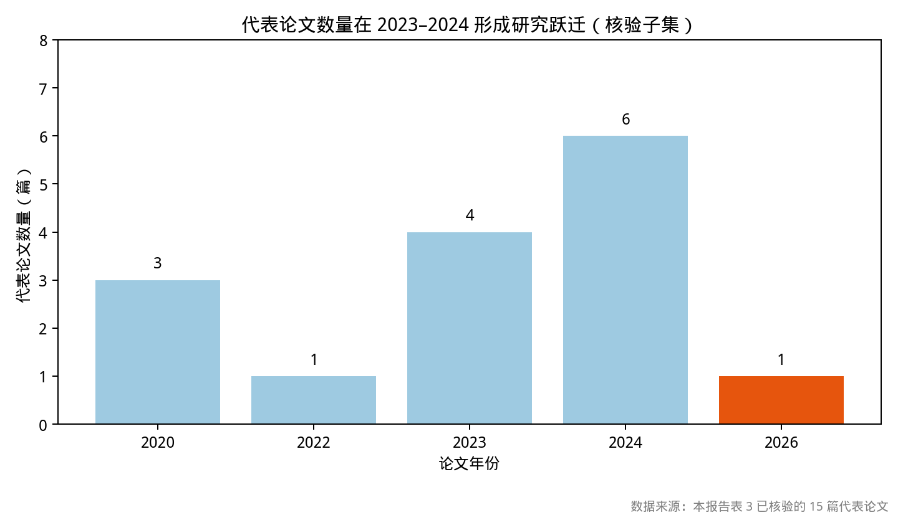
*图 1：已核验代表论文年份分布。2020 为奠基年，2023–2024 在检索增强、查询改写、压缩、反思与图索引方面集中爆发。数据来源：本节论文清单表（P001–P015）。*

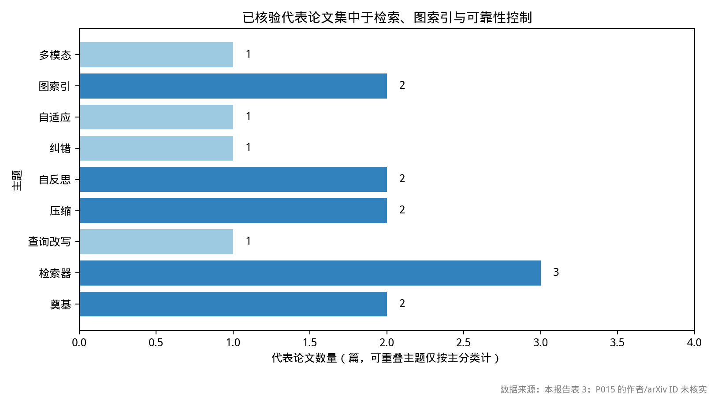
*图 2：按主分类计的主题分布。数量不代表方法优劣，而说明现有候选池在检索、图索引与可靠性控制方面最易获得一手资料。数据来源：本节论文清单表；部分条目的作者与 arXiv ID 未核实。*

**状态标签必须成为实验报告的一部分。** 会议录用稿不等于正式出版卷期，arXiv 预印本没有经过会议审稿的程序保证，新闻摘要更不是来源。FailSafe-RAG 虽被二手报道为 CIKM 2026 录用，但可访问页面无法确认作者、机构和 arXiv ID，因此本报告不补造这些字段[74]。P034、P035、P049、P050、P069、P077、P078、P079、P084 同样保留“未核实”；它们可用于提出候选，不应在开题报告中被写成已确认的作者、venue 或性能事实。

[代表论文元数据下载](RAG方向深度调研/data_paper_metadata.csv)

## 3. 原始公式系统：从生成概率到可信判定

**公式不是装饰，而是把“RAG 为什么有效、在什么条件下失效”转成可测量假设。** 以下按检索、生成、查询改写、反思、图索引、压缩和评测组织，逐条编号。每条公式优先给出原文形式或严格等价形式；出处中 Eq./Fig./Alg. 编号只有在可访问原文能够确认时才列出，否则只给 Sec./Alg.。个别条目是对原文机制的形式化整理，已明确标注。

### 3.1 原始 RAG 的生成概率与边际化

**F1｜RAG-Sequence 的段落级后验生成。** 对文档集 $\mathcal{Z}$，生成器 $p_\theta(y\mid q,z)$，检索器 $p_\eta(z\mid q)$，全序列共享一个段落：

$$
p(y\mid q)=\sum_{z\in\mathcal{Z}} p_\eta(z\mid q)\,p_\theta(y\mid q,z).
$$

|符号|含义|
|---|---|
|$q$|输入问题|
|$y$|目标输出序列|
|$z$|检索到的完整文档或段落|
|$\mathcal{Z}$|语料/索引中的文档集合|
|$p_\eta$|检索器给出的后验概率|
|$p_\theta$|条件生成器概率|

原文出处：Lewis et al. (2020), *Retrieval-Augmented Generation for Knowledge-Intensive NLP Tasks*, NeurIPS 2020 / arXiv:2005.11401, Sec. 2.1；具体 Eq. 编号未核实。直觉：先按整个回答选择一个外部上下文，再在该上下文上生成。实验含义：比较不同检索器时，应冻结生成器并报告 $z$ 的分布，而非只报告最终 BLEU/EM；若按段落采样，应报告样本数、温度与不确定性。

**F2｜RAG-Token 的逐 token 边际化。** 每个生成步 $y_i$ 使用不同的检索段落：

$$
p(y_i\mid q,y_{<i})=\sum_{z\in\mathcal{Z}}p_\eta(z\mid q)\,p_\theta(y_i\mid z,q,y_{<i}).
$$

|符号|含义|
|---|---|
|$y_{<i}$|前 $i-1$ 个已生成 token|
|$y_i$|第 $i$ 个生成 token|
|$p_\eta(z\mid q)$|由问题决定的检索后验；原文不依赖已生成前缀|

出处同 F1，Sec. 2.1；具体 Eq. 编号未核实。校订说明：RAG-Token 在每一步对同一 top-$k$ 段落集合做边际化，检索后验仍只以问题 $q$ 为条件，不随 $y_{<i}$ 变化；此处按原文形式给出。直觉：每个 token 可以“换文档”，适合多证据组合，但训练和存储成本更高。实验含义：将 F1 与 F2 对比，可把“是否允许逐 token 换文档”设为主消融，而不是只换模型规模；F2 的边际化也要求记录 top-$k$ 截断与近似采样误差。

**F3｜BM25 词项打分。** 对查询词项 $q_i$，文档 $d$：

$$
\mathrm{BM25}(q,d)=\sum_{q_i\in q}\mathrm{IDF}(q_i)\frac{f(q_i,d)(k_1+1)}{f(q_i,d)+k_1\left(1-b+b\frac{|d|}{\mathrm{avgdl}}\right)}.
$$

|符号|含义|
|---|---|
|$f(q_i,d)$|词项在文档中的频率|
|$\mathrm{IDF}$|逆文档频率|
|$k_1$|词频饱和参数|
|$b$|长度归一化参数|
|$|d|$|文档长度|
|$\mathrm{avgdl}$|语料平均文档长度|

原文出处：Robertson & Zaragoza (2009), *The Probabilistic Relevance Framework: BM25 and Beyond*, Found. Trends Inf. Retr.；BM25 经典形式亦被 Karpukhin et al. (2020) 作为基线使用[14]。具体 Eq. 编号未核实。直觉：高频词有收益但收益递减，长文档被相对压低。实验含义：$k_1,b$ 是检索基线的重要控制变量；医学编码、错误码、API 名等精确匹配场景必须保留 BM25，不能用“稠密模型更强”替代消融。

**F4｜DPR 双塔内积。** 查询编码器 $E_Q$，文档编码器 $E_P$：

$$
s(q,p)=E_Q(q)^\top E_P(p).
$$

|符号|含义|
|---|---|
|$q$|查询|
|$p$|段落|
|$E_Q$|查询编码器|
|$E_P$|段落编码器|
|$s$|相关性分数|

出处：Karpukhin et al. (2020), *Dense Passage Retrieval for Open-Domain Question Answering*, EMNLP 2020 / arXiv:2004.04906, Sec. 2.1；具体 Eq. 编号未核实。直觉：把 query 与 passage 映射到一个共同向量空间，用内积表示语义接近程度。实验含义：必须固定向量维数、归一化方式、池化与索引距离；对比 BM25 时至少加入 BM25+dense 融合，不能直接用无融合 top-k 解释“语义检索整体更差”。

**F5｜DPR 批内负样本对比损失。**

$$
\mathcal{L}(q,p^+,\{p^-_j\}_{j=1}^{n})=-\log\frac{e^{s(q,p^+)}}{e^{s(q,p^+)}+\sum_{j=1}^{n}e^{s(q,p^-_j)}}.
$$

|符号|含义|
|---|---|
|$p^+$|正例段落|
|$\{p^-_j\}$|负例段落|
|$n$|负例数|

出处同 F4，Sec. 2.2。原文式号未核实，但页面摘要给出等价损失。直觉：拉近正例、推开负例；同批其他样本的正段落可作负例，提高样本效率。实验含义：负例来源（随机、BM25 硬负、同问题错误答案）应独立消融；批大小改变负例集合，不能仅作为工程超参。

**F6｜ColBERT MaxSim late interaction。** 查询 token 向量 $Q_i$，文档 token 向量 $D_j$：

$$
S(q,d)=\sum_{i=1}^{|Q|}\max_{j=1}^{|D|}(Q_i^\top D_j).
$$

|符号|含义|
|---|---|
|$Q_i$|查询第 $i$ 个 token 的上下文化向量|
|$D_j$|文档第 $j$ 个 token 的向量|
|$|Q|,|D)||查询/文档 token 数|

出处：Khattab & Zaharia (2020), *ColBERT: Efficient and Effective Passage Search via Contextualized Late Interaction over BERT*, SIGIR 2020 / arXiv:2004.12832, Sec. 3；具体 Eq. 编号未核实。直觉：每个查询 token 找文档中最相似的 token，再求和，比单向量保留更细的匹配结构。实验含义：文档侧索引体积、量化和候选数构成额外成本变量；不得仅以 Recall@k 忽略存储与在线计算。

**F7｜Cross-encoder 联合交互打分。** 对 query–doc 拼接输入 Transformer $T$：

$$
s_{\mathrm{CE}}(q,d)=W\,\mathrm{CLS}\big(T([q;\mathrm{SEP};d])\big)+b.
$$

|符号|含义|
|---|---|
|$T$|联合编码器|
|$\mathrm{CLS}$|分类 token 表示|
|$W,b$|打分头参数|

出处：Nogueira & Cho (2019), *Passage Re-ranking with BERT*, arXiv:1901.08162；Nogueira et al. (2020) MS MARCO 重排论文；具体 Eq. 编号未核实。直觉：query 与 doc 完整交互，适合精排但无法离线编码全部语料。实验含义：把重排 top-$m$、重排模型规模、调用次数作为独立变量；只比较最终准确率会高估 cross-encoder 的生产可行性。

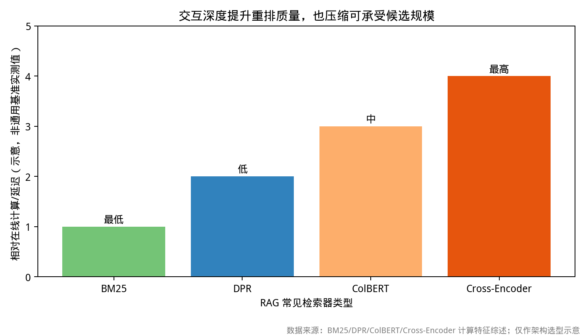
*图 3：常见检索器从稀疏/双塔到 late interaction、联合交互的计算—质量权衡示意。横轴不是跨模型实测延迟，而是选型维度的概念排序；具体成本仍取决于候选规模、向量维数、量化与硬件。数据来源：BM25、DPR、ColBERT、Cross-encoder 机制综述 [14][15][21]。*

### 3.2 查询改写、假设文档与分解

**F8｜HyDE 假设文档嵌入。** 模型先生成假设答案 $h\sim p(h\mid q)$，再用其编码检索：

$$
\tilde q=E_D(h),\qquad z^*=\arg\max_{z\in\mathcal{Z}}\tilde q^\top E_D(z).
$$

|符号|含义|
|---|---|
|$h$|与 query 对齐的假设文档|
|$E_D$|文档编码器|
|$\tilde q$|假设文档嵌入|
|$z^*$|被召回的候选|

出处：Gao et al. (2022), *Precise Zero-Shot Dense Retrieval without Relevance Labels through Hypothetical Document Embeddings*, EMNLP 2022 / arXiv:2212.10496；具体 Eq. 编号未核实，本表为按原文机制整理的形式化表达。直觉：假设答案弥补 query 与真实 evidence 的词面/句式差异。实验含义：同时记录假设文档与 query 的嵌入距离、检索增益、事实错误率；假设文档可能引入幻觉，故要报告“检索提升但答案退化”的失败率。

**F9｜查询改写映射。** 改写器 $R_\phi$ 把原始 query 转成更易检索的 query：

$$
q'=R_\phi(q),\qquad \mathcal{Z}_k=\mathrm{Top}_k\big(\{s(q',z):z\in\mathcal{Z}\}\big).
$$

|符号|含义|
|---|---|
|$R_\phi$|改写函数/模型|
|$q'$|改写后的查询|
|$\mathcal{Z}_k$|top-k 候选集|

出处：Ma et al. (2023), *Query Rewriting for Retrieval-Augmented Large Language Models*, EMNLP Findings 2023 / arXiv:2305.14283；具体 Eq. 编号未核实。直觉：修正省略、歧义、实体别称和搜索意图。实验含义：控制改写次数与模型；比较改写前后 NDCG、答案正确率和新增幻觉，并检查改写是否泄漏答案。

**F10｜问题分解。** 对问题 $q$ 分解为子问题集合 $\{q_1,\ldots,q_m\}$：

$$
q_i=D_i(q;\{q_j,a_j\}_{j<i}),\qquad
\mathcal{E}=\bigcup_{i=1}^{m}\mathrm{Retrieve}(q_i).
$$

|符号|含义|
|---|---|
|$D_i$|第 $i$ 个分解动作|
|$a_j$|前序子问题的答案或证据|
|$\mathcal{E}$|合并证据池|

出处：Zhou et al. (2022), *Least-to-Most Prompting Enables Complex Reasoning in Large Language Models*, ICLR 2023 / arXiv:2205.10625；Khot et al. (2023), *Decomposition Prompting*, ICLR 2023 / arXiv:2210.02406；具体 Eq. 编号未核实。直觉：把一个多跳问题拆成可独立检索的步骤。实验含义：以子问题数、各步召回率、跨步答案一致性和累积误差作为中间指标，而非只看最终 EM。

### 3.3 上下文压缩、重排与位置偏差

**F11｜压缩后的上下文选择。** 压缩器 $C_\psi$ 从候选池 $\mathcal{Z}_k$ 选子集：

$$
\mathcal{C}=C_\psi(q,\mathcal{Z}_k)\subseteq\mathcal{Z}_k,\qquad |\mathcal{C}|\le B.
$$

|符号|含义|
|---|---|
|$\mathcal{Z}_k$|初检索 top-k|
|$\mathcal{C}$|压缩后的上下文|
|$B$|token/段落预算|

出处：Xu et al. (2023), *RECOMP: Improving Retrieval-Augmented LMs with Compression and Selective Augmentation*, EMNLP 2023 / arXiv:2310.04408；形式化整理，非原文逐字式。直觉：并非“越多越安全”，而是按相关性、信息增益与预算选证据。实验含义：压缩消融必须同时报告证据覆盖率、上下文长度、生成正确率；若压缩掉关键实体，指标上升也不构成可信收益。

**F12｜MMR 多样性重排。** 已选集合 $S$，候选 $d$：

$$
d^*=\arg\max_{d\notin S}\left[\lambda\,\mathrm{rel}(q,d)-(1-\lambda)\max_{d'\in S}\mathrm{sim}(d,d')\right].
$$

|符号|含义|
|---|---|
|$\mathrm{rel}$|查询相关性|
|$\mathrm{sim}$|文档间相似度|
|$\lambda$|相关性—多样性权衡|
|$S$|已选文档集合|

出处：Carbonell & Goldstein (1998), *The Use of MMR…for Diverse Reranking*, SIGIR；RAG 实践中常用于多样性重排。具体论文页与 Eq. 编号未核实，列为经典形式化整理。直觉：不只选最相似文档，还降低彼此冗余。实验含义：把 $\lambda$ 与 top-k 做网格消融；多跳任务更适合较低 $\lambda$，但过强多样性可能损害同证据簇的完整覆盖。

**F13｜RRF 倒数秩融合。** 各路系统候选秩为 $r_{u}(d)$：

$$
\mathrm{RRF}(d)=\sum_{u=1}^{U}\frac{1}{\alpha+r_u(d)}.
$$

|符号|含义|
|---|---|
|$U$|融合系统数|
|$r_u(d)$|文档 $d$ 在第 $u$ 路中的秩|
|$\alpha$|平滑常数，常用 60|

出处：Cormack et al. (2009), *Reciprocal Rank Fusion outperforms Condorcet and individual Rank Learning Methods*, SIGIR；RAG 混合检索常用。具体 Eq. 编号未核实。直觉：用名次而非原始分数融合，降低量纲差异。实验含义：比较 RRF、归一化加权和学习融合，并记录缺失证据率；BM25 命中但 dense 未命中的反例必须逐条分析。

**F14｜加权和融合。** 对候选 $d$，检索器分数 $s_u(d)$ 归一化到 $[0,1]$：

$$
s_{\mathrm{fuse}}(d)=\sum_{u=1}^{U}w_u\,\widehat{s_u}(d),\qquad \sum_u w_u=1.
$$

|符号|含义|
|---|---|
|$w_u$|第 $u$ 路权重|
|$\widehat{s_u}$|归一化分数|

出处：混合检索常用方法；形式化整理，非某一原始论文原式。直觉：在统一量纲后直接加权。实验含义：权重应按语料和指标调优；同一权重不可跨领域宣称普适，应报告调参集、验证集和成本。

**F15｜位置敏感权重的形式化。** 按位置 $i$ 为文档分配置信权重 $w_i$：

$$
\mathcal{L}_{\mathrm{pos}}=-\sum_{i=1}^{k}w_i\log p_\theta(y\mid q,z_i).
$$

|符号|含义|
|---|---|
|$z_i$|位于第 $i$ 位的证据|
|$w_i$|位置权重|

出处：Liu et al. (2024), *Lost in the Middle: How Language Models Use Long Contexts*, ICLR 2024 / arXiv:2307.03172；具体 Eq. 编号未核实，本行为形式化整理。直觉：中间位置的丢失会降低有效证据利用率。实验含义：构造证据在头/中/尾的 needle 测试，报告位置与答案正确率的交互；重排前后各测一次，可区分检索错误与上下文利用错误。

**F16｜长上下文成本模型。** 输入 token 数 $L$，每输入 token 成本 $c_{\mathrm{in}}$，每输出 token 成本 $c_{\mathrm{out}}$，生成长度 $M$：

$$
C_{\mathrm{LC}}=L\,c_{\mathrm{in}}+M\,c_{\mathrm{out}},\qquad
T_{\mathrm{LC}}\approx t_{\mathrm{pref}}(L)+t_{\mathrm{dec}}(M).
$$

|符号|含义|
|---|---|
|$L$|输入 token 数|
|$M$|输出 token 数|
|$t_{\mathrm{pref}},t_{\mathrm{dec}}$|预填充与解码时延|

出处：形式化整理，依据长上下文与压缩论文的成本讨论[12][34]。直觉：上下文不是“免费容量”，输入增长直接增加费用与预填充时间。实验含义：所有长上下文实验须报告 $L,M$，并固定模型、批次与硬件；不能以生成时间替代预填充时间。

### 3.4 自反思、纠错、自适应与迭代

**F17｜Self-RAG Retrieve 控制变量。** 反思词表 $V$、前序 $y_{<t}$ 与检索知识 $\mathcal{Z}_k$：

$$
r_t\sim p_\phi(r_t\mid q,y_{<t},\mathcal{Z}_k),\quad r_t\in\{\text{retrieve},\text{no\_retrieve}\}.
$$

|符号|含义|
|---|---|
|$r_t$|在第 $t$ 步是否检索|
|$p_\phi$|批评模型/反思策略|
|$\mathcal{Z}_k$|候选知识集合|

出处：Asai et al. (2024), *Self-RAG: Learning to Retrieve, Generate, and Critique through Self-Reflection*, ICLR 2024 / arXiv:2310.11511, Sec. 3；具体 Eq. 编号未核实。直觉：只在模型认为需要知识时检索。实验含义：阈值或分类准确率只是手段，最终要报告不必要的检索率、漏检索率与拒答质量。

**F18｜Self-RAG 相关性判别 ISREL。** 输出判别标记 $c$：

$$
c\sim p_\phi(c\mid q,z),\quad c\in\{\text{ISREL},\text{IRREL}\}.
$$

|符号|含义|
|---|---|
|$c$|相关性反思标记|
|$z$|候选文档|

出处同 F17，Sec. 3；具体 Eq. 编号未核实。直觉：判断候选是否真正相关。实验含义：训练时若只有答案标签，可用可验证证据代理；必须报告标记与人工/程序标注的一致性，避免用答案正确率反向定义“相关性”。

**F19｜Self-RAG 支持度 ISSUP。**

$$
s\sim p_\phi(s\mid q,z,y_o),\quad s\in\{\text{ISSUP},\text{ISUNS}\}.
$$

|符号|含义|
|---|---|
|$y_o$|模型生成的输出片段|
|$s$|支持度反思标记|

出处同 F17，Sec. 3；具体 Eq. 编号未核实。直觉：判断候选能否支撑输出，而非只是表面上与问题相关。实验含义：构造“相关但无答案”“相关且答案充分”两组数据；这是最接近归因可靠性的指标。

**F20｜Self-RAG 效用 ISUSE 与加权生成目标。**

$$
u\sim p_\phi(u\mid q,y_o,[z]),\quad u\in\{\text{ISUSE},\text{ISNOTUSE}\}.
$$

出处同 F17，Sec. 3；具体 Eq. 编号未核实。直觉：判断最终答案对问题是否有用。实验含义：不应单独最大化“有用”；应把支持度、引用充分性和拒答条件共同纳入策略收益。

**F21｜Self-RAG 推理目标（形式化整理）。** 训练目标可理解为生成/反思 token 的负对数似然：

$$
\mathcal{L}_{\mathrm{SRAG}}=\mathbb{E}_{(x,y)}\left[-\sum_{t}\log p_\phi(y_t\mid x,y_{<t})-\sum_{j}\log p_\phi(c_j\mid x,\mathcal{Z}_k)\right].
$$

|符号|含义|
|---|---|
|$y_t$|普通生成 token|
|$c_j$|Retrieve/ISREL/ISSUP/ISUSE 等反思 token|

出处：Asai et al. (2024), ICLR 2024 / arXiv:2310.11511；具体 Eq. 编号未核实，本行为形式化整理，非原文原式。直觉：把生成与四种控制动作统一成可学习序列。实验含义：控制反思 token 数、候选数、监督来源和微调数据分布；否则反思可能只是增加推理调用，并未改善证据选择。

**F22｜CRAG 检索质量评价器。** 对候选集 $\mathcal{D}$：

$$
\kappa=\mathrm{Evaluator}(q,\mathcal{D})\in[0,1].
$$

|符号|含义|
|---|---|
|$\kappa$|整体检索置信度|
|$\mathrm{Evaluator}$|相关性/质量评价模型|

出处：Yan et al. (2024), *Corrective Retrieval Augmented Generation*, ICLR 2024 / arXiv:2401.15884, Sec. 3；具体 Eq. 编号未核实。直觉：先问“这批评结果是否可信”，再决定后续处理。实验含义：阈值 $\tau_h,\tau_l$ 是主要自变量；必须报告阈值曲线和不同状态下的成本，而非单一阈值下的答案准确率。

**F23｜CRAG 三种状态分支。**

$$
K(q)=\begin{cases}
\mathrm{DecomposeRecompose}(\mathcal{D}), & \kappa\ge\tau_h,\\
\mathrm{WebSearch}(q), & \kappa\le\tau_l,\\
\mathrm{Both}, & \tau_l<\kappa<\tau_h.
\end{cases}
$$

|符号|含义|
|---|---|
|$\tau_h,\tau_l$|高/低置信阈值|
|$K(q)$|最终知识输入|

出处同 F22，Sec. 3；具体 Eq. 编号未核实，本行为形式化整理。直觉：正确集合就做句级分解—重组，明显错误就转向外部检索，模糊时对冲。实验含义：三分支必须分别评价；若“模糊分支”永远命中外部检索，相当于把控制器退化成固定网络搜索。

**F24｜CRAG 句级分解与重组成立条件（形式化整理）。** 文档 $d$ 分为句段 $\{s_j\}$，保留集 $S_+$：

$$
S_+=\left\{s_j:\mathrm{Score}(q,s_j)\ge\theta\right\},\qquad
K=\mathrm{Reconstruct}(\mathrm{sort}(S_+)).
$$

|符号|含义|
|---|---|
|$\theta$|句子相关性阈值|
|$S_+$|保留句集|

出处：Yan et al. (2024), ICLR 2024 / arXiv:2401.15884；具体 Eq. 编号未核实，列为形式化整理。直觉：文档级相关不等于句子级可用。实验含义：阈值、句粒度、原顺序恢复和 token 预算共同构成消融；不能只比较拼接后的最终文本。

**F25｜Adaptive-RAG 复杂度分类。** 分类器 $g_\psi$：

$$
a=g_\psi(q)\in\{\mathrm{NoRetrieval},\mathrm{SingleStep},\mathrm{Iterative}\},\qquad
\hat y=G_a(q).
$$

|符号|含义|
|---|---|
|$a$|策略动作|
|$G_a$|对应生成/检索策略|

出处：Jeong et al. (2024), *Adaptive-RAG…*, ICLR 2024 / arXiv:2403.14403, Sec. 3；具体 Eq. 编号未核实。直觉：简单问题不必付费检索，复杂问题应允许多跳。实验含义：分类误差成本不对称：错把难问题判为简单会造成幻觉，错把简单问题判为复杂只增加成本。应同时报告成本与风险。

**F26｜FLARE 低置信触发。** 生成前缀 $y_{<t}$，下一步 token 分布 $p_\theta(\cdot\mid q,\mathcal{C},y_{<t})$；当

$$
\max_v p_\theta(v\mid q,\mathcal{C},y_{<t})<\gamma,
$$

触发再检索并将新证据并入 $\mathcal{C}$。出处：Jiang et al. (2023), *FLARE: Active Retrieval Augmented Generation*, EMNLP 2023 / arXiv:2305.06983；具体 Eq. 编号未核实，本行为形式化整理。直觉：在模型“不确定接下来写什么”时补充证据。实验含义：把阈值、触发步、最大检索次数、上下文冲突和提前停止共同报告；避免无限触发。

**F27｜IRCoT 与 Iter-RetGen 的状态转移（形式化整理）。** 状态 $s_t=(q,\mathcal{C}_t,y_{\le t})$：

$$
s_{t+1}=\begin{cases}
(\;q,\mathcal{C}_t\cup R(q,y_t),y_t), & \text{若检索条件满足},\\
(\;q,\mathcal{C}_t,y_t), & \text{否则}.
\end{cases}
$$

出处：Trivedi et al. (2023), *IRCoT*, ACL 2023 / arXiv:2212.10509；Shao et al. (2023), *Retrieval-Generation Alternating*, ACL Findings 2023 / arXiv:2305.14322；具体 Eq. 编号未核实。直觉：推理步骤决定下一步要查什么。实验含义：状态中必须保存检索 query、来源、步编号和终止条件；实验复现不可只保留最终答案。

### 3.5 图索引、社区摘要与双层检索

**F28｜GraphRAG 实体—关系抽取。** 文本块 $c$ 经 LLM 抽取实体与关系集合：

$$
\mathcal{G}=\bigcup_{c\in\mathcal{C}}\{(e_i,r,e_j):\mathrm{LLM}(c)\to(e_i,r,e_j)\}.
$$

|符号|含义|
|---|---|
|$c$|文档/文本块|
|$e_i,e_j$|头尾实体|
|$r$|关系标签|
|$\mathcal{G}$|实体图|

出处：Edge et al. (2024), *GraphRAG: From Local to Global…*, arXiv:2404.16130, Sec. 2；具体 Eq. 编号未核实。直觉：把文本块中的实体和关系固化成可遍历结构。实验含义：抽取器版本、实体消歧、关系 schema 与错误类型必须作为超参；抽取漏召回会直接导致“图完整但证据链缺失”。

**F29｜Leiden 社区划分。** 图 $G=(V,E)$，社区划分 $C$：

$$
C=\mathrm{Leiden}(G;\gamma),\qquad
Q_\gamma(C)=\frac{1}{2m}\sum_{ij}\left[A_{ij}-\gamma\frac{k_i k_j}{2m}\right]\delta(c_i,c_j).
$$

|符号|含义|
|---|---|
|$A_{ij}$|邻接矩阵|
|$k_i$|节点度|
|$m$|总边数|
|$\gamma$|分辨率参数|
|$Q_\gamma$|模块化目标|
|$c_i,c_j$|节点社区标签|

出处：Traag et al. (2019), *From Louvain to Leiden…*, Scientific Reports；GraphRAG 采用其做层次社区检测[6]。具体 Eq. 编号未核实。直觉：把紧密相连的实体聚成社区，再在更粗的社区层做摘要。实验含义：固定随机种子、分辨率与层次；社区摘要可能因分辨率不同而遗漏跨社区桥接证据。

**F30｜GraphRAG 全局 map-reduce。** 社区集合 $\{C_l\}$，摘要函数 $S$：

$$
a_q=\mathrm{Reduce}\left(\left\{S(q,C_l,\mathrm{Map}(q,C_l))\right\}_{l}\right).
$$

|符号|含义|
|---|---|
|$q$|查询|
|$C_l$|第 $l$ 个社区|
|$\mathrm{Map}$|社区级中间回答|
|$S$|摘要/打分函数|
|$a_q$|最终答案|

出处：Edge et al. (2024), arXiv:2404.16130, Sec. 4；具体 Eq. 编号未核实。直觉：先让每个社区回答，再合并成全局答案。实验含义：报告 LLM 调用数、token、社区摘要覆盖、冲突与冗余；其成本通常远高于 top-k，不能只以准确率评价。

**F31｜LightRAG low-/high-level 检索（形式化整理）。** 查询经查询关键词提取 $K(\cdot)$：

$$
\mathcal{R}_L=\mathrm{LocalRetrieval}(K(q),\mathcal{G}),\quad
\mathcal{R}_H=\mathrm{GlobalRetrieval}(K(q),\mathcal{G}).
$$

|符号|含义|
|---|---|
|$K(q)$|查询关键词|
|$\mathcal{R}_L$|局部/实体级证据|
|$\mathcal{R}_H$|全局/主题级证据|

出处：Guo et al. (2024), *LightRAG*, arXiv:2410.05779；具体 Sec./Eq. 编号未核实，本行为形式化整理。直觉：既要实体周边的局部事实，也要概念级主题理解。实验含义：两条路径各自有独立召回率和成本，必须分别报告并给出融合规则，而非只给合并答案。

**F32｜LightRAG 图+向量混合索引（形式化整理）。** 图节点/边索引 $I_G$，向量索引 $I_V$：

$$
I_{\mathrm{LightRAG}}=(I_G,I_V),\qquad \mathcal{R}=\mathcal{R}_G(q)\cup\mathcal{R}_V(q).
$$

|符号|含义|
|---|---|
|$I_G$|图结构索引|
|$I_V$|向量索引|
|$\mathcal{R}_G,\mathcal{R}_V$|图与向量检索结果|

出处同 F31；形式化整理，非原文原式。直觉：图提供结构导航，向量提供语义召回。实验含义：图增量更新、向量索引重建与双索引一致性是核心系统变量；消融时分别禁用，观察漏召与延迟。

### 3.6 评测、归因与拒答

**F33｜Recall@k。**

$$
\mathrm{Recall@}k=\frac{|\{z_i^*\}_{i=1}^{n^*}\cap \mathrm{Top}_k(q)|}{n^*}.
$$

|符号|含义|
|---|---|
|$z_i^*$|第 $i$ 个真实相关文档|
|$n^*$|真实相关文档总数|
|$\mathrm{Top}_k$|检索前 $k$ 文档|

出处：标准信息检索定义；BEIR、KILT 等 RAG 基准的检索组件。直觉：相关文档被找回了多少。实验含义：仅 top-1 Recall 不足以评估多跳；应同时给 Recall@5/10/20，并说明真实相关集合是否完整。

**F34｜MRR。**

$$
\mathrm{MRR}=\frac{1}{N}\sum_{i=1}^{N}\frac{1}{\mathrm{rank}_i}.
$$

|符号|含义|
|---|---|
|$\mathrm{rank}_i$|第 $i$ 个查询首个相关文档的秩|
|$N$|查询数|

出处：标准 IR 定义；具体原始出处页未核实。直觉：首个相关结果出现多快。实验含义：只适用于每问题单正确答案的问题，不能代表证据集覆盖。

**F35｜nDCG@k。**

$$
\mathrm{nDCG}@k=\frac{\mathrm{DCG}@k}{\mathrm{IDCG}@k},\quad
\mathrm{DCG}@k=\sum_{i=1}^{k}\frac{2^{rel_i}-1}{\log_2(i+1)}.
$$

|符号|含义|
|---|---|
|$rel_i$|第 $i$ 位文档的相关性等级|
|$\mathrm{IDCG}$|理想排序的 DCG|

出处：Järvelin & Kekäläinen (2002), *Cumulated Gain-based Evaluation of IR Techniques*, TOIS；RAG 检索与 RGB 等评测采用。具体 Eq. 编号未核实。直觉：既看相关性，也看排序位置。实验含义：若相关性只有二元标签，必须说明等级如何构造；重排实验优先报告 nDCG，但下游答案还需要证据充分率。

**F36｜EM / F1。** 标准化预测 $\hat a$、标准答案 $a$：

$$
\mathrm{EM}=\mathbf{1}[\mathrm{normalize}(\hat a)=\mathrm{normalize}(a)],\quad
\mathrm{F1}=2\frac{P\cdot R}{P+R}.
$$

|符号|含义|
|---|---|
|$P,R$|token 级精确率与召回率|

出处：Rajpurkar et al. (2016), *SQuAD*；Voorhees & Tice (2000) 的 QA F1 实践。具体 Eq. 编号未核实。直觉：EM 判断完全匹配，F1 容忍部分匹配。实验含义：只适合答案明确、跨度有限的任务；不能替代引文充分与忠实度。

**F37｜BLEU / ROUGE（摘要式输出）。**

$$
p_n=\frac{\sum_g \mathrm{Count}_{\mathrm{clip}}(n\text{-gram})}{\sum_g \mathrm{Count}(n\text{-gram})},\quad
\mathrm{ROUGE}\text{-}L=\frac{(1+\beta^2)R_LP_L}{R_L+\beta^2P_L}.
$$

|符号|含义|
|---|---|
|$p_n$|n-gram 修正命中率|
|$R_L,P_L$|最长公共子序列召回/精确率|

出处：Papineni et al. (2002) BLEU；Lin (2004) ROUGE。具体 Eq. 编号未核实。直觉：衡量 n-gram 重叠。实验含义：不适合作为 RAG 事实性的唯一指标；高 n-gram 重叠也可能把幻觉写得很流畅。

**F38｜RAGAS faithfulness（形式化整理）。** 将答案拆成声明 $\{c_i\}$，验证声明是否被上下文蕴含：

$$
\mathrm{Faithfulness}=\frac{1}{|A|}\sum_{c_i\in A}\mathbf{1}[\mathrm{NLI}(c_i,\mathcal{C})=\mathrm{entail}].
$$

|符号|含义|
|---|---|
|$A$|答案声明集合|
|$\mathcal{C}$|检索上下文|
|$\mathrm{NLI}$|蕴含判断器|

出处：Es et al. (2024), *RAGAS*, arXiv:2309.15217；具体 Eq. 编号未核实，本行为形式化整理。直觉：答案每句话都应被证据支持。实验含义：NLI 模型和 prompt 是评测器变量；应报告与人工标注的一致性，不能把 LLM-as-judge 当真值。

**F39｜RAGAS answer relevance。**

$$
\mathrm{AR}=\frac{1}{n}\sum_{j=1}^{n}\mathrm{sim}(q,\hat q_j),
$$

其中 $\hat q_j$ 是答案对问题生成的“反向问题”。出处：RAGAS 文档/论文[59]；形式化整理。直觉：答案要回应问题，而不只是与上下文相似。实验含义：必须与 faithfulness 联合报告；高 relevance 低 faithfulness 是典型流畅幻觉。

**F40｜RAGAS context relevance / context precision（形式化整理）。**

$$
\mathrm{CP}=\frac{\sum_{k=1}^{n}P(k)\cdot\mathbf{1}[d_k\text{ relevant}]}{\sum_{k=1}^{n}\mathbf{1}[d_k\text{ relevant}]}.
$$

|符号|含义|
|---|---|
|$P(k)$|前 $k$ 位置的 precision|
|$d_k$|第 $k$ 位上下文|

出处：RAGAS 项目与论文[59]；形式化整理。直觉：高排名位置应尽量都是相关上下文。实验含义：相关性的 gold 标注程序本身必须冻结；它测的是排序质量，不等价于证据充分率。

**F41｜RAGAS context recall（形式化整理）。** 对人工标注的 ground-truth claim/evidence：

$$
\mathrm{CR}=\frac{|\{g_j:\exists d_k, \mathrm{supports}(d_k,g_j)=1\}|}{G}.
$$

|符号|含义|
|---|---|
|$g_j$|人工标注所需证据单元|
|$G$|所需证据总数|

出处：RAGAS 项目与论文[59]；形式化整理。直觉：答案所需事实有多少能在上下文中找到。实验含义：只有 gold 证据清单完整时才可信；它比“文档是否相关”更接近多跳覆盖。

**F42｜ARES 预测器与 Wilson 置信区间（形式化整理）。** 对样本 $i$、指标 $m$、预测器 $f$：

$$
\hat p_m=\bar y_m,\qquad
\mathrm{CI}=\hat p_m\pm z\frac{\sqrt{\hat p_m(1-\hat p_m)/n+1/(4n^2)}}{1+1/n}.
$$

出处：Saad-Falcon et al. (2024), *ARES*, arXiv:2311.09476；具体 Eq.编号未核实，形式为 Wilson 区间的常见写法。直觉：用少量标注训练指标预测器，再给系统性能估计置信区间。实验含义：标注样本数和预测器校准是主要误差源；应报告预测器与留出标注的一致性与区间宽度。

**F43｜证据充分性与拒答函数（形式化整理）。** 证据状态估计器 $\Phi$：

$$
\Phi(q,\mathcal{C})\in\{\mathrm{sufficient},\mathrm{insufficient},\mathrm{conflicting}\}.
$$

若 $\Phi=\mathrm{sufficient}$ 则回答；否则追问、检索或拒答。出处：FailSafe-RAG 与可信 RAG 的通用原则；P015 元数据未核实[74]。实验含义：拒答率不可孤立优化；必须报告真需要拒答时是否拒答、错误证据下的拒答成功率与有用提示质量。

## 4. 三代 RAG 架构与流程的 Mermaid 重绘

**Naive、Advanced、Modular 三分法适合入门，但不构成互斥的历史分期。** 下面的图不是原图复制，而是据 Gao et al. 综述“索引—检索—生成”“查询改写、混合检索、重排、压缩”“可路由、可迭代模块”的文字描述重绘，原图编号未核实。

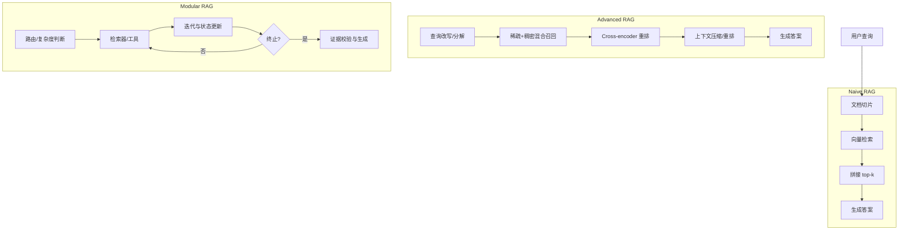

*图 4：三代 RAG 结构对比。据 Gao et al., 2023, arXiv:2312.10997 的 Naive/Advanced/Modular 架构描述重绘；原图号未核实。*

**原始 RAG 的最小单元是检索器、文档索引与条件生成器。** 下图据 Lewis et al. (2020) Sec. 2 的 retriever-generator 框架重绘。

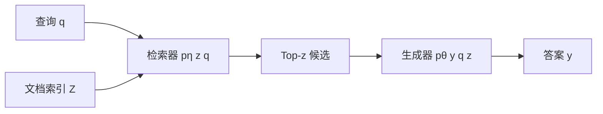

*图 5：RAG 联合架构。据 Lewis et al., 2020, Sec. 2 重绘；原图号未核实。*

**Self-RAG 的核心不是批评一句话，而是把 Retrieve、ISREL、ISSUP、ISUSE 编成可学习动作。** 下图据 Asai et al. (2024) Sec. 3 的推理算法重绘。

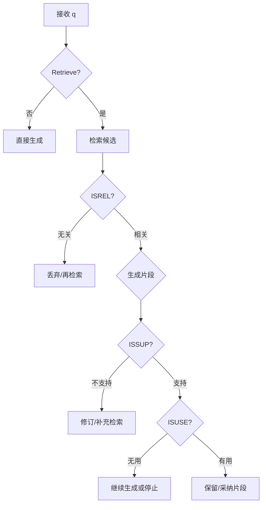

*图 6：Self-RAG 反思标记决策流。据 Asai et al., 2024, Sec. 3 重绘；原文 Alg./Fig. 编号未核实。*

**CRAG 把“评价器置信度”变成三条纠错分支。** 下图据 Yan et al. (2024) Sec. 3 重绘。

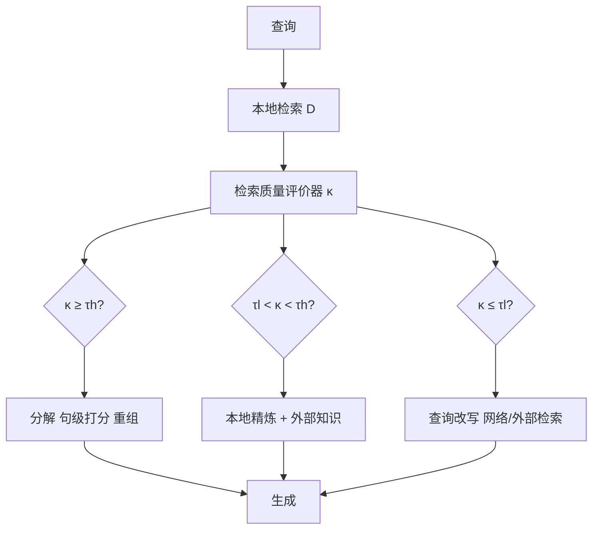

*图 7：CRAG 检索评价与纠错分支。据 Yan et al., 2024, Sec. 3 重绘；原文 Alg. 编号未核实。*

**Adaptive-RAG 在生成前按复杂度路由，成本与风险不对称。** 下图据 Jeong et al. (2024) Sec. 3 重绘。

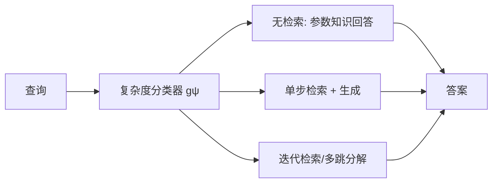

*图 8：Adaptive-RAG 复杂度路由。据 Jeong et al., 2024, Sec. 3 重绘；原文 Fig. 编号未核实。*

**GraphRAG 的索引、社区与 map-reduce 是同一个 pipeline 的三段。** 下图据 Edge et al. (2024) Sec. 2–4 重绘。

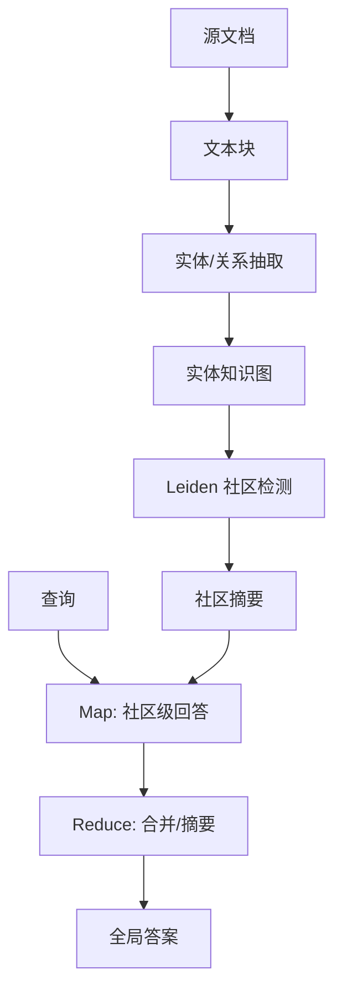

*图 9：GraphRAG 索引与查询 map-reduce。据 Edge et al., 2024, Sec. 2–4 重绘；原文 Fig. 编号未核实。*

**LightRAG 的两条路径分别对应局部实体证据和全局主题理解。** 下图据 Guo et al. (2024) 的 dual-level retrieval 描述重绘。

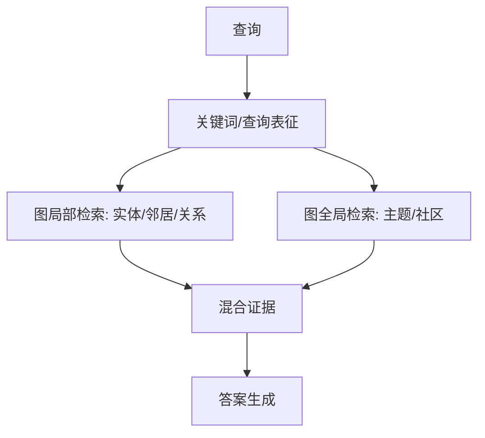

*图 10：LightRAG 双层检索。据 Guo et al., 2024, Sec. 3–4 重绘；原文 Fig. 编号未核实。*

**Agentic RAG 的合理设计是有限状态机，而不是无限循环。** 下图据 IRCoT、FLARE、Iter-RetGen 和 ReAct 的交替检索—推理机制重绘，不是某篇论文原图。

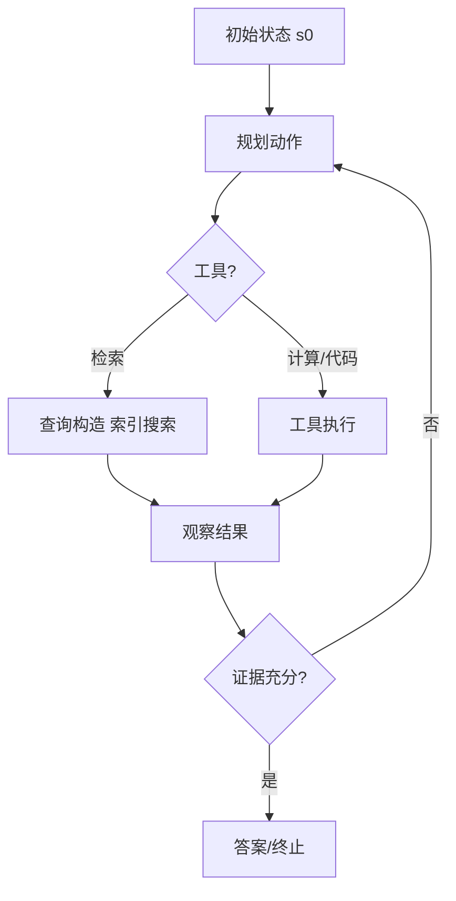

*图 11：Agentic RAG 规划—工具—检索—状态循环。据 Trivedi et al. 2023、Jiang et al. 2023、Shao et al. 2023 与 Yao et al. 2023 的方法描述重绘；无单一原文图号。*

**多模态 RAG 的证据链路必须从源页/区域一直贯穿到生成和归因。** 下图据 MMed-RAG、VisRAG、ColPali 的多模态证据思想重绘，原图号未核实。

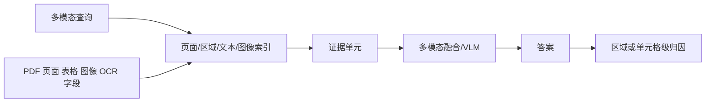

*图 12：多模态 RAG 证据链路。据 Li et al. 2024、Yu et al. 2024、Faysse et al. 2024 的描述重绘；原图号未核实。*

**RAGAS 与 ARES 的共同目标是把评测拆成可校准的中间变量。** 下图据 Es et al. (2024) 与 Saad-Falcon et al. (2024) 的评测流程重绘。

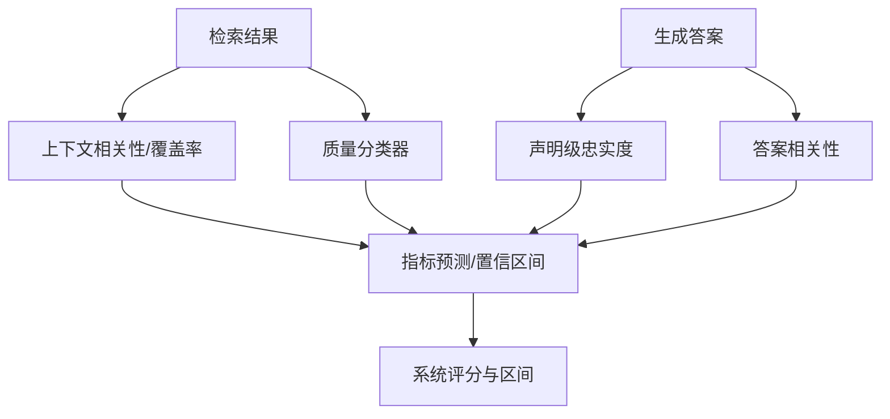

*图 13：RAGAS/ARES 评测流水线。据 Es et al. 2024、Saad-Falcon et al. 2024 重绘；原文 Fig. 编号未核实。*

**建议把研究系统统一建模为证据状态转移。** 状态 $s_t=(q,\mathcal{C}_t,y_{<t})$ 在检索、压缩、反思和生成之间转换；答案 $a$ 与证据子集 $\mathcal{E}\subseteq\mathcal{C}$ 必须共同输出，否则无法审计归因。该图不是引用单一原论文，而是本报告提出的研究框架。

*图 14：证据—推理—答案—归因可验证闭环。本报告提出的研究框架图，非原论文复制图。*

## 5. 从公式到实验：把机制转成可复现协议

**最小实验不是“再实现一个 RAG”，而是检验某一机制是否在受控条件下改善或失效。** 对每个研究问题，建议先定义失效模式、证据状态、成本和允许错误类型，再确定模型与数据集。

### 5.1 通用变量字典

**自变量必须同时覆盖检索、证据、推理和预算。** 至少包含：分块策略（固定切分、语义切分）、chunk size、overlap、检索器（BM25/DPR/ColBERT）、候选数 $k$、融合策略（无/RRF/加权和）、重排器与 $m$、查询改写开关、迭代/停止策略、上下文组织（原始序/按相关度/MMR）、生成模型与温度、上下文长度预算、最大检索轮数、拒答阈值。控制变量至少包括：语料版本与哈希、索引版本、模型与 API 版本、系统提示、随机种子、日期、token 成本口径。

**因变量要形成链路指标。** 检索层：Recall@k、MRR、nDCG@k、命中率；证据层：context precision、context recall、证据充分率、冗余率、冲突率、来源时效；生成层：EM/F1、答案正确率、faithfulness、声明级归因准确率、拒答准确率、真拒答率、假拒答率；系统层：端到端延迟、首 token 延迟、总 token、检索调用、重排调用、LLM 调用、失败重跑、能耗估计。不要用一个“总体分数”掩盖链条中的失败模块。

**证据覆盖是最值得新增的自变量。** 对一个多跳问题，设所需最小证据单元为 $g_1,\ldots,g_h$。已覆盖集合为 $E(q)=\{g_j:\exists d_k,\mathrm{supports}(d_k,g_j)=1\}$，可定义边际覆盖：

$$
\Delta\mathrm{Cover}(r_t)=|E(q_{t+1})\setminus E(q_t)|.
$$

它直接衡量第 $t$ 次检索是否新增有用证据，而非只是返回更多相似文本。实验含义：每次迭代同时记录检索 query、调用成本、新增覆盖、重复率、冲突率和答案变化；这是 F10、F27、F35–F42 的统一实验接口。

### 5.2 证据充分性驱动的停止与拒答

**这是最贴近现实部署的可发表题目之一。** 实验以一个 baseline（固定 $k$、固定 1 次检索）和三个停止策略为起点：最大轮次、置信度触发（F26）、证据充分率触发（F43）。

|模块|基线 A|消融 B1|消融 B2|消融 B3|目标|
|---|---|---|---|---|---|
|检索次数|固定 1|固定 2|置信触发|证据覆盖触发|检验“少调用但足够”|
|上下文选择|top-k 拼接|RECOMP 式选择|MMR|相关度重排|检验冗余是否伤害|
|停止/拒答|无|阈值 0.5|阈值调优|证据充分|检验漏答与误拒的平衡|
|评测|EM/F1|faithfulness|claim-attribution|拒答质量|拆分生成与证据错误|

自变量：停止阈值、证据充分阈值、最大迭代轮数；因变量：正确率、真拒答率、假拒答率、平均检索调用、token、延迟。研究问题可以是：在同等成本下，证据覆盖触发是否比“生成困惑度触发”降低幻觉，并在证据不可得时提高拒答质量。

### 5.3 多跳覆盖路由

**多跳实验应把子问题当作中介变量，而不能只看最终 EM。** 比较三条链路：单查询 top-k、问题分解后独立检索（F10）、图游走/社区摘要（F28–F31）。对每跳记录 Recall@k、跨跳组合覆盖率、冲突与答案正确率。

|策略|查询构造|证据组合|主要风险|应报告|
|---|---|---|---|---|
|单查询 top-k|原问题|前 $k$ 文档|远距离证据漏召|Recall@k、组合覆盖率|
|分解检索|子问题|跨子问题合并|错误分解与累积|子问题正确率、边际覆盖|
|图检索|实体/关键词|子图或社区|图构建与消歧错误|图抽取误差、路径覆盖|
|迭代检索|推理状态驱动|增量证据池|无限循环、冲突|轮数、停止原因、最终证据|

最小可发表单元不是“某数据集 +0.5 分”，而是：在同一语料、同一检索器和同一成本约束下，报告某一机制在直接/间接证据、时序冲突和缺失证据条件下的因果差异。

### 5.4 归因、幻觉与拒答的联合评测

**忠实度、答案正确性和引用充分性必须分别报告。** 实验可从 RAGTruth 类型的人工标注集开始，将答案拆成声明，逐句映射到来源 span；无法映射、与来源矛盾或来源不足的声明计为不可信。拒答判定可定义状态变量：

$$
\mathcal{Y}=\begin{cases}
\mathrm{Answer}, & \Phi=\mathrm{sufficient},\\
\mathrm{Ask}, & \Phi=\mathrm{insufficient}\ \&\ \mathrm{可追问},\\
\mathrm{Abstain}, & \Phi=\mathrm{insufficient}\ \text{且不可恢复}.
\end{cases}
$$

自变量为证据充分阈值和拒答策略；因变量包括误拒率、漏拒率、拒答后的有用指引率，以及拒答时的 token/检索节省。必须报告：证据缺失时错误答案率是否下降，而不只是“拒答率上升”。

### 5.5 图构建误差与长上下文成本

**图结构只有在抽取误差可控时才是优势。** 向实体、关系和社区摘要注入可控噪声：实体漏抽、关系错边、社区错分、摘要幻觉；以原始文本 top-k 与 GraphRAG/LightRAG 作对照。因变量包括检索命中、跨跳路径正确率、最终答案、上下文 token、LLM 调用数和摘要一致性。

**长上下文与 RAG 的消融应报告分层预算。** 第一组：纯长上下文；第二组：top-k + 长上下文；第三组：多查询检索 + 重排 + 长上下文。按证据位置构造 head/middle/tail 测试，并固定原始文档版本、截断策略与生成器。F16 的成本指标使“效果略高但上下文翻倍”不可被误写为免费增益。

## 6. 评估资源与指标适用边界

**RAG 的评测第一原则是拆层，第二原则是指标与任务匹配。** Retrieval 指标回答“是否找回所需证据”；context 指标回答“证据是否充分、低冗余且无冲突”；generation 指标回答“答案是否正确、忠实并可归因”；system 指标回答“质量是否值得其成本”。

|资源/数据集|适用对象|核心形式|优点|边界|
|---|---|---|---|---|
|NQ/TriviaQA|开放 QA|问题—答案—语料|接近真实搜索式问题|答案存在不等于证据链完整|
|HotpotQA/MultiHop-RAG|多跳 QA|组合问题/证据句|可测试跨文档推理|最终答案可由参数知识猜中|
|BEIR|零样本检索|异构检索任务|适合评测检索器泛化|不是生成或归因评测|
|KILT|知识密集任务|证据 + 生成任务|统一来源与任务|构建与版本管理成本高|
|LongBench|长上下文|多任务长文档|跨任务比较上下文利用|不专门测 RAG 归因|
|RGB|RAG 生成评测|RAG 任务与指标|聚焦系统级能力|当前版本与协议须逐版核验|
|RAGTruth|幻觉与归因|人工标注 RAG 输出|适合忠实度诊断|覆盖任务/模型有限|
|RAGChecker|细粒度诊断|检索/生成错误分类|可定位失败环节|需要细粒度标注与版本控制|
|RAGAS|快速迭代评测|LLM 自动指标|标注成本低、可扩展|评测模型偏差与提示版本敏感|
|ARES|预测器+CI|少量标注训练指标预测|给出置信区间|预测器校准与样本数决定可信度|

**评测基准的选择应由证据形态决定。** 文本事实问答可用 NQ、TriviaQA；跨文档组合用 HotpotQA/MultiHop-RAG；动态知识应记录查询日期和文档发布时间；长文档应保存页面/段落级 gold；多模态应保存页面、区域、OCR 与坐标；高风险领域要增加拒答、时效、权限与来源冲突测试。所有端到端实验至少报告：语料版本、索引版本、模型/API 日期、prompt、温度、随机种子、token、延迟、检索次数与失败重跑。

## 7. 开放问题与对应失效公式

**“相关性不等于充分性”意味着 top-k 排序目标本身可能失效。** F4、F6、F7 最大化相关性，但多跳任务要求 $E(q)$ 覆盖全部必要证据单元。研究应构造“单文档相关但证据不完整”“跨文档证据冲突”“所需证据分散在不同社区”的反事实，检验 F33–F36 与 F41 的差距。

**检索融合可能掩盖而不是修复模型差异。** F13、F14 能补回 BM25 或 dense 各自漏召的文档，但若两路都漏召同一关键证据，融合无解。因此应报告“任一单路命中但融合失败”和“融合新增命中”的细分类，而不是只报告最终 nDCG。

**反思标记可能复制生成器的先验偏差。** F17–F20 使 Self-RAG 能按需检索和评价，但若模型因参数知识误判“无需检索”，会在未知事实上失败。开放问题包括：反思标签如何获得可靠监督、如何避免“支持度”退化为答案风格偏好、控制器误差如何回滚。对应实验应把“真实证据状态”与“模型反思判断”分表报告。

**CRAG 与 Adaptive-RAG 的阈值不是单一全局最优。** F22–F25、F26、F29 的阈值决定成本—风险权衡；不同领域、查询难度、语料时效和拒答容忍度会改变最优阈值。应报告阈值曲线、分群结果和代价敏感错误率，而不是只给一个平均准确率。

**图索引把上游抽取误差编码为长期结构。** F28–F32 中的实体漏抽、关系错标、消歧错误会在社区和摘要中放大。开放问题是：如何区分图结构缺失与知识库本身缺失；如何在社区摘要失真时回退到原文；如何增量更新而不破坏既有社区。

**多模态证据的主要风险是粒度不一致。** 若 OCR 文本、图像区域和生成答案不在同一粒度，F38 的 NLI 会错误判断“相关即支持”。应保留页面、表格单元格、公式、坐标和区域级引用，并评测生成 span 到视觉区域的映射。

**自动评测者不是无偏 oracle。** RAGAS 的 LLM judge 和 ARES 的预测器均依赖模型版本、prompt 和标注集。应报告评测者复现次数、一致性、与人工标注的分群差异，并对高风险输出保留人工复核。

## 8. 安全、版权、隐私与动态更新

**RAG 不会因“未微调”就天然安全。** 不可信文档进入索引后可成为 prompt injection、数据投毒与版权侵权的载体。PoisonedRAG、HijackRAG 和间接注入研究说明，恶意文本可在检索阶段影响生成、工具调用和下游行为[65][66][67][68]。实验系统必须做租户隔离、来源信任分级、不可信文档沙箱、外发工具审批、提示边界标记与审计日志。

**数据最小化是 RAG 的隐私控制手段，而非性能损失。** 对每个查询记录最小必要证据集、敏感字段脱敏、来源授权、保留期限与访问者身份；生成阶段只引用授权可见的证据。若长上下文把整个知识库放入提示，访问控制必须前置到检索层，否则“能看到索引”会直接变成“能读到全文”。

**动态知识需要版本化，而不是重建索引了事。** 每个来源保存发布时间、生效时间、失效时间、来源权威度和版本哈希；冲突回答不只按相似度排序，还要记录证据状态。更新后必须回归旧问题，报告旧答案一致性、索引漂移、缓存污染与失效证据回收。

**版权问题应作为可追溯字段处理。** 对训练数据、索引材料、检索文档和生成摘要分别记录许可状态；本报告不提供跨法域的法律结论。工程上优先选择可授权语料，保留来源、引用边界与许可元数据。

## 9. 三个月研究路径与每周复现清单

**三个月目标不是读完 60 篇论文，而是形成一套能复现、能消融、能解释失败的实验。** 每周至少完成“读原文—写一页机制卡—跑一个式子/模块—记录失败案例”。

|周次|核心任务|精读/复现对象|交付物|
|---|---|---|---|
|1|建立奠基框架|Lewis 2020；REALM；KILT|实现 F1/F2 的 top-k 近似、召回日志|
|2|理解检索器|DPR；BM25；ColBERT|比较 F3–F7、候选数、批内负样本|
|3|掌握查询改写与分解|HyDE；Query Rewriting；Least-to-Most|实现 F8–F10，记录改写误差|
|4|掌握压缩与重排|RECOMP；MMR；RRF；Lost in Middle|实现 F11–F16，构造位置 needle|
|5|掌握反思与纠错|Self-RAG；CRAG|实现 F17–F24，分三状态报告|
|6|掌握自适应与迭代|Adaptive-RAG；IRCoT；FLARE；Iter-RetGen|实现 F25–F27，记录边际覆盖|
|7|掌握图索引|GraphRAG；LightRAG；HippoRAG|实现 F28–F32，注入抽取噪声|
|8|掌握多模态|MMed-RAG；VisRAG；ColPali|建立区域/页面级引用日志|
|9|建立检索评测|BEIR；HotpotQA；Recall/nDCG|冻结语料与版本，完成检索消融|
|10|建立生成与归因评测|RAGTruth；RAGAS；ARES；RAGChecker|报告 F33–F43 与 judge 一致性|
|11|完成选定课题|证据充分性停止或跨跳覆盖|完成成本—质量帕累托曲线|
|12|形成可发表雏形|整轮实验、失败分析、伦理审查|代码、数据卡、实验脚本、论文草稿|

每周的“复现公式”建议如下：第 1 周用 top-k 近似复现 RAG-Sequence/F2 的边缘选择；第 2 周用内积与批内负样本实现 DPR 对比损失；第 3 周分别复现 HyDE、查询改写与子问题独立检索；第 4 周实现 RRF、加权和、MMR 与位置重排；第 5 周实现反思标签的离线分类器；第 6 周实现置信触发、最大轮数、证据覆盖触发三种停止器；第 7 周比较文本 top-k、实体图和社区摘要；第 8 周复现图像页/区域级检索与 span 级归因。

## 10. 原图与公式的引用规范

**本报告中的 Mermaid 图都是重绘，不是对版权原图的复制。** 每张图均标注“据 XX et al., YYYY, Sec./Alg. 重绘”；若原文图号无法核实，明确写“原图号未核实”或“据原文架构描述重绘”。若未来需要出版论文中的原始 figure，必须从论文版权页、ACM/IEEE/Springer 版权许可或作者授权获得明确许可，不能直接截图搬运。

**公式引用应遵循“原文式号优先、可访问章节次之、形式化整理最低优先”。** 本报告采用“作者，年份，会议/arXiv，Sec./Eq./Alg.”格式；无法核实式号的公式标注“具体编号未核实”。凡明确写“形式化整理，非原文原式”的条目，只能作为机制说明，不可冒充论文的原始数学表达。

**引用时把公式与实验协议绑定，能减少“引用堆叠”。** 例如写“我们按 Lewis et al. (2020) Sec. 2.1 的边缘化形式（式号未核实）实现 RAG-Token 近似”，同时说明 top-k 截断；写“F1/F2”只在本文内部公式索引中有效，正式论文应使用原始论文标注。

## 11. 公式与图表索引

|编号|主题|来源论文|所在章节|
|---|---|---|---|
|F1–F2|RAG 段落级/逐 token 生成概率|Lewis et al. 2020|3.1|
|F3–F7|BM25/DPR/ColBERT/cross-encoder|Robertson & Zaragoza；Karpukhin 2020；Khattab 2020；Nogueira 2019|3.1|
|F8–F10|HyDE/查询改写/分解|Gao 2022；Ma 2023；Zhou 2022；Khot 2023|3.2|
|F11–F16|压缩/MMR/RRF/加权融合/位置与成本|Xu 2023；Carbonell 1998；Cormack 2009；Liu 2024|3.3|
|F17–F21|Self-RAG 四类反思标记|Asai et al. 2024|3.4|
|F22–F24|CRAG 评价器与 decompose-then-recompose|Yan et al. 2024|3.4|
|F25–F27|Adaptive-RAG、FLARE、IRCoT/Iter-RetGen|Jeong 2024；Jiang 2023；Trivedi 2023；Shao 2023|3.4|
|F28–F32|GraphRAG/Leiden/LightRAG|Edge 2024；Traag 2019；Guo 2024|3.5|
|F33–F43|Recall/MRR/nDCG/EM/F1/BLEU/ROUGE/RAGAS/ARES/拒答|标准 IR/QA/RAG 评测文献|3.6|
|图 1|已核验代表论文年份分布|P001–P015 一手页面|2|
|图 2|代表论文主题分布|P001–P015 一手页面|2|
|图 3|检索器质量—成本谱系|BM25/DPR/ColBERT/cross-encoder 机制|3.1|
|图 4|三代 RAG 结构|Gao et al. 2023，Fig. 号未核实|4|
|图 5|原始 RAG 联合架构|Lewis et al. 2020，Fig. 号未核实|4|
|图 6|Self-RAG 决策流|Asai et al. 2024，Fig./Alg. 号未核实|4|
|图 7|CRAG 纠错分支|Yan et al. 2024，Fig./Alg. 号未核实|4|
|图 8|Adaptive-RAG 路由|Jeong et al. 2024，Fig. 号未核实|4|
|图 9|GraphRAG 索引与 map-reduce|Edge et al. 2024，Fig. 号未核实|4|
|图 10|LightRAG 双层检索|Guo et al. 2024，Fig. 号未核实|4|
|图 11|Agentic RAG 状态循环|IRCoT/FLARE/Iter-RetGen/ReAct，无单一原图号|4|
|图 12|多模态证据链路|MMed-RAG/VisRAG/ColPali，Fig. 号未核实|4|
|图 13|RAGAS/ARES 流水线|Es 2024；Saad-Falcon 2024，Fig. 号未核实|4|
|图 14|证据—推理—答案—归因闭环|本报告提出的研究框架|4|
|表 1|60+ 代表论文主题清单|P001–P086 一手页面/元数据核验状态|2|
|表 2|停止与拒答消融矩阵|F1/F16/F26/F43|5.2|
|表 3|多跳覆盖策略|F10/F27/F28–F31|5.3|
|表 4|评估资源与边界|F33–F43、BEIR/NQ/HotpotQA/RAGTruth 等|6|
|表 5|12 周复现与实验路径|F1–F43|9|

## 12. 技术演进时间线

**技术时间线说明趋势，不意味着旧方法被淘汰。** BM25、双塔、late interaction、重排、图索引、长上下文各有适用成本区间；实际系统通常是组合而非替代。

|年份|代表工作/节点|范式转变|研究含义|
|---|---|---|---|
|2020|REALM、RAG、DPR、ColBERT|外部记忆可微化；稠密检索可用|建立 retriever-generator 最小闭环|
|2021|KILT、RAG 知识来源标准化|检索、知识来源与生成统一|指标开始强调证据与来源|
|2022|HyDE、DSI、MuRAG、IRCoT|假设文档、可微索引、多模态、交替推理|从一次召回转向表达改写与状态转移|
|2023|Query Rewriting、RECOMP、LongLLMLingua、FLARE、Iter-RetGen、RAPTOR|查询改写、压缩、迭代、树状摘要|上下文组织与调用预算成为变量|
|2024|Self-RAG、CRAG、Adaptive-RAG、GraphRAG、LightRAG、MMed-RAG、ColPali|反思、纠错、路由、图结构、多模态证据|可靠性从后处理提升为控制目标|
|2025|HippoRAG、RAGAS/ARES/RAGTruth 生态扩展|神经长时记忆与自动评测深化|图检索与评测置信区间受重视|
|2026|FailSafe-RAG（会议录用报道）、可信/多模态/智能体持续研究|证据状态感知与拒答|高风险场景要求“可拒答而非必作答”|

## 13. 结论

**最值得研究的是证据状态，而不是再增加一个检索模块。** RAG 的下一阶段不是“长上下文替代检索”“图替代向量”或“智能体替代 pipeline”，而是把相关性、覆盖、冲突、时效、来源权限、拒答、成本和归因统一到一个可验证闭环中。Lewis 等人的边缘化生成仍是理解 RAG 的最小理论单元；BM25、DPR、ColBERT、cross-encoder 与 FLARE、Self-RAG、CRAG、GraphRAG、LightRAG 分别对应召回、排序、触发、反思、纠错和结构覆盖的不同失效模式。

**新人最现实的最小可发表单元，是固定语料、模型、成本与证据状态，检验某一机制是否改善“证据充分—答案忠实—拒答正确”。** 例如，证据覆盖触发的停止策略能否在相同 token 与调用预算下降低幻觉；图抽取噪声在何种条件下会使 GraphRAG 弱于文本 top-k；重排带来的质量增益是否值得其额外延迟。只要把检索 query、证据状态、调用次数、成本与失败原因完整记录，这些研究就具备可复现价值。

**截至 2026-11-13，本报告维持“未核实”纪律。** P015（FailSafe-RAG）的作者、机构与 arXiv ID，以及 P034、P035、P049、P050、P069、P077–P079、P084 的元数据未核实，不能被升级为已确认；2026 工作尤其要以论文原始页面、会议论文集与代码仓库最终版本为准。由于一手网页无法为全部 60 篇以上候选提供稳定式号、图号和作者机构字段，本报告对未核实字段明确标注，不为完成清单而补造。

## 引用来源

[1] https://arxiv.org/abs/2005.11401
> “We explore a general-purpose fine-tuning recipe for retrieval-augmented generation (RAG).”

[2] https://arxiv.org/abs/2312.10997
> “This comprehensive review paper offers a detailed examination of the progression of RAG paradigms.”

[3] https://arxiv.org/abs/2310.11511
> “Self-RAG enhances an LM's quality and factuality through retrieval and self-reflection.”

[4] https://arxiv.org/abs/2401.15884
> “We propose the Corrective Retrieval Augmented Generation (CRAG) to improve the robustness of generation.”

[5] https://arxiv.org/abs/2403.14403
> “Adaptive-RAG…can dynamically select the most suitable strategy…based on the query complexity.”

[6] https://arxiv.org/abs/2404.16130
> “We propose GraphRAG, a graph-based approach to question answering over private text corpora.”

[7] https://arxiv.org/abs/2410.05779
> “LightRAG incorporates graph structures into text indexing and retrieval processes.”

[8] https://arxiv.org/abs/2002.08909
> “REALM: Retrieval-Augmented Language Model Pre-Training.”

[9] https://arxiv.org/abs/2212.10496
> “Precise Zero-Shot Dense Retrieval without Relevance Labels through Hypothetical Document Embeddings.”

[10] https://arxiv.org/abs/2305.14283
> “Query Rewriting for Retrieval-Augmented Large Language Models.”

[11] https://arxiv.org/abs/2310.04408
> “RECOMP: Improving Retrieval-Augmented LMs with Compression and Selective Augmentation.”

[12] https://arxiv.org/abs/2310.06839
> “LongLLMLingua: Accelerating and Enhancing LLMs in Long Context Scenarios via Prompt Compression.”

[13] https://arxiv.org/abs/2410.13085
> “MMed-RAG…enhance[s] the factuality of Med-LVLMs.”

[14] https://aclanthology.org/2020.emnlp-main.550
> “Dense Passage Retrieval for Open-Domain Question Answering.”

[15] https://arxiv.org/abs/2004.12832
> “ColBERT: Efficient and Effective Passage Search via Contextualized Late Interaction over BERT.”

[16] https://arxiv.org/abs/1908.10084
> “Sentence-BERT: Sentence Embeddings using Siamese BERT-Networks.”

[17] https://arxiv.org/abs/2107.05720
> “SPLADE: Sparse Lexical and Expansion Models for First Stage Ranking.”

[18] https://arxiv.org/abs/2210.07316
> “MTEB: Massive Text Embedding Benchmark.”

[19] https://arxiv.org/abs/2212.03533
> “E5: Text Embeddings by Weakly-Supervised Contrastive Pre-Training.”

[20] https://arxiv.org/abs/2309.07597
> “BGE: BAAI General Embedding.”

[21] https://arxiv.org/abs/1901.08162
> “Passage Re-ranking with BERT.”

[22] https://arxiv.org/abs/2202.05144
> “InPars: Data Augmentation for Information Retrieval Using Open-Source LLMs.”

[23] https://arxiv.org/abs/2202.06991
> “Transformer Memory as a Differentiable Search Index.”

[24] https://arxiv.org/abs/2205.09707
> “PLAID: An Efficient Engine for Late Interaction Retrieval.”

[25] https://arxiv.org/abs/2112.01488
> “ColBERTv2: Effective and Efficient Retrieval via Reduced Representations.”

[26] https://arxiv.org/abs/2310.06117
> “Step-Back Prompting: When Not to Look Back.”

[27] https://arxiv.org/abs/2312.16339
> “Chain-of-Verification Reduces Hallucination in Large Language Models.”

[28] https://arxiv.org/abs/2205.10625
> “Least-to-Most Prompting Enables Complex Reasoning in Large Language Models.”

[29] https://arxiv.org/abs/2210.02406
> “Decomposition Prompting: Uncovering the Hidden Language Capabilities of Large Language Models.”

[30] https://arxiv.org/abs/2310.00536
> “Selective-Context: Leveraging LLMs for Data Selection and Context Reorder.”

[31] https://arxiv.org/abs/2310.05736
> “LLMLingua: Compressing Prompts for Accelerated Inference of Large Language Models.”

[32] https://arxiv.org/abs/2311.08377
> “Learning to Filter Context for Retrieval-Augmented Generation.”

[33] https://arxiv.org/abs/2305.20095
> “FILCO: Filtering Long Contexts for Context-Aware Machine Translation.”

[34] https://arxiv.org/abs/2307.03172
> “Lost in the Middle: How Language Models Use Long Contexts.”

[35] https://arxiv.org/abs/2310.05002
> “Self-Knowledge Guided Retrieval Augmentation for Large Language Models.”

[36] https://arxiv.org/abs/2301.12652
> “REPLUG: The Power of General-Purpose Language Models Is What Your Retriever Is.”

[37] https://arxiv.org/abs/2212.10509
> “Interleaving Retrieval with Chain-of-Thought Reasoning for Knowledge-Intensive Multi-Step Questions.”

[38] https://arxiv.org/abs/2305.06983
> “FLARE: Active Retrieval Augmented Generation.”

[39] https://arxiv.org/abs/2305.14322
> “Retrieval-Generation Alternating for Open-Domain Multi-Hop Questions.”

[40] https://arxiv.org/abs/2210.03629
> “ReAct: Synergizing Reasoning and Acting in Language Models.”

[41] https://arxiv.org/abs/2302.04761
> “Toolformer: Language Models Can Teach Themselves to Use Tools.”

[42] https://arxiv.org/abs/2112.09332
> “WebGPT: Browser-assisted question-answering with human feedback.”

[43] https://arxiv.org/abs/2210.03350
> “Measuring and Narrowing the Compositionality Gap in Language Models.”

[44] https://arxiv.org/abs/2303.09014
> “ART: Automatic multi-step reasoning and tool-use for large language models.”

[45] https://arxiv.org/abs/2308.03688
> “AgentBench: Evaluating LLMs as Agents.”

[46] https://arxiv.org/abs/2405.14831
> “HippoRAG: Neurobiologically Inspired Long-Term Memory for Large Language Models.”

[47] https://arxiv.org/abs/2401.18059
> “RAPTOR: Recursive Abstractive Processing for Tree-Organized Retrieval.”

[48] https://arxiv.org/abs/2307.07697
> “Think-on-Graph: Deep and Responsible Reasoning of Large Language Model on Knowledge Graph.”

[49] https://arxiv.org/abs/2305.09645
> “StructGPT: A General Framework for Large Language Model to Reason over Structured Data.”

[50] https://arxiv.org/abs/2310.13023
> “GraphGPT: Graph Instruction Tuning for Large Language Models.”

[51] https://arxiv.org/abs/2410.10594
> “VisRAG: Vision-based Retrieval-Augmented Generation on Multi-Modality Documents.”

[52] https://arxiv.org/abs/2407.01449
> “ColPali: Efficient Document Retrieval with Vision Language Models.”

[53] https://arxiv.org/abs/2210.02928
> “MuRAG: Multimodal Retrieval-Augmented Generator for Open Question Answering over Images and Text.”

[54] https://arxiv.org/abs/2302.02533
> “RA-VQA: Retrieval-Augmented Visual Question Answering.”

[55] https://arxiv.org/abs/2309.11419
> “Kosmos-2.5: A Multimodal Literate Model.”

[56] https://arxiv.org/abs/2308.14508
> “LongBench: A Bilingual, Multitask Benchmark for Long Context Understanding.”

[57] https://arxiv.org/abs/2405.13576
> “FlashRAG: A Modular Toolkit for Efficient Retrieval-Augmented Generation Research.”

[58] https://arxiv.org/abs/2410.18113
> “RAGLAB: A Modular and Research-Oriented Unified Framework for Retrieval-Augmented Generation.”

[59] https://arxiv.org/abs/2309.15217
> “RAGAS: Automated Evaluation of Retrieval Augmented Generation.”

[60] https://arxiv.org/abs/2311.09476
> “ARES: An Automated Evaluation Framework for Retrieval-Augmented Generation Systems.”

[61] https://arxiv.org/abs/2401.00396
> “RAGTruth: A Hallucination Corpus for Developing Trustworthy Retrieval-Augmented Language Models.”

[62] https://arxiv.org/abs/2408.08067
> “RAGChecker: A Fine-grained Framework for Diagnosing Retrieval-Augmented Generation.”

[63] https://dl.acm.org/doi/10.1145/3644815.3644945
> “Seven Failure Points When Engineering a Retrieval Augmented Generation System.”

[64] https://arxiv.org/abs/2009.02252
> “KILT: A Benchmark for Knowledge Intensive Language Tasks.”

[65] https://arxiv.org/abs/2210.03693
> “Prompt Injection Attacks and Defenses in LLM-Integrated Applications.”

[66] https://arxiv.org/abs/2404.02929
> “HijackRAG: Hijacking Attacks against Retrieval-Augmented Large Language Models.”

[67] https://arxiv.org/abs/2307.15007
> “Not What You've Signed Up For: Compromising Real-World LLM Applications with Indirect Prompt Injection.”

[68] https://arxiv.org/abs/2402.07867
> “PoisonedRAG: Knowledge Corruption Attacks to Retrieval-Augmented Generation of Large Language Models.”

[69] https://arxiv.org/abs/2403.10131
> “RAFT: Adapting Language Model to Domain Specific RAG.”

[70] https://arxiv.org/abs/2310.01352
> “RA-DIT: Retrieval-Augmented Dual Instruction Tuning.”

[71] https://arxiv.org/abs/2404.10981
> “A Survey on Retrieval-Augmented Text Generation for Large Language Models.”

[72] https://arxiv.org/abs/2410.12837
> “A Comprehensive Survey of Retrieval-Augmented Generation (RAG): Evolution, Current Landscape and Future Directions.”

[73] https://arxiv.org/abs/2402.19473
> “Retrieval-Augmented Generation for AI-Generated Content: A Survey.”

[74] https://stcn.com/article/detail/4229835.html
> “FailSafe-RAG: Evidence-State-Aware Generation under Retrieval Failures.”

> **编校说明**：检索过程中曾返回两条不应纳入本清单的条目——`arXiv:2310.12837` 为编号误写，`arXiv:2603.02134` 实为 3D 视觉重建工作、与 RAG 无关。二者正文均未引用，已剔除；正式引用请以 [1]—[74] 的一手页面为准。