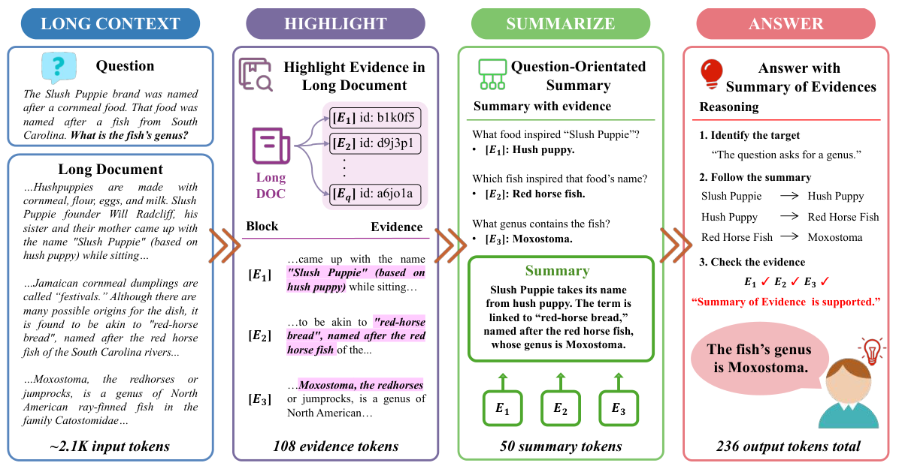
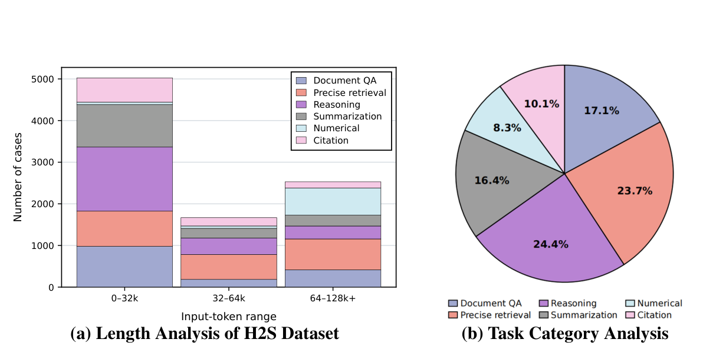
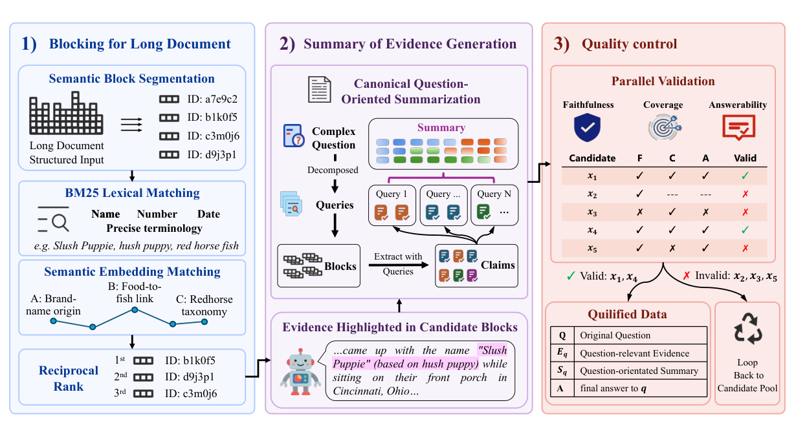
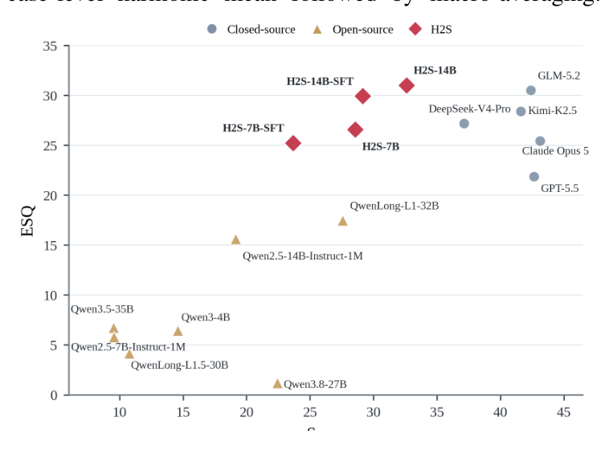
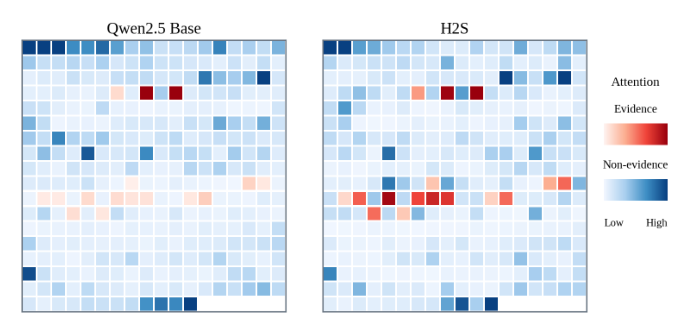

# 精读笔记 · Highlight-Then-Summarize: Learning to Compress Evidence for Long-Context Understanding

> arXiv 2609.31382v1（2026-09-25，cs.CL）· 北大 + 百度 + 清华 · 23 页 13 图
> 代码：https://github.com/X-Luffy/Highlight-Then-Summarize（已克隆到本目录 `code/`，浅克隆）
>
> 本目录材料：`paper.pdf` · `paper.tex`（拍平源码，行号与 `outline.md` 一致）· `paper.txt` · `outline.md` ·
> `htslce_figures/`（图 14 张 + 表 7 张 + `_contact.png`）· `code/`
> 另有一份：**`研究想法-评审.md`**（基于这篇论文提出的两个研究想法的概念评审：最近工作对照、机制假设与反例、六维评分、重构路线）
>
> **标注约定**：**【论文】**＝原文写的；**【代码】**＝官方仓库里看到的；**【我算的】**＝我按论文数字推导的；**【示意】**＝我编的示例数字。

---

## 基本情况

- **谁做的**：10 人。北大（Zhaoyuan Xia、Tong Mo）、百度（Qinghongbing Xie、Jianguang Jiang、Gaofeng Lu、Zhenyu Jiao、Xing Yuan、Dai Dai）、清华（Yung Xiang Hue、Long Zeng）。
  Xia 与 Xie 共同一作；通讯 Dai Dai、Tong Mo、Long Zeng。2026-09-25 挂 arXiv v1。
- **一句话**：输入「一句问题 + 一篇被切成 `[BLOCK_ID: xxxxxxxx]` 标记块的长文档（最长 128K token）」→
  输出三段：`<evidence>`（引用了哪个块、块里哪一段）→ `<summary>`（面向这个问题的证据摘要）→ `<answer>`（最终答案）。
- **类型**：训练方法（全参 SFT + GRPO）。基座 `Qwen2.5-7B/14B-Instruct-1M`，出 7B、14B 两档，各带一个 `-SFT` 中间版本。
- **开源**：代码、SFT/RL 数据 schema、reward 实现、eval 代码、判定脚本都已放出；**模型权重没有放出**
  （README「Release Scope」明说 repository does not include model checkpoints / optimizer states / full datasets / full prediction files）。
- **卖点**：把「选证据」和「把证据整理成面向问题的摘要」变成**显式的、可监督、可打分**的中间产物，用过程级 reward 训它们；
  4K 输出预算就能拿到 SFT 之后 +3.44~4.88 分，且对输出预算不敏感（H2S-14B 4K→16K 只涨 0.96）。
- **和读过的哪篇最像**：同目录 `context-compression-llm-agents-survey`（EMNLP 2026）。
  那篇给「压缩」建坐标系（What / How / Who-When）与失败分类（F1 选错 / F2 压坏 / F3 取不回）。
  **H2S 正好落在那张坐标系里的一个点上**：

  | 综述的三轴 | H2S 的取值 |
  |---|---|
  | **What**（压什么） | 输入文档本身（不是历史/记忆），而且**按当前问题条件化** |
  | **How**（怎么压） | Summarize（不是 prune、不是 externalize）；证据以 block+span 形式保留出处 |
  | **Who/When**（谁、何时决定） | **模型自己**，在答题前的同一条自回归轨迹里；不是外部检索器、不是固定阈值触发 |

  它的失效案例（「claim 超出所引 span」）在综述的分类里就是 **F2（压的过程中压坏）**，不是 F1 也不是 F3。

---

## 导读地图

行号指 `paper.tex`；代码指本目录 `code/`。

| 站 | 这一站讲清楚什么 | 图 / 表 | 原文 | 代码 |
|---|---|---|---|---|
| ① 动机 | 长上下文「塞得进去但用不好」；以前只训「找到证据」；押注「把证据整理成摘要再答」 | 图 1、表 1 | §1 L27–55；§3.1 L88–120 | — |
| ② 架构 | 三段式 H2S 的接口、因子分解、与「先检索再 RAG」的根本差别 | 图 1、式 1–3 | §3.2 L121–148 | `sft/system_prompt.py`、`block_input.py` |
| ③ 训练 | 两阶段：SFT 学格式 → 三段长度课程 GRPO；reward 四项与乘积/调和平均结构 | 式 4 | §3.4 L205–215；§A.1 L426–437；§A.7 L621–631 | `rl/h2s_rewards.py:782–925`、`configs/rl/*.yaml` |
| **③-附 RL 详解** | GRPO 是什么、8 条候选怎么变成梯度、代数字算 advantage、`beta=0` 与 VNext 补丁（节号见文内） | — | §3.4 + 【代码】 | `rl/h2s_reward_swift.py`、`rl/h2s_rewards.py:1036` |
| **③-附2 reward 分项** | `R_format/R_valid/R_span/R_summary/R_answer` 各自怎么算；用一条真实记录跑出六个分数；各分项的软肋 | — | §3.4 + 【代码】 | `rl/h2s_rewards.py:165/250/466/612/857/888`、`eval/h2s_evaluator.py:1886` |
| ④ 数据 | 一条样本长什么样；6,647 条从哪来（5 步流水线 + 三重质检 + 打回重造） | 图 2、图 3、表 7 | §3.3 L149–204；§A.2 L438–452；§A.5 L560–590 | `data/examples/*.jsonl`、`data_pipeline/`、`block_input.py` |
| ⑤ 信息流 | 128K token 输入 → 三段输出，哪些是输入哪些是生成；训练/推理差在哪 | 图 1 | §3.2、§A.1 | `block_input.py`、`eval/run_h2s_eval.py` |
| ⑥ 例子走一遍 | 烤箱清洁剂那条（附录 A.5），evidence → summary → answer 逐段走，顺带算一遍 reward | 图 A8/A9/A12 | §A.5 L560–590；§A.9 | `data/H2S-RL-example.jsonl`、`rl/h2s_rewards.py` |
| ⑦ 实验与地位 | 32.60 的对手是谁、消融说明什么、输出预算那张表的真相、局限与现在的处境 | 表 2、表 3、表 4；图 4、图 5 | §4 L216–407 | `eval/configs/` |

---

## ① 动机

### 1. 要解决什么问题

读一整个长文档（仓库、多文档报告、长对话）再回答一个问题。

**【论文】**举的例子：修一个仓库级 bug，要跨三跳——失败的 API 调用 → 另一个文件里的接口定义 → 某处的配置改动。三块内容在原文里离得很远。

### 2. 以前卡在哪（三层，一层比一层具体）

1. **塞得进去 ≠ 用得好**：上下文窗口涨到 128K/1M，但任务相关证据稀疏、散落在远距离位置，被大量无关内容稀释（引 Lost in the Middle、RULER）。
2. **已有方法只解决「找到」**：长上下文 RL 这条线（LoongRL、LongRLVR、GoLongRL）训的是「检索 + 推理」轨迹、奖励的是「你引的这段是否 grounded」。这解决的是**定位**。
3. **「多段证据怎么合并」没人管**（全文立足点）：论文原话 *evidence selection alone does not specify how multiple passages should be combined*。
   合并**隐式发生在最终答案的生成里**——模型得同时干三件事：（a）记住碎片证据（b）推断碎片之间的关系（c）把任务答完。
   作者认为这种纠缠导致证据用不稳、并且诱导出不必要的长推理。

> 注意第 3 点的准确含义：不是「以前没人做检索/引用」，而是**以前没把「合并」当成一个要被监督的独立步骤**。

### 3. 押注的想法（一句话）

> 把「选证据」和「把证据整理成面向这个问题的摘要」**都外化成显式的中间产物**，
> 让模型先写 `evidence`、再写 `summary`、最后才写 `answer`，三步在同一条自回归轨迹里；
> 而且**原文全程留在上下文里，不做裁剪**——是重新组织 context，不是剪掉 context。

【论文】Highlight preserves a traceable path to the document, whereas Summarize converts fragmented passages into a compact, reasoning-ready state.
两件事的分工：**Highlight 保「出处」，Summarize 保「关系」**。

### 4. 押注前先做了个验证（表 1，§3.1）

DocQA-RL-1.6K，答题模型 Qwen3.5-Flash，输入 15.19K token 的原文档：

| 喂进去的东西 | 上下文 token | 准确率 |
|---|---|---|
| 原文档 | 15.19K | 72.6 |
| 只用 Claude 的摘要（不放原文） | 0.46K | 93.0 |
| 原文档 + Claude 摘要 | 15.19K + 0.46K | **96.7** |
| 原文档 + 模型自生成摘要（S / M / L） | 15.19K + 0.14 / 0.60 / 1.04K | 69.3 / 77.8 / 85.9 |

三条读法：

- **0.46K ＝ 原文的 3%**，单独喂进去就有 93.0，比读全文高 20 分 → 「重新组织」本身有价值。
- 摘要 + 原文 > 只用摘要（96.7 vs 93.0）→ 这就是「不裁剪原文」的理由。
- 自生成摘要**越短越差**：0.14K 那档反而掉 3.3 分 → 摘要太短会丢东西；这条后来直接体现为 RL 里用 ROUGE-L 罚短摘要。

### 5. 图 1 讲的是什么



**这张图分四列，从左到右是一条轨迹的四个阶段，不是四个模块。**

| 列 | 里面是什么 | 图上的数字 |
|---|---|---|
| **LONG CONTEXT**（蓝） | 上面 4 句话的问题（Slush Puppie 这品牌名来自一种玉米饭，那种饭来自一种鱼，问**那条鱼属于什么属**）；下面是整篇文档 | ~2.1K 输入 token |
| **HIGHLIGHT**（紫） | 左：文档切成 block、每块一个 id；右：模型挑出 E1/E2/E3 并抄出块内 span（紫色高亮处） | 108 evidence token |
| **SUMMARIZE**（绿） | 把三个 span 按**子问题**重组：什么食物启发了这名字 → 什么鱼启发了那食物 → 什么属包含那鱼；每句挂 [E1][E2][E3] | 50 summary token |
| **ANSWER**（红） | 定目标（问 genus）→ 顺摘要的链走（Slush Puppie → Hush Puppy → Red Horse Fish → Moxostoma）→ 回查 E1 E2 E3 | 总共 236 输出 token |

**一句话回顾**：H2S = 让模型在答之前，先把「引用哪一块的哪一段」和「这些片段合起来说明什么」写成两段看得见的中间产物，再照着它答题。

---

## ② 架构

### 1. 先把接口说清楚（这些数在图 1 上就画着）

| 项 | 取值 | 来源 |
|---|---|---|
| 输入 | 一句问题 + 一整篇被 `[BLOCK_ID: xxxxxxxx]` 块标记的文档 | 图 1、`block_input.py` |
| 输入预算 | 最大 128K token（训练 SFT 阶段 `max_length: 135168`＝128K+4K 目标） | §A.1、`configs/sft/H2S-SFT-7B.yaml` |
| 输出 | 三段，**同一条自回归轨迹一次生成**：`<evidence>` → `<summary>` → `<answer>` | §3.2 式 3 |
| 输出预算 | 主实验 4K；RL 阶段最多只生成 **2,048** token | §4.1、§A.1 |
| 块的粒度 | 每个块有一个 **8 字符 id**（如 `m6wyi3kt`），id 是数据构造阶段（Stage-2）给的，推理时同一套 | §A.5、`block_input.py` 注释 |
| 证据的粒度 | `block_id` + 块内 span（写成 `头 … 尾` 的形式，用 `…` 或 `...` 分隔） | 【代码】`rl/h2s_rewards.py:250` `resolve_quote` |
| 参数 | 7B / 14B，全参更新 | §4.1 |

### 2. 形式化（式 1–3）

```
式 1（流水线）：  (D, q) ──Highlight──▶ E_q ──Summarize──▶ S_q ──Reason──▶ a

式 2（证据是什么）：E_q = {(u_i, s_i)}_{i=1..m},   s_i ⊆ B(u_i)
                  u_i = 稳定的源块 id；B(u_i) = 那个块的原文；s_i = 块内支撑片段

式 3（因子分解）：p_θ(E_q, S_q, a | D, q)
                = p_θ(E_q | D, q) · p_θ(S_q | D, q, E_q) · p_θ(a | D, q, E_q, S_q)
```

| 符号 | 是什么 | 取值 / 形状 |
|---|---|---|
| D | 被块化的长文档 | M 个块，`D = (B_1, …, B_M)` |
| q | 问题 | 一句到一段 |
| E_q | 证据集合 | m 条 `(block_id, span)`，m 个位数到十几个 |
| S_q | 面向问题的摘要 | 几十到几百 token |
| a | 最终答案 | 跟 benchmark 原生格式（数字 / 选项 / 列表 / 段落） |

**为什么要写成式 3 这个因子分解？** 论文的说法：直接训 `p_θ(a | D, q)` 的话，前两步是**不可观测的**；
把它拆成三个因子之后，第 1、2 步就变成**能被监督、能被过程级评估**的产物。这是全文的核心论证结构。

### 3. 逐模块讲

**(1) 文档块化（只在数据构造时做，推理时直接用现成的标记）**
把文档在语义边界切成块，每块分配一个稳定 id，块在原文中的位置信息保留。
【代码】渲染出来就是：块内容前面顶一行 `[BLOCK_ID: 7wew75mg]`（open-only 形式，`v1_question_doc_open_block_v1`）。

**(2) Highlight（模型的第一个生成段）**
吃：「问题 + 全部块」；吐：m 条 `{"claim": "...", "block_id": "...", "span": "头 … 尾"}`。
保的是**出处**——每条证据都能指回原文某块某段。这是后面所有「可追溯」说法的物理基础。

**(3) Summarize（模型的第二个生成段）**
吃：「问题 + 全部块 + 已经生成的 E_q」；吐：一段**按子问题组织**的摘要。
论文强调：`S_q` **既不是通用文档摘要，也不是检索到的段落拼接**（neither a generic document summary nor a concatenation of retrieved passages），
而是「为回答 q 所需的推理而组织的紧凑表示」。

**(4) Answer（模型的第三个生成段）**
吃：「D + q + E_q + S_q」；吐：任务原生格式的最终答案。

**为什么不能让模型自己「心里想」就行，非要写出来？**
因为不写出来就没法监督、没法打分；而过程级 reward（③ 站）要求中间产物是可解析、可对齐的文本。

### 4. 和「先检索再 RAG」的根本差别

**【论文】** §3.3 明写：*Retrieval is used only for offline data construction; H2S reads the full supplied document without an external retriever at inference time.*

| | 传统 RAG | H2S |
|---|---|---|
| 谁决定看哪段 | 外部检索器（BM25 / dense / RRF） | 模型自己，在生成轨迹里 |
| 原文还在吗 | 通常不在（只放 top-k 段落） | **在**，全程保留 |
| 检索是否条件化于问题 | 是（query ＝ 问题或改写的 query） | 是，而且更细（按子问题组织摘要） |
| 中间产物有没有监督 | 一般不监督（检索是离线组件） | 有，SFT + RL 双重监督 |
| 会不会漏掉东西 | 检索漏了就永久丢了 | 原文还在，模型可以回头再查 |

一句话：**H2S 是「组织」而不是「裁剪」**（organizes rather than prunes）。

### 5. 和读过的模型对比

| | ACON（综述里的「学习式控制」代表） / ReSum 一类 | H2S |
|---|---|---|
| 压缩发生在 | **推理之前或轨迹之间**（外部一步） | **答题轨迹之内**（第一、二段生成） |
| 压缩条件 | 通常是「到了预算」或「到了轮次」 | 由问题条件化，每个问题压一次 |
| 压完原文 | 通常丢掉 | 保留 |
| 谁监督 | 端到端 / 启发式 | SFT 目标 + 过程级 reward 双重 |

### 6. 输出格式：论文写了两套，代码里也真的有两套

| 版本 | `<evidence>` 里的形态 | `<summary>` 里 | 出现在哪 |
|---|---|---|---|
| **V1 系统提示**（随数据一起放的这套） | `{"claim 文本": [{"block_id": "...", "span": "头 … 尾"}]}` | 纯文本 | `sft/system_prompt.py` 的 `V1_SYSTEM_PROMPT`；`data/*sample.jsonl` 里正是这个 |
| **训练输出协议**（`block_input.py` / `H2S-REWARD.md`） | `[{"id":"E0001","block_id":"...","quote":"逐字片段"}]` | 每句挂 `[E0001]` 引用 | `block_input.py:OUTPUT_PROTOCOL`、`rl/H2S-REWARD.md` |

【代码】reward 解析器两种都认（`parse_response` 里的 `_normalize_evidence` 会处理 claim→supports 的字典，也会处理 `id/quote` 的列表），
`H2S-REWARD.md` 说 tagged 形式才是「the training contract」。

---

## ③ 训练

### 1. 一句人话的训练目标

**SFT 阶段**：给「问题 + 块化文档」，让模型学会**照着格式**同时产出「引用哪一段」「这些段合起来说明什么」「答案是啥」。
**RL 阶段**：在格式已经会了之后，用过程级 reward 逼它「引对了 + 摘好了 + 答对了」，而**不是**只逼「答对了」。

### 2. 损失 / 奖励（式 4）

```
式 4：R_H2S(y) = R_structure(y) · [ λ·R_answer(a) + (1−λ)·HM( R_evidence(E), R_summary(S) ) ]

其中 HM(x, y) = 2xy / (x + y)   （调和平均）
```

**【代码】实际实现**（`rl/h2s_rewards.py:915–916`，函数是 `compute_programmatic_reward`，从 L782 开始）：

```
r_path  = HM( R_valid, R_span, R_summary_task )          # 三项的调和平均
total   = R_format · ( 0.60 · R_answer + 0.40 · r_path ) # 权重写死 0.60/0.40
```

**两处对不上，要指出来**（论文式 4 是简化版）：

| 项 | 论文式 4 | 代码 |
|---|---|---|
| 答案项权重 | λ（未给具体值） | 固定 **0.60** |
| 路径项内部 | 两项调和平均：`HM(R_evidence, R_summary)`，其中 `R_evidence` 又拆成 `R_ground`+`R_span` | 三项调和平均：`HM(R_valid, R_span, R_summary_task)` |

| 符号 | 论文定义 | 代码对应 | 形状 / 取值 |
|---|---|---|---|
| `R_structure` | 结构门：缺 / 部分有效 / 完整 | `format_score()` | **1.0 / 0.5 / 0.0**（核心段缺失直接 0） |
| `R_answer` | 各任务原生指标（数值容差 / 选择题准确率 / EM 或 token-F1 / set-F1 或 NDCG / ROUGE-L / 内容+引用联合质量） | `evaluate_record()` | 0–1 |
| `R_ground` | 证据条目的 block id + span 能在原文里解析出来的比例 | `R_valid`＝`len(resolved)/len(evidence)` | 0–1 |
| `R_span` | 解析出的区间与参考区间的 span 级 F1 | `span_f1` / `fragment_span_f1` | 0–1 |
| `R_summary` | 去掉本地证据 id 后与参考摘要的 ROUGE-L | `summary_task_score()` | 0–1 |

**为什么是调和平均**（论文原话的意思）：调和平均**不允许一项强、另一项垮**。
如果证据选得完美（1.0）但摘要烂（0.1），HM = 0.18，而不是算术平均的 0.55。作者要的就是这个「两个阶段都得好」。

**为什么还要乘一个结构门**：防止「格式乱掉但刚好某一项分数高」的轨迹占便宜（prevents malformed trajectories from exploiting otherwise high component scores）。
GRPO 用的是**同一条 prompt 内 8 个候选之间的相对优势**，所以结构门等于把烂格式的候选整体压低，不让它进优势比较的高位。

### 3. 代一组小数字算一遍【示意】

假设某条 rollout：

```
R_format = 1.0
R_valid  = 1.0     （2 条证据都在块里定位到了）
R_span   = 0.8     （区间有一点点偏）
R_summary= 0.6     （ROUGE-L）
R_answer = 1.0     （答对了）

r_path = 3 / (1/1.0 + 1/0.8 + 1/0.6) = 3 / (1 + 1.25 + 1.667) = 3 / 3.917 = 0.766
total  = 1.0 × (0.60×1.0 + 0.40×0.766) = 0.600 + 0.306 = 0.906
```

对比：如果这条 rollout **答对了但没输出 evidence/summary**（`R_format = 0.0`）→ total = **0.0**。
如果**答错了但中间过程完美**（`R_answer = 0, 其余 1.0`）→ 0.60×0+0.40×1.0 = **0.40**。
→ 这就是「过程分有 40% 权重」的直接后果。

### 4. 训练流程：两阶段，共 4 个 checkpoint

```
SFT（1 epoch）──▶ RL-32K ──▶ RL-64K ──▶ RL-128K   （式 5，§A.7）
```

| 阶段 | 数据 | 更新什么 | 步数 / batch | 关键超参 |
|---|---|---|---|---|
| **SFT** | `H2S-SFT.jsonl`（4,228 条） | 全参 | 1 epoch；**32 GPU × 1 = 全局 batch 32** | lr **1e-5**、cosine、warmup 5%、`max_length` 135168、目标 ≤4K、bf16、grad ckpt、ZeRO-3 |
| **RL-32K** | `H2S-RL.jsonl` 的 32K 档 | 全参 GRPO | 1 epoch；每问 **8 个候选** | lr **1e-6**、`max_length` 34,816（含 ≤2,048 生成）、`num_generations` 8 |
| **RL-64K** | 同上 64K 档 | 全参 GRPO | 1 epoch | `max_length` 67,584 |
| **RL-128K** | 同上 128K 档 | 全参 GRPO | 1 epoch | `max_length` 133,120（7B）/ 131,072（14B） |

三个阶段用的是**同一套** Evidence–Summary–Answer 协议和同一套 reward，**只有允许的上下文长度变**。
论文的理由：先在短文档上把「证据选择 + 结构化输出」稳下来，再逐步扩大要定位和压缩的范围。

【代码】`configs/rl/*.yaml`：`rlhf_type: grpo`、`beta: 0.0`（不加 KL 惩罚）、`scale_rewards: group`、`temperature: 1.0`、`top_p: 1.0`、
`max_completion_length: 2048`、`sequence_parallel_size: 8`、`enable_thinking: false`（**关掉思维链**，因为思考过程已经被 evidence/summary 两段替代了）。

### 5. 训练和推理不一样的地方

- **训练时**：SFT 目标段 ≤4K；RL 每个 rollout 最多 2,048 token，且要采 8 个候选做组内相对优势。
- **推理时**：一次前向、一条轨迹，没有采样、没有循环、没有检索器。主实验给 4K 输出预算。
- 有一个隐喻值得点破：H2S 内部没有「迭代压缩」（不像 ReSum 是周期性重压），它是**一次性把两步写在答案前面**。

### 6. 论文没写的训练细节

- **没写硬件**：只说 bf16 / ZeRO-3 / grad ckpt / cosine / warmup 5%。SFT 配置注释里能看到「32 GPUs」，但那是对应 7B 的模板；14B 和 RL 用多少卡、跑多久、总 GPU 小时，论文和 README 都没给。
- **λ 的具体值没写**（代码里是 0.60）。
- **RL 阶段的数据重采样策略没写**（每个 prompt 只训 1 epoch，8 候选，没有说怎么处理全对/全错的 prompt）。

---

## ③-附：H2S-RL（GRPO）详解

> 这一节是把 §3.4 那句「employs GRPO」拆开讲：GRPO 是什么、为什么这里用它、8 个候选怎么变成梯度、代一组小数字走一遍、
> 以及论文没写但代码里能看到的两个「后来者补丁」。

### 0. 先把「RL 在优化什么」说清楚

SFT 阶段模型在学「输出长什么样」（逐 token 交叉熵，有标准答案）；
RL 阶段标准答案没了——**同一道题可以有很多条合理轨迹**，只能用分数排序。

于是问题变成：**只有「谁比谁好」的信息，怎么变成梯度？** GRPO 就是回答这个的。

### 1. GRPO 是什么（和 PPO 的唯一根本差别）

GRPO ＝ **Group Relative Policy Optimization**（DeepSeekMath，2024）。

> **本质差别一句话：PPO 要额外养一个 value 网络来估 baseline，GRPO 直接拿「同一道题的 G 个候选的平均分」当 baseline。**

```
对每个问题 q：
  采 G 个候选  {y_1, …, y_G}，各自得分  {r_1, …, r_G}          （H2S 里 G = 8）

  Â_i = ( r_i − mean(r_1..G) ) / std(r_1..G)                    ← 组内标准化，这就是 advantage

目标（PPO 式的 clip 目标，但没有 value 网络）：
  max  E[ min( ρ_i · Â_i , clip(ρ_i, 1−ε, 1+ε) · Â_i ) ]  −  β · KL(π_θ ‖ π_ref)
  ρ_i = π_θ(y_i | q) / π_old(y_i | q)                          ← 重要性比
```

| 符号 | 是什么 | H2S 里的取值 |
|---|---|---|
| G | 每道题采几个候选 | **8**（`num_generations: 8`） |
| r_i | 第 i 条轨迹的 reward | `R_H2S`，0–1 |
| Â_i | 组内标准化后的优势 | 均值为 0、标准差为 1 的 8 个数 |
| ρ_i | 新策略 / 旧策略的概率比 | PPO 里被 clip 到 [1−ε, 1+ε] |
| β | KL 惩罚系数 | **`beta: 0.0`，即不加 KL** |

**对 H2S 来说选 GRPO 不选 PPO 的三个理由**（前两个是通用的，第三个是这篇特有的）：

1. **省一个网络**：14B 模型在 128K 上下文下前向一次已经很贵，再养一个同样规模的价值网络 + 它的显存和梯度，成本翻倍。
2. **不需要校准 reward 的绝对尺度**：advantage 只在同一道题的 8 个候选之间比，跨题目的尺度差异自动消失。
3. **（关键）reward 天生是多峰的**。见下面第 4 节。

### 2. 一条「候选」是什么

**注意：这里的 G = 8 条候选，每一条都是完整的 `evidence + summary + answer` 三段轨迹**，不是 8 个答案。
一条轨迹可能两千 token——这是 H2S 和数学题 RL 最大的不同（那里一条候选是几十 token 的算式）。

```
采样
  从 RL 池取一批 prompt（每条 = 一句问题 + 一份块化长文档）
  generation_batch_size = 32        → 一次 32 道题
  num_generations       = 8         → 每题 8 条完整轨迹
  → 一步生成 32 × 8 = 256 条轨迹，每条最多 2048 token
temperature 1.0 / top_p 1.0 / top_k 0     ← 温度不降低，保证组内有差异

打分（对每条轨迹各算一次）
  R_H2S = R_format · ( 0.60·R_answer + 0.40·HM(R_valid, R_span, R_summary) )
  【代码】rl/h2s_rewards.py:915–916；由 rl/h2s_reward_swift.py 的 H2SReward（ms-swift 的 ORM 插件）
           以 orms["h2s_reward"] = H2SReward 注册进训练器 → 256 个标量

组内标准化
  对每道题的 8 个分数做 (r − mean)/std → 8 个 advantage      （scale_rewards: group）

更新
  PPO-clip 目标，full-parameter，lr 1e-6，bf16，ZeRO-3
  gradient_accumulation_steps 8，sequence_parallel_size 8，num_iterations 1（一批 rollout 只更新一次）
```

### 3. 代一组小数字走一遍【示意】

假设某一道题采了 8 条，分数如下（`R` 列就是组内要标准化的那个数）：

| 候选 | `R_format` | `R_answer` | `R_valid` | `R_span` | `R_summary` | `path = HM(后三项)` | **`R_H2S`** | **`Â`** |
|---|---|---|---|---|---|---|---|---|
| y₁ 全对 + 摘要好 | 1.0 | 1.0 | 1.0 | 0.9 | 0.7 | 0.8475 | **0.939** | **+1.69** |
| y₂ 全对 + 摘要一般 | 1.0 | 1.0 | 1.0 | 0.6 | 0.5 | 0.6429 | **0.857** | **+1.45** |
| y₃ 答错但链条完美 | 1.0 | 0.0 | 1.0 | 0.9 | 0.7 | 0.8475 | **0.339** | −0.12 |
| y₄ 答错 + 略有偏差 | 1.0 | 0.0 | 1.0 | 0.8 | 0.6 | 0.7660 | **0.306** | −0.21 |
| y₅ 答错 + 定位也差 | 1.0 | 0.0 | 0.5 | 0.4 | 0.4 | 0.4286 | **0.171** | −0.62 |
| y₆ 格式半崩但答对 | 0.5 | 1.0 | 0.8 | 0.5 | 0.4 | 0.5217 | **0.404** | +0.08 |
| y₇ 格式崩了（但答对） | 0.0 | 1.0 | 0.3 | 0.2 | 0.1 | 0.1636 | **0.000** | −1.14 |
| y₈ 同 y₇ | 0.0 | 1.0 | 0.3 | 0.2 | 0.1 | 0.1636 | **0.000** | −1.14 |

`mean = 0.377`，`std = 0.332`（【我算的】）。

**这张表里有四件事值得看清楚：**

1. **答对不等于被奖励**。y₇/y₈ 的 `R_answer = 1.0`，但 `R_format = 0` 把整条轨迹**乘成 0**，advantage −1.14。
   这就是「结构门」在 GRPO 里的作用：不是扣分，是**让这条轨迹在组内排到最后**。
2. **答错不等于被惩罚得多**。y₃ 答错了，但它的中间过程满分，advantage 只有 −0.12——
   在组内它几乎和平均线齐平。**过程分把「答错但思路对」和「答错且思路乱」区别开了**，这正是作者要的。
3. **半崩的格式惩罚很轻**。y₆ `R_format = 0.5`、答案对，advantage 还是 +0.08（高于均值）。
   也就是说 `0.5` 这个中间档在组内并不构成明显劣势——**结构门主要惩罚的是「整段缺失」，不是「引用标错」。**
4. **8 条里若有 2 条一模一样的 y₇/y₈，它们共享同一个 advantage**，梯度方向一致——重复的坏模式会被一起压低。

### 4. 组内标准化给 H2S 带来的三个具体后果

**(a) 跨 benchmark 的尺度差异自动消失（这是选 GRPO 最实际的理由，论文没写）**

七个任务的 `R_answer` 是完全不同的东西：DocFinQA 是数值容差、MRCR 是精确复现、LongCite 是内容+引用联合分、
HELMET-Summ 是 ROUGE-L。如果做**绝对** reward 的 PPO，就得手工把这些量纲调平（否则 ROUGE-L 天然偏高/偏低会主导梯度）。
组内标准化只在**同一道题的 8 个候选之间**比 → **不需要任何跨任务校准**。

**(b) 过程分打破平局——这是过程奖励在 RL 里的第二重价值**

如果 reward 里只有 `R_answer`（0/1），8 条里 2 对 6 错时 advantage 只有两种取值：

```
mean = 0.250, std = 0.433
advantage = [ +1.73, +1.73, −0.58, −0.58, −0.58, −0.58, −0.58, −0.58 ]   ← 只有 2 个不同的值
```

更要命的是：**全对或全错时 std = 0 → advantage 全为 0 → 这次 rollout 完全白跑，不产生任何梯度。**
而加上 `R_valid`/`R_span`/`R_summary` 三个连续项之后，**即使 8 条全答对，摘要写得好坏也能拉开差距**（对比 y₁ 和 y₂，advantage +1.69 vs +1.45）。

> 论文把过程 reward 的作用说成「更细的监督信号」，这是对的，但只讲了**监督**这一面；
> **在 GRPO 这种组相对算法里它还有第二重作用：提高组内 reward 的方差，减少零梯度 rollout。**
> 这一层论文没提，是我从算法结构推出来的【我推测】。

**(c) 结构门 × 组内标准化 = 一种「全组归零」的风险**

`R_format = 0` 让整条轨迹得 0。如果 8 条候选**全都格式崩了**，std = 0 → 整组 advantage 全 0 → 这一批 rollout 浪费。
这也解释了为什么后来的 VNext 把结构门从「0 / 0.5 / 1」软化成连续形式（`h2s_rewards.py:1091`）：

```python
format_gate = 0.0 if format_score_value <= 0 else 0.75 + 0.25 * format_score_value
# 注释原文：A citation-link mistake is a light gate, preserving ranking information inside a GRPO group.
```

### 5. 三段长度课程，在 GRPO 的视角下是什么

```
SFT  ──▶  RL-32K  ──▶  RL-64K  ──▶  RL-128K          （式 5，§A.7）
max_length:          34,816        67,584        133,120 (7B) / 131,072 (14B)
每阶段：1 epoch，lr 1e-6，8 候选，≤2048 生成 token，reward 与协议完全不变
```

- 课程改的不是任务，是**输入分布**（题目变长）。
- 为什么需要课程：**上下文越长，一条轨迹越贵、格式越容易崩**。先在 32K 上把「挑块 + 写摘要 + 保格式」固化，
  再逐步扩大要定位的范围——从 GRPO 的角度看，这是在**降低零梯度 rollout 的比例**。
- 论文的说法：*The curriculum first stabilizes evidence selection and structured output on shorter documents, then gradually expands the range of information that the model must locate and compress.*

### 6. 配置逐项（`configs/rl/H2S-RL-14B-128K.yaml`）

| 配置 | 值 | 作用 / 含义 |
|---|---|---|
| `rlhf_type` | `grpo` | 用的是 ms-swift 的 GRPO 实现 |
| `num_generations` | **8** | 每题 8 个候选（G） |
| `generation_batch_size` | 32 | 一步 32 道题 → **256 条轨迹** |
| `per_device_train_batch_size` / `gradient_accumulation_steps` | 1 / 8 | 梯度累积 |
| `num_iterations` | 1 | 一批 rollout 只做一次更新（经典 GRPO） |
| `beta` | **0.0** | **不加 KL 惩罚** —— 见下面第 7 节第 1 点 |
| `scale_rewards` | `group` | 组内标准化，就是 `(r−mean)/std` |
| `max_completion_length` | 2048 | 单条轨迹的生成上限 |
| `max_length` | 131072（14B）/ 133120（7B） | 含 prompt |
| `temperature` / `top_p` / `top_k` | 1.0 / 1.0 / 0 | 不降温，保证组内有差异 |
| `sequence_parallel_size` | 8 | 128K 序列的并行切分 |
| `enable_thinking` | **`false`** | **关掉思维链**——推理过程已经由 evidence/summary 两段承担 |
| `learning_rate` | 1e-6 | 比 SFT 的 1e-5 低一个数量级 |
| `lr_scheduler_type` / `warmup_ratio` | cosine / 0.05 | 与 SFT 一致 |
| `strict` / `remove_unused_columns` | true / false | ORM reward 要拿到完整记录，不能剪列 |
| `save_strategy` / `save_only_model` | `epoch` / true | 每个阶段只存一个模型 |

### 7. 论文没写、但代码里能看到的四点

**1. `beta = 0` 意味着没有「别跑偏」的锚。**
SFT 之后直接无约束地最大化 `R_H2S`；长度和重复**都没有代价**（`max_completion_length: 2048` 只是硬截断，不产生惩罚）。
→ 这正是后面 VNext 要补的洞。

**2. VNext 是一次方向明确的修补（`compute_programmatic_reward_vnext`，`h2s_rewards.py:1036`）。**
论文里那套 reward 的 VNext 版本改成：

```
core        = 0.65·R_answer + 0.25·grounding + 0.10·R_summary      ← 结构变了
  grounding = 0.60·R_valid + 0.40·R_span                          ← R_evidence 的两项在这里才合成一个数
length_score= exp( −0.35 · max(0, (实际 token − 目标 token)/目标) )  ← 新增：软长度预算，目标默认 2048
format_gate = 0.75 + 0.25·R_format                                 ← 结构门软化
total       = format_gate · core · length_score
```

代码注释直接写了加长度项的理由：
> *the model can spend extra tokens when they improve answer/evidence quality, but unbounded generation no longer has a neutral cost.*

**也就是说：论文发表时那套 reward 有一个作者自己已经知道的「生成越长越不吃亏」的漏洞，VNext 是补丁。**
VNext 里还有 `_repeat_stats` / `_enumeration_excess` / `_response_shape_stats` 等诊断统计，
但注释明确说这些**只记录、不加分项惩罚**：唯一的新增行为代价就是长度项。

**3. reward 里没有「引用覆盖率 / 信息需求覆盖率」两项。**
论文写了：*Citation coverage and information-need coverage are logged for diagnosis but are not additional terms in Equation 4.*
【代码】`compute_programmatic_reward` 里确实算了 `citation_coverage` 和 `subquery_coverage`，但只放进返回字典，不进 `total`。

**4. 没有报告 rollout 的「零梯度比例」。**
格式全崩、或 8 条同分时 std = 0。论文没有报告平均格式失败率、也没有报告每批 rollout 里有多少是零梯度的。
考虑到 128K × 8 候选 × 2048 token 的 rollout 成本，这个数字挺关键。

### 8. 一句话串起来

```
一道题 → 采 8 条完整的 evidence/summary/answer 轨迹 → 每条按 R_H2S 打分
      → 组内标准化成 advantage → PPO-clip 更新全参
      → 32K/64K/128K 三段各走一遍，reward 不变、只是文档变长
```

---

## ③-附2：四个 reward 分项是怎么算出来的（含真实数据流）

> 这一节回答「`R_answer` / `R_valid` / `R_span` / `R_summary` 到底怎么得到的」。
> 所有数字都是用仓库里**真实的一条 RL 记录**跑 `compute_programmatic_reward()` 得到的，不是示意值。

### 1. 四个分项的分工表

| 分项 | 拿什么算 | 算法 | 代码位置 |
|---|---|---|---|
| `R_format` | 解析后的三段结构 | 结构门，**1.0 / 0.5 / 0.0** | `format_score()` `rl/h2s_rewards.py:165` |
| `R_valid` | 生成的每条证据能不能在原文里定位到 | 逐条 `resolve_quote()`，**命中条数 ÷ 总条数** | `:857` + `resolve_quote()` `:250` |
| `R_span` | 定位出的区间 vs 参考区间 | **二分图最大匹配** → F1 | `:888` + `fragment_span_f1()` `:466` |
| `R_summary` | 生成的 summary vs 参考 summary | 去掉 `[E…]` 引用后算 **ROUGE-L** | `summary_task_score()` `:612` |
| `R_answer` | 生成的 answer vs gt | **按 benchmark 路由到不同指标** | `evaluate_record()` `eval/h2s_evaluator.py:1886` |

**一句话记法**：`R_format` 查**形状**，`R_valid` 查**能不能找到**，`R_span` 查**找得准不准**，`R_summary` 查**摘要像不像**，`R_answer` 查**答得对不对**。

### 2. 数据流总图

```
RL 记录（data/H2S-RL.jsonl 的一行）
├─ prompt             : [question] + [Doc] + [BLOCK_ID: xxx] …    ← 模型看到的输入
├─ reference_spans    : [{block_id, start_offset, end_offset, exact_span}, …]   ← R_span 的答案
├─ reference_summary  : "…"                                        ← R_summary 的答案
├─ gt.answer          : "[答案]\n5\n15\n3…"                        ← R_answer 的答案
└─ reference_claims / reference_subqueries                         ← 只做诊断，不进 reward
                       │
                       │ ① GRPO 采样 8 条（temperature 1.0），每条是完整三段文本
                       ▼
  completion = "<evidence>{…}</evidence>\n<summary>…</summary>\n<answer>…</answer>"
                       │
                       │ ② parse_response(completion)                      :51
                       ▼
  parsed = { evidence: [...], summary: "…", answer: "…" }
                       │
      ┌────────────────┼────────────────┬──────────────────┐
      ▼                ▼                ▼                  ▼
 ③ format_score   ④ 每条 evidence    ⑤ fragment_span_f1   ⑥ summary_task_score
      │              在块原文里定位         ↓                    ↓
      ▼               ↓               R_span              R_summary
  R_format      R_valid = 命中/总数
                       │
                       │ ⑦ evaluate_record(rec, completion, protocol="tagged")
                       ▼
                   R_answer（按 benchmark 路由）
                       │
                       ▼
  R_H2S = R_format × ( 0.60·R_answer + 0.40·HM(R_valid, R_span, R_summary) )
```

### 3. 真实记录：`v3_lbp_T1_0333_11c3d951c2dc`

来自 `data/examples/H2S-RL-sample.jsonl`：

| 字段 | 值 |
|---|---|
| benchmark | `LongBench-Pro-T1` |
| 输入 | 7,767 token，**24 个块** |
| 问题 | 把张艺谋 1984–2004 年间导演的电影按上映时间排序 |
| `gt.answer` | `[答案]\n5\n15\n3\n16\n10\n7\n6\n14\n12\n25\n23\n22` |
| 参考 span | **15 条**（分布在 13 个块上） |
| 指标路由 | `metric_name_for_record` → **`ranking`**（问题里有「排序」标志词） |

15 条参考 span 长这样（前 5 条）：

```
E01  ght1t07y [ 68: 78] '该片于1987年公映'
E02  ght1t07y [287:304] '于1984年2月1日在中国大陆播出'
E03  dduyyy1x [ 71: 88] '该片于1990年4月21日日本上映'
E04  o72lnklc [ 65: 84] '该片于1988年10月10日在中国上映'
E05  z92sgk1f [ 56: 74] '于1995年9月14日在中国香港上映'
```

### 4. 逐步拆：从文本到五个数

#### （0）`_block_texts`：块原文从哪来（`:220`）

优先顺序：① record 里的 `block_store` → ② `blocks` / `retrieved_blocks` / `selected_blocks` →
③ 都没有时，**从 `prompt` 里用正则 `parse_blocks()` 抠 `[BLOCK_ID: xxx]` 段落**。
本例走的是第 ③ 条，抠出 24 个块。

> **为什么这一步重要**：`R_valid` 和 `R_span` 全靠它。如果块原文抽不出来，**所有证据都会定位失败，`R_valid` 直接归零**。

#### （1）`parse_response`：把文本拆成三段（`:51`）

`<evidence>` 的内容 `json.loads`。两种写法都认：

```
{"claim 文本": [{"block_id":"…","span":"头 … 尾"}]}     ← V1 格式（随数据放出的是这个）
[{"id":"E0001","block_id":"…","quote":"逐字片段"}]     ← 训练协议格式
```

| 字段 | 拆法 | 唯一性要求 |
|---|---|---|
| `span` | 按 `…` 或 `...`（`LOCATOR_SEPARATOR_RE`）拆成多个片段 | **每个片段在块内必须唯一**（`source.count(fragment) > 1` → 作废） |
| `quote` | 整段当一个片段 | **不要求唯一** |
| `head` / `tail` | 两段 | 不要求唯一 |

> 这就是「只抄两头」这个写法的由来：抄整块太长，只抄两头又必须保证唯一。

#### （2）`resolve_quote`：一条引文怎么变成区间（`:250`）—— **四道递减的桶**

```
① 逐字匹配            re.finditer(re.escape(quote), source)     命中取【第一个】
                     （先试原样；若被引号包着，再去掉引号试一次）
② 空白容错            按空白拆词后重新拼成 \s+ 正则           ← 容错换行/多空格
③ NFKC 归一化后重试   unicodedata.normalize("NFKC", …)         ← 全角/半角、兼容字符
④ fuzzy 相似度        difflib 最长公共子串；相似度 = 匹配长度/引用长度
                     ≥ 0.95 → 命中，区间 = 那个最长公共子串的位置
```

**四道桶全不过 → 这条证据进 `invalid_evidence`，不计入 `resolved`。**

#### （3）`R_valid`：命中比例（`:857`）

```python
r_valid = len(resolved) / evidence_count if evidence_count else 0.0
```

注意它**只数「定位到没定位到」，不查「这段文字是不是真的支持那句 claim」。**

#### （4）`R_span`：两种算法，取决于 schema（`:870–888`）

```python
new_locator_schema = any(item.get("claim") and item.get("span") for item in parsed["evidence"])
bounded = new_locator_schema or any(item.get("bounded_fragments") for item in cited_resolved)
span_scores = fragment_span_f1(...) if bounded else span_f1(...)
```

**路径 A：`fragment_span_f1`（本例走这条）—— 二分图最大匹配**

- 每个「生成的证据条目」是一个左节点，每个「参考 span」是右节点。
- 连边的条件（`locator_matches_reference`）：**生成的区间包住了参考区间**，或**重叠 ≥ min(8 字符, 参考长度) 且 ≥ 参考长度的 50%**。
- 用 Kuhn 增广路求**最大一对一匹配**（代码注释解释了为什么：参考里可能有嵌套 span，贪心先来先占会人为压低 recall）。
- `precision = 匹配上的生成条目 / 生成条目总数`，`recall = 匹配上的参考 span / 参考 span 总数`，`F1 = 2PR/(P+R)`。

**路径 B：`span_f1` —— 字符级区间重叠**

- 按块把生成的区间和参考区间分别 `merge_intervals` 合并（去重叠），再算字符级的 precision / recall / F1。
- 这条对「一个 span 被拆成多段」和「多段被合成一个」是不变的。

#### （5）`R_summary`（`:612`）

```python
prediction = _strip_summary_citations(summary)      # 去掉 [E0001] / [clm_0001]
score = max(rouge_l(prediction, strip(ref)) for ref in references)
```

- 有 `reference_summary` → ROUGE-L（基于 LCS 的 F 值）。
- **没有参考摘要时退化**：把摘要当成答案去答原题，用原题的指标（`evaluate_record(record, summary, protocol="native")`）。

#### （6）`R_answer`：按 benchmark 路由（`eval/h2s_evaluator.py:1862` + `eval/evaluators.py:1097`）

| 评测任务 | 路由到的指标 | 具体怎么算 |
|---|---|---|
| **DocFinQA** | `numeric` | `_numeric_match_score`：`tol = max(1e-4, 0.001·\|expected\|)`；误差在 tol 内给 1.0，超出后给 `1/normalized`（平滑衰减，不直接归零） |
| **Frames** | `qa`（**特判只取 EM**） | `frames_exact_match`：归一化后完全相等才 1.0 |
| **LongCite** | `cited_answer` | `evaluate_cited_answer_v2`：内容与引用的联合分 |
| **MRCR** | `exact` | `evaluate_strict_exact` |
| **AA-LCR** | `set` | `_set_f1` / `_set_alias_f1` |
| **LongBenchV2** | `choice` | `evaluate_choice`：`predicted == expected` 才 1.0；**只看最终声明**（`final_only=True`） |
| **HELMET-Summ** | `summary` | ROUGE-L |
| **LongBench-Pro-T1/T6**（问题带「排序」） | **`ranking`** | `_ndcg`，**cutoff 默认 10** |

### 5. 同一道题，六种模型输出的真实分数

保持 `gt.answer` 或故意改掉，只动 evidence / summary：

| 输出 | `R_format` | `R_answer` | `R_valid` | `R_span` | `R_summary` | `path` | **`R_H2S`** |
|---|---|---|---|---|---|---|---|
| **A** 完美：15/15 证据 + 参考摘要 + 答案对 | 1.0 | 1.000 | 1.000 | 1.000 | 1.000 | 1.000 | **1.0000** |
| **B** 只引 8/15 条 + 摘要砍一半 + 答案对 | 1.0 | 1.000 | 1.000 | 0.696 | 0.670 | 0.763 | **0.9053** |
| **C** 15 条但 14 条重复指向同一错块 | 1.0 | 1.000 | 0.133 | 0.235 | 1.000 | 0.235 | **0.6941** |
| **D** **编造 1 条引文** + 其余 14 条全对 | 1.0 | 1.000 | 0.933 | 0.966 | 1.000 | 0.966 | **0.9862** |
| **E** 只输出答案（不做 evidence/summary） | **0.0** | 1.000 | 0 | 0 | 0 | 0 | **0.0000** |
| **F** 三段完美但答案错 | 1.0 | **0.128** | 1.000 | 1.000 | 1.000 | 1.000 | **0.4768** |

细节：C 里 15 条有 13 条被 `locator_not_unique` 判废（`invalid_evidence = 13`）；E 的 `format_errors = ['missing_evidence','missing_summary']`。

**四行值得单独说：**

| 观察 | 数字 | 含义 |
|---|---|---|
| **D：编造一条原文里没有的引文** | 1.0000 → **0.9862**（扣 1.4 分） | 论文附录 A.6 承认的那个真实失败案例（摘要里编了「布克奖评委的评价」）正是这类错。**reward 几乎不惩罚单条伪造引用。** |
| **E：答案 100% 正确但不吐中间产物** | `R_answer = 1.000` 但 **总分 = 0** | 结构门的优先级压倒一切；这就是「过程 reward 有 40% 权重」的硬边界 |
| **F：过程满分但答案错** | 仍有 **0.4768** | 就算全答错，只靠过程分也能拿到将近一半——组内比较时这会把「不会答但会写格式」的轨迹抬起来 |
| **B：只做一半** | 仍有 **0.9053** | 「部分正确」非常划算，这解释了为什么 RL 相对 SFT 只涨 3.44 而不是更多 |

### 6. `R_answer` 的粒度有多粗（RL 里最容易被忽略的一环）

用同一条记录测 `ranking` 指标的 NDCG@10：

| 输出 | NDCG | 总分 |
|---|---|---|
| 完全正确 | 1.000 | 1.0000 |
| 正确，但**末尾多塞 2 个错的** | 1.000 | **1.0000 ← 不扣分** |
| 正确，但**少最后 1 个** | 1.000 | **1.0000 ← 不扣分** |
| 正确，但**删掉前 3 个** | 0.651 | 0.6510 |
| 正确，但**前面插 2 个错的** | 0.664 | 0.6642 |
| 只给对前 3 个 | 0.613 | 0.6130 |
| 12 个全对但**顺序颠倒** | 0.513 | 0.5125 |

原因：`_ndcg` 只累加前 `cutoff = 10` 个位置，IDCG 也只累加前 10 个。所以
**排在 10 名之后的错项不计入，排在 10 名之后的正确答案丢了也不扣**。

→ **在 GRPO 里，这意味着一整类「偷懒策略」不会被惩罚**：末尾塞垃圾、漏掉尾部条目，reward 都不变。

### 7. 五个分项各自的软肋

| 分项 | 谁能骗过它 |
|---|---|
| `R_format` | 三段标签在就给 1.0；引用 id 写错、id 重复只掉到 0.5 |
| `R_valid` | 只查「这段文字在不在块里」，**不查「这段文字是否支持那句 claim」** |
| `R_span` | 只查区间覆盖；`locator_matches_reference` 允许「抄得比参考宽」（包住即可） |
| `R_summary` | ROUGE-L 是词面重叠，**不查事实一致性**；论文自己把 claim–span entailment 列为 future work |
| `R_answer` | 粒度因任务而异：ranking 只看 NDCG@10（尾部不算），choice 是 0/1，numeric 有 0.1% 容差 |

> **合起来看**：这套 reward 非常擅长抓「有没有在做这件事」（格式、定位、像不像），
> 不太擅长抓「做对没做对」（单条伪造、claim 超出 span、英文摘要的事实错误）。
> 这正是 ⑦ 第 3b 节说的「方向可信、幅度要打折」在 reward 层面的根源。

---

## ④ 数据

### 1. 一条训练样本长什么样（真实字段）

以 `code/data/H2S-SFT-example.jsonl` 的第一条为例（**注意：仓库里放的是 schema 示例，文档被截短过**，
`input_token_num` 只有 422，而 `input_token_num_original` 是 64,480——不能拿这条当真实规模）：

| 字段 | 形状 | 取值 / 单位 | 这条的真实值 |
|---|---|---|---|
| `schema_version` | str | — | `v3_sft_v1` |
| `id` / `case_id` | str | 全局唯一 | `v3_lbp_T6_0690_b505069c6a34` |
| `benchmark` | str | 11 个 benchmark 家族之一 | `LongBench-Pro-T6` |
| `ability` | str | 能力标签 | `reasoning` |
| `question` | str | — | 「在 77 篇关于『生命的意义』的议论文中，筛选所有引用『古诗词』阐释生命意义的篇章…」 |
| `input_token_num` / `_original` | int | token | 422 / 64,480 |
| `messages[0]` system | str | 固定的系统提示 | `V1_SYSTEM_PROMPT` |
| `messages[1]` user | str | `[question]\n…\n[Doc]\n[BLOCK_ID: xxx]\n<块原文>…` | 见下方渲染式 |
| `messages[2]` assistant | str | **目标输出**：三段 | `<evidence>{...}</evidence><summary>…</summary><answer>…</answer>` |
| `reference_evidence` | dict | claim 文本 → `[{block_id, span}]` | 3 条（示例被截短） |
| `reference_spans` | list | `{block_id, start_offset, end_offset, exact_span, document_id}` | 与上面对齐 |
| `reference_claims` | list | `{claim_id, claim, subquery_ids, supports}` | 原子事实 + 它挂在哪个子问题上 |
| `reference_subqueries` | list | `{subquery_id, query, purpose, claim_ids}` | 问题被拆成的信息需求 |
| `reference_summary` | str | 参考摘要 | 一段 |
| （RL 专属）`gt.answer`、`reward_metadata` | — | `stage6_status` / `answerability` / `input_renderer` / `evidence_renderer` | `PASS` / `true` / `v1_question_doc_open_block_v1` / `v1_claim_span_locator_v2` |

**user 那一栏渲染出来长这样**（【代码】`block_input.py`）：

```
[question]
<问题原文>
[Doc]
[BLOCK_ID: 7wew75mg]
<这一块的原文，可能几十到上千 token>
[BLOCK_ID: xy2fqs45]
<下一块>
[BLOCK_ID: qp20dqse]
<再下一块>
...
```

**assistant 那一栏渲染出来长这样**（论文给的规范格式）：

```
<evidence>
{"<claim 文本>": [{"block_id": "7wew75mg", "span": "头几个字 … 尾几个字"}]}
</evidence>
<summary>
<按子问题组织的摘要，每句背后有对应的 claim>
</summary>
<answer>
<benchmark 原生格式的最终答案>
</answer>
```

### 2. 数据规模和构成

- **总量**：6,647 条，来自 **11 个 benchmark 家族**（表 7 里名为 benchmark families，正文提到 LongBench-Pro 含 T1–T11 共 11 个配置）。
- **切分**：SFT **4,228** 条 + RL **2,419** 条（两者来自同一池子，但**不是同一批样本**）。
- **长度**（§A.2）：

| 统计量 | SFT | RL |
|---|---|---|
| 均值 | 44,097 token | 43,656 token |
| 中位数 | 28,290 | 27,726 |
| P90 | 108,497 | 108,151 |
| ≤32K 占比 | ~55% | ~55% |
| >64K 占比 | ~26% | ~26% |

  超过 128K 的样本留在完整数据资源里，但当前 128K 训练阶段用不到。

- **长度分布（图 2a）**：0–32K 约 5,000 条、32–64K 约 1,650 条、64–128K+ 约 2,500 条——**短中长三档都占相当比例**，不是只堆超长样本。
- **任务构成（图 2b，饼图）**：

| 类别 | 占比 |
|---|---|
| Reasoning（推理） | 24.4% |
| Precise retrieval（精确检索） | 23.7% |
| Document QA | 17.1% |
| Summarization | 16.4% |
| Citation | 10.1% |
| Numerical（数值） | 8.3% |

- **主要来源**：MRCR、CUAD、Frames、LongBench-Pro 是最大的四个；**没有任何单一任务占大头**（论文自己强调这点）。



### 3. 这 6,647 条是怎么造出来的（图 3，5 步 + 三重质检）



**图 3 分三栏：左＝块化与检索，中＝证据与摘要生成，右＝质检与打回。**

**栏 1：Blocking for Long Document**（对应论文的 blocking + retrieval）

1. **语义切块**：在语义边界切，每块给一个稳定 id，保留源位置。
2. **BM25 词法匹配**：专治人名、数字、日期、精确术语（图上例子：`Slush Puppie`、`hush puppy`、`red horse fish`）。
3. **语义向量匹配**：专治换说法（图上例子：品牌名起源 / 食物→鱼的联系 / 红马鱼的分类学）。
4. **RRF（Reciprocal Rank Fusion）**：两路排序融合 → 高召回候选池。

**栏 2：Summary of Evidence Generation**

5. **复杂问题拆分**：问题 → 若干子问题（图上 Query 1 / Query 2 / … / Query N）。
6. **抽取原子事实**：用子问题去候选块里抽 claim，每条 claim 绑定一个 `BLOCK_ID` 和一段支撑 span。
7. **规范化摘要**：去掉不被支持的、重复的 claim，按信息需求重排，合成面向问题的摘要 `S_q`。

**栏 3：Quality control**（三条并行检查，图上是 F / C / A 三列的打勾表）

| 检查 | 查什么 |
|---|---|
| **Faithfulness（保真）** | block id 和源 span 是否对得上原文 |
| **Coverage（覆盖）** | 每个信息需求是否都有被引证据支撑 |
| **Answerability（可答）** | 只看问题 + 构造出的摘要，能不能推出答案 |

- 三条全过 → **Qualified Data**（图右下角那个 `Q / E_q / S_q / A` 的四行表，就是一条训练样本）。
- 任意一条不过 → **Loop Back to Candidate Pool**（回炉重造）。
- **接受下来的记录保留 benchmark 原生答案，再补上 `E_q` 和 `S_q`。**

### 4. 构造过程的规模（表 7，可作为「这批数据有多贵」的量化）

| 阶段 | 统计项 | SFT | RL | 合计 |
|---|---|---|---|---|
| 块 / 检索 | 原始候选 case | 5,300 | 3,000 | 8,300 |
| | 切出的块 block | 1,127,610 | 657,020 | **1,784,630** |
| | 排序后保留的候选块 | 193,031 | 109,550 | **302,581** |
| claim / 摘要 | 子问题 subquery | 17,712 | 10,232 | 27,944 |
| | 抽出的 claim | 22,107 | 12,927 | 35,034 |
| | 规范化后 claim | 21,211 | 12,325 | 33,536 |
| | 构造出的摘要 case | 5,160 | 2,945 | 8,105 |
| 质检 | 保真 citation | 24,523 | 14,598 | 39,121 |
| | 覆盖 subquery | 15,473 | 8,832 | 24,305 |
| | 可答 case | 4,539 | 2,600 | 7,139 |
| | **最终数据 case** | **4,228** | **2,419** | **6,647** |

【我算的】通过率：按 case 数看，候选 8,300 → 最终 6,647（**~80%**）；
按构造出的摘要 8,105 → 最终 6,647（**~82%**）。也就是说回炉重造兜回来的比例不高，
**质检卡掉的大部分以「重写直到过」的形式回收了**（论文说的是 iteratively reconstructed until the required criteria are satisfied，但没说平均迭代几次）。
另外还有 **7,436 条 citation** 是放宽到「normalized fuzzy-0.95 匹配」才过的（表 7 脚注）。

### 5. 一条完整的构造实例（附录 A.5，来自真实 RL 集）

**case id**：`v3_lbp_T10_1249_167a08600320` · **输入 17,688 token** · **LongBench-Pro 的 T10**

- **文档**：一份产品说明书
- **问题**：在 AF-500 的不粘涂层上使用烤箱清洁剂，应归类为 *Warning*、*Caution* 还是 *Note*？
- **Step 1 分块 + 检索**：BM25 与 embedding 并行召回，RRF 排序，命中两块：
  - `m6wyi3kt`：「Do not use harsh chemicals (e.g., oven cleaner) on the non-stick surface—they will degrade the coating over time.」
  - `g7wu5mov`：「Caution: Indicates a situation that may cause minor personal injury or slight appliance damage if not followed.」
- **Step 2 子问题拆分 + 原子事实抽取**：
  - 子问题 q1：烤箱清洁剂用在这台机器的不粘涂层上的**安全等级**是什么？→ claim：该操作属于 *Caution*
  - 子问题 q2：AF-500 手册里 *Caution* 是什么**含义**？→ claim：*Caution* 表示可能导致轻微人身伤害或轻微设备损坏
  - 还有一个关于 **CM-800** 的子问题**抽不出被支持的 claim，被丢掉**（这一步正是「摘要不是检索片段拼接」的证据）
- **Step 3 摘要 + 答案**：
  - 摘要：「The AF-500 manual classifies using an oven cleaner on the non-stick coating as *Caution*. In this manual, *Caution* indicates possible minor personal injury or slight appliance damage if the instruction is not followed.」
  - 答案：`[Answer] Caution`
- **Step 4 质检**：block id、源 span 对齐、claim–evidence 对齐、问题覆盖、以及**只看摘要能否作答**——全部通过 →
  `stage6_status=PASS`、`answerability=true`。

### 6. SFT 池和 RL 池是怎么分开的（同一条流水线，两个池子）

**这是两批不相交的样本，不是同一批数据切两半。**

【代码】`data_pipeline/06_materialize_train_test.py`：

```python
stage2_rendered_inputs: Dict[str, str] = {}
for split in ("sft", "rl"):                       # ← Stage-2 的输出本身就按 sft/ rl/ 分了目录
    stage2_rendered_inputs.update(load_stage2_block_inputs(stage2_root, split))
```

也就是说：**在块化（Stage-2）之前，每个 case 就已经被指派给了 SFT 或 RL**，两条池子各自独立走完 5 步构造流水线。
这解释了表 7 为什么两栏的候选数不一样（SFT 5,300 / RL 3,000）——不是切分比例，是**两个独立的池子**。

**最实际的形态差别在代码里（同一个函数的两条分支，`06_materialize_train_test.py:197`）：**

```python
if split == "sft":
    item["messages"] = [
        {"role": "user",      "content": rendered},
        {"role": "assistant", "content": answer_text(item.get("gt"))},   # ← 有 assistant 目标
    ]
else:
    item.pop("messages", None)
    item["prompt"] = [{"role": "user", "content": rendered}]                # ← 只有题面，没有目标
```

| | SFT 记录 | RL 记录 |
|---|---|---|
| 关键字段 | `messages`（system + user + **assistant**） | `prompt`（system + user）**＋** `gt` + `reference_*` + `reward_metadata` |
| assistant 是什么 | `<evidence>…</evidence><summary>…</summary><answer>…</answer>` 的完整目标 | **没有** |
| 训练算法怎么用 | 逐 token 交叉熵 | GRPO 采样 + 打分，题面 + 判分依据 |
| schema_version | `v3_sft_v1` | `v3_rl_v1` |

【代码】SFT 的 assistant 目标由 `sft/prepare_paper_sft.py` 生成：
`<evidence>` 和 `<summary>` 来自 Stage-6 的构造产物，`<answer>` 来自 benchmark 原生 gold（经 `render_native_answer()` 转成本任务要求的表面形式）。
该文件开头有一句很关键的自我约束：

> *Native benchmark gold is metadata only. It is never inserted into the assistant message, which prevents evaluation labels from leaking into SFT.*

另外摘要目标**按任务有长度上限**：`SUMMARY_BUDGETS = {"CNNSum": {evidence 2048, summary 512}, "GovReport": {evidence 2048, summary 768}}`（token）。

**两个池子的分布是对齐的**（图 A7）：

- 图 A7(b)：SFT 与 RL 的输入长度分布**几乎完全重合**（都用 Qwen2.5-7B-Instruct-1M tokenizer 统计）。
- 图 A7(a)：11 个来源在两个 split 里都有，只是比例不同。
  【我算的·估读堆叠条】SFT 侧占比更高的是 MRCR / CUAD / LongCite / CNNSum / QwenLong-DocMC，RL 侧相对更高的是 Frames / LongBench-Pro / DocFinQA / GovReport。
  两个池子的合计条数（图 A7(a) 标注值）：MRCR 1,310 · CUAD 928 · Frames 723 · LongBench-Pro 717 · DocFinQA 598 · GovReport 554 · QwenLong-DocMC 415 · LongCite 404 · CNNSum 400 · FinGLM 387 · QwenLong-MultiHopRAG 211 ＝ **6,647** ✓

> **这 11 个来源就是论文说的「11 benchmark families」**（不是 11 个 benchmark，LongBench-Pro 一个就含 T1–T11）。
> 【代码】`data/DATA_MANIFEST.json` 里 RL 那栏写的是 `benchmarks: 21`——指的是 **21 个任务配置**（T1–T11 拆开算），和论文的「11 families」是两种数法。

**为什么要分两个池子，而不是同一批数据先 SFT 再 RL？** 论文没解释。
合理的推测【我推测】：如果同一道题既当监督目标又当 RL 题，模型可以「背」出 SFT 的答案，reward 组内方差塌掉、advantage 全 0——RL 阶段等于空转。分池是为了保证 **RL 的题对模型（至少对 SFT 阶段的梯度）是新的**。

**两种训练分别在干什么（一句话版）**：

| | SFT | RL |
|---|---|---|
| 学什么 | **格式 + 定位**：看到块化文档就吐三段式 | **取舍**：同样格式下，哪条证据该引、摘要该怎么写 |
| 监督信号 | 标准答案（逐 token） | 只有分数（组内相对） |
| 效果（14B） | 19.14 → 29.16（+10.02） | 29.16 → 32.60（+3.44） |
| 增益分布 | **高度集中在 MRCR**（见 ⑦ 第 2b 节） | **分散在 6/7 个任务** |

### 7. 数据开没开

| 产物 | 状态 |
|---|---|
| 完整 `H2S-SFT.jsonl`（4,228 条） / `H2S-RL.jsonl`（2,419 条） / `H2S-Bench.jsonl`（2,575 条） | **未放进仓库**（README：The full corpora are not committed to Git） |
| schema 示例（每条 1 条） | 已放出：`data/*example.jsonl`、`data/examples/`（多例） |
| 七任务各若干条的预测样例 | 已放出：`eval/examples/cases/*.jsonl` |
| 数据构造的**私有/API 阶段**（Stage-2/4/5/6 的执行器） | **未放出**；`docs/README_H2S_CODE.md` 明说 repository documents the data contract … but does not provide an offline one-command rebuild of the full H2S-Bench |

**结论：数据契约开了，数据本身没开，构造流水线也只开了一半（编排层有、执行层没有）。**
这一点对复现很关键——**6,647 条训练数据用 LLM + API 造出来的成本，论文没有披露**。

---

## ⑤ 输入输出信息流

### 1. 推理由此一次调用（没有循环、没有检索器）

```
问题 q（一句） + 块化文档 D（M 个块，最大 128K token）
        │
        │  一次性喂进 Qwen2.5-7B/14B-Instruct-1M（全注意力，原文全程在上下文里）
        ▼
┌──────────────── 同一条自回归轨迹，三段落依次生成 ────────────────┐
│ ① <evidence>                                                      │
│    {"claim 文本": [{"block_id": "m6wyi3kt", "span": "头 … 尾"}]}  │
│    形状：m 条，m 通常 1–20                                       │
│                              ↓ 这一段已经生成完，留在上下文里      │
│ ② <summary>                                                       │
│    按子问题组织的几十到几百 token                                  │
│                              ↓                                    │
│ ③ <answer>                                                        │
│    benchmark 原生格式                                             │
└───────────────────────────────────────────────────────────────────┘
        │
        ▼
   最终只拿 <answer> 去算分数（表 2 的主指标）
   <evidence> 和 <summary> 另外拿去算 ESQ（表 4、图 4）
```

### 2. 哪些是输入、哪些是生成的、哪些被丢掉

| 东西 | 来源 | 之后去哪 |
|---|---|---|
| 块化文档 D（含 `[BLOCK_ID: …]` 标记） | 数据构造时定好，推理时直接给 | 全程在上下文里，**从不删除** |
| `E_q`（evidence 段） | **模型生成** | 留给 summary 段看；reward 里算 `R_valid` / `R_span`；不参与最终打分 |
| `S_q`（summary 段） | **模型生成** | 留给 answer 段看；reward 里算 `R_summary`；不参与最终打分 |
| `a`（answer 段） | **模型生成** | 唯一的任务分 |
| 各段的 token 长度 | — | 都算进 4K 输出预算（图 1 上 108 + 50 + 236 = 394 个大致的 token 量级） |

**关键区分**：训练时 `E_q` 和 `S_q` 有**参考标准答案**（构造阶段造的），
推理时没有，只有最终答案有；所以 «answer 分» 和 «过程分» 是两套独立的评估。

### 3. 训练时和推理时的流不一样

| | 训练（SFT） | 训练（RL） | 推理（主实验） |
|---|---|---|---|
| 输入 | 128K 预算（`max_length` 135168） | 32K / 64K / 128K 三档递进 | 128K |
| 目标 | 参考的 `E_q + S_q + a`，**逐 token 交叉熵** | **采样 8 条**，各自算 `R_H2S`，做组内相对优势 | 贪心/采样一条 |
| 生成上限 | 4K | **2,048** | 4K |
| 有没有检索器 | 没有 | 没有 | 没有 |
| 有没有循环 | 没有 | 没有（GRPO 是采样，不是迭代） | 没有 |

### 4. 与「机器人/在线系统」类比的时间量级

**不适用**——这是离线文档问答，没有控制频率、没有动作块、没有重规划周期。
一篇 128K token 的文档 + 4K 输出，一次前向就是全部成本；论文没有报告延迟或吞吐。

---

## ⑥ 例子走一遍（用附录 A.5 那条真实的 LongBench-Pro 样本）

### 玩具化说明

真实那条是 **17,688 token** 的输入，块数没有在论文里写。
下面把「块数」缩到 4 块、把 span 缩到看得清的几行，**结构完全一样，只是数字变小**。

**问题**：在 AF-500 的不粘涂层上使用烤箱清洁剂，应归类为 Warning / Caution / Note？

**模型看到的输入**（截取相关部分）：

```
[question]
在 AF-500 的不粘涂层上使用烤箱清洁剂，应归类为 Warning、Caution 还是 Note？

[Doc]
[BLOCK_ID: 3kd9wq2p]
AF-500 使用与保养
本机的不粘涂层需使用软布与温水清洁。避免使用钢丝球或研磨性清洁剂。

[BLOCK_ID: m6wyi3kt]
Do not use harsh chemicals (e.g., oven cleaner) on the non-stick surface—they
will degrade the coating over time.

[BLOCK_ID: g7wu5mov]
Caution: Indicates a situation that may cause minor personal injury or slight
appliance damage if not followed.

[BLOCK_ID: u8fj20aa]
CM-800 使用与保养
...
```

### 第 1 步：生成 `<evidence>`（Highlight）

模型要吐出的东西（对照参考标注，这是我按 A.5 的描述还原的形式【示意】）：

```
<evidence>
{"在不粘涂层上使用烤箱清洁剂会损坏涂层，因而不属常规清洁操作":
   [{"block_id": "m6wyi3kt", "span": "Do not use harsh chemicals (e.g., oven cleaner) … they will degrade the coating over time."},
    {"block_id": "g7wu5mov", "span": "Caution: Indicates a situation that may cause minor personal injury …"}]}
</evidence>
```

**这一刻发生了什么，用大白话说**：模型在 17,688 token 里挑出了**两块**——
一块是「不能这么干」，一块是「Caution 是什么级别」。它没有抄整块，只抄了两头（`头 … 尾`），
因为这样既能唯一定位、又不用把整块复制一遍（省 token，也更容易被 reward 判定为「解析得出来」）。

【代码】这一步怎么被打分（`rl/h2s_rewards.py:788–890`）：

1. 拿 `block_id` 去 `_block_texts()` 里找块原文 → 找不到就这条**直接作废**（进 `invalid_evidence`）。
2. 把 `span` 按 `…` 或 `...` 拆成若干片段（`LOCATOR_SEPARATOR_RE`），逐个在块原文里定位（逐字匹配，或 **fuzzy ≥ 0.95**）。
   - 某个片段在块里**出现不止一次** → 记 `locator_not_unique` → 作废（这是「只抄两头」这个约定的由来）。
   - 片段顺序反了 → 记 `locator_order` → 作废。
3. 定位成功的条目数 ÷ 总条目数 ＝ **`R_valid`**；定位出的区间与参考区间算 **span 级 F1 ＝ `R_span`**。

### 第 2 步：生成 `<summary>`（Summarize）

```
<summary>
The AF-500 manual classifies using an oven cleaner on the non-stick coating as
Caution. In this manual, Caution indicates possible minor personal injury or
slight appliance damage if the instruction is not followed.
</summary>
```

**这一段就是「压缩」本身**：两块原文（约 200 token）→ 两句话（约 35 token）。
而且注意它**不是按原文顺序抄的**，是按**两个信息需求**排的：
（a）这操作什么等级 → Caution；（b）Caution 什么含义 → 轻微伤害/轻微损坏。
论文特别强调这个顺序不是随意的：*The information needs act as a coverage scaffold, preventing a fluent summary from omitting part of the question.*

【代码】打分：去掉摘要里的 `[E0001]` 这类本地引用后，和**参考摘要**算 **ROUGE-L** ＝ `R_summary_task`。
没有参考摘要时，退化成「用摘要去答题，看答得对不对」。

### 第 3 步：生成 `<answer>`

```
<answer>
[Answer] Caution
</answer>
```

打分：走 benchmark 原生指标。这里是选择题 → 准确率，对了给 1。

### 第 4 步：这条 rollout 的 reward 长什么样【示意】

```
R_format  = 1.0   （三段齐全、block_id 都在、span 都解析得出来）
R_valid   = 1.0   （2/2 条证据都在块里定位到）
R_span    = 0.8   （区间略有偏差，比如只抄了两头没覆盖中间那句话）
R_summary = 0.6   （ROUGE-L，措辞与参考摘要不同）
R_answer  = 1.0   （答对了）

r_path = HM(1.0, 0.8, 0.6) = 0.766
total  = 1.0 × (0.6×1.0 + 0.4×0.766) = 0.906
```

### 第 5 步：这条样本为什么会「成功」——和另一个成功案例对照

附录 A.9.1 里 Case 2 是**多跳链**（Slush Puppie → hushpuppy → red horse fish → 属 Moxostoma），
也就是图 1 用的那个例子。论文自己的评论是：

> *A readable multi-hop chain: Slush Puppie → hushpuppy → red horse fish → genus Moxostoma.
> It clearly demonstrates organization of scattered facts before answering, and both models are correct.*

**两个成功案例的共同结构**：① 证据能定位到具体的块和 span；② 摘要把**碎片之间的关系**显式写出来（等价关系、传递链）；
③ 答案能**直接照着摘要读出来**，不需要再回原文重新推一遍。

### 第 6 步：失败时长什么样（附录 A.9.2，这比成功案例更有信息量）

| 案例 | 输入 | 症状 | 归因 |
|---|---|---|---|
| **Case 5**（DocFinQA） | 100,115 token | 问「2014-05-30 持 1000 股能拿多少股息」，模型被 2015 年那条 `$0.0675` 的干扰块带偏，选错块 + 算错 | **选错**（对应综述的 F1） |
| **Case 6**（Gareau） | — | 两个模型都认出 Jacqueline Gareau 是随后的波士顿冠军，但对她在 1988 Grandma's Marathon 的名次说法不一致，双方都 0 分 | **时间/归属链错**（关系推理） |
| **Case 7**（LongBenchV2，OOD） | 15,515 token | H2S-7B 选 (C)、H2S-14B 选 (D)，**摘要「漂移」**：14B 的摘要集中在数据集细节上，跑偏了问题 | **摘要漂移**（F2 的一种） |
| **A.6 失败案例**（LongBench-Pro-T11） | 31,340 token | 模型**找到了正确块**，但摘要里编了一句「国际布克奖评委形容这部小说 unsettling, subtle, and beautiful」——**原文和评委都没这句话**，答案因此选错 B（正确是 C） | **claim 超出所引 span**（F2 的典型），论文自己承认：block-level provenance makes evidence traceable but does not guarantee claim faithfulness |

**【我算的】这四条失败模式里，3 条不是「找不到」，而是「找到之后的错」。**
这正是论文想强调的「localization alone is insufficient」的实证支持，
但也反过来暴露了它的软肋：**reward 只查「span 能不能解析出来」和「摘要像不像参考」，查不出「claim 是否被 span 蕴含」。**

---

## ⑦ 实验与地位

### 1. 实验设置

- **评测集 H2S-Bench**：2,575 条，七个任务，官方数据 artifact 名 `test_v2.jsonl`。
- 七个任务与它们各自考的能力：

| 任务 | 考什么 | 条数占比（未单独给出） |
|---|---|---|
| DocFinQA | 数值检索 + 计算 | — |
| Frames | 多文档推理 | — |
| LongCite | 带引用的长文问答 | — |
| MRCR | 长对话里的精确检索 | — |
| AA-LCR | 分布式信息聚合 | — |
| LongBenchV2 | 通用长上下文理解 | — |
| HELMET-Summ | 长文档摘要 | — |

- **统一口径**：所有模型同一套 system prompt、同一个问题、同一份块化文档；**最大输入 128K、最大输出 4K**；
  只用各 benchmark 的原生指标评**最终答案**；解析不出来的输出记 0 分。
- 评测集本身带 ID / OOD 两个 split（`H2S-Bench-ID-example` / `-OOD-example`）。

### 2. 主结果（表 2）

**Average（七任务宏平均，越高越好）**

| 类别 | 模型 | Average |
|---|---|---|
| 开源 | **H2S-14B**（本文） | **32.60** |
| 开源 | H2S-14B-SFT（本文） | 29.16 |
| 开源 | **H2S-7B**（本文） | **28.56** |
| 开源 | QwenLong-L1-32B | 27.59 |
| 开源 | H2S-7B-SFT | 23.68 |
| 开源 | Qwen3.8-27B | 22.43 |
| 开源 | Qwen2.5-14B-Instruct-1M | 19.14 |
| 开源 | DeepSeek-R1-Distill-Qwen-14B | 17.46 |
| 开源 | Qwen3-4B-Thinking-2507 | 14.59 |
| 开源 | QwenLong-L1.5-30B-A3B | 10.76 |
| 开源 | Qwen2.5-7B-Instruct-1M | 9.55 |
| 开源 | Qwen3.5-35B-A3B | 9.52 |
| 开源 | DeepSeek-R1-Distill-Qwen-7B | 2.51 |
| 闭源 | Claude Opus 5 | 43.13 |
| 闭源 | GPT-5.5 | 42.65 |
| 闭源 | GLM-5.2 | 42.40 |
| 闭源 | Kimi-K2.5 | 41.62 |
| 闭源 | DeepSeek-V4-Pro | 37.14 |

**三个关键数字**（论文最爱引的）：
1. H2S-14B **32.60**，比 QwenLong-L1-32B（27.59）+5.01，比 Qwen3.8-27B（22.43）**+10.17**，开源第一。
2. H2S-7B **28.56**，参数不到 QwenLong-L1-32B 的 1/4，还高 0.97。
3. RL 相对 SFT：**7B +4.88，14B +3.44**。

**分任务细看（H2S-14B 的位置，全表见 `htslce_figures/tab-02.png`）**：

| 任务 | H2S-14B | 开源最好 | 闭源最好 | 解读 |
|---|---|---|---|---|
| DocFinQA | 30.83 | **Qwen3.8-27B 40.52** | Claude Opus 5 56.11 | H2S **不是**开源第一，且 RL 后从 31.49 掉到 30.83 |
| Frames | 37.72 | H2S-14B-SFT **37.76** | DeepSeek-V4-Pro / Kimi-K2.5 37.41 | 基本持平，**RL 后略降** |
| LongCite | 13.88 | H2S-7B **15.76** | GPT-5.5 / GLM-5.2 12.62 | 14B 反而不如 7B，但都超过闭源 |
| MRCR | 66.13 | **H2S-14B** | Claude Opus 5 **100.00** | 开源第一，但闭源普遍 87–100，**差距很大** |
| AA-LCR | 26.86 | **H2S-14B** | GPT-5.5 52.34 | 开源第一 |
| LongBenchV2 | 35.42 | QwenLong-L1-32B **37.98** | Claude Opus 5 64.18 | 不是第一 |
| HELMET-Summ | 17.38 | **H2S-14B** | GLM-5.2 16.52 | 开源第一，**而且超过所有闭源** |

**【我算的】三个值得警惕的点**：

1. **「32.60 是开源第一」成立，但离闭源还是很远**：Claude Opus 5 43.13 / GPT-5.5 42.65，差 10 分左右。
   论文的表述一直限定在 among the evaluated open-source models，这个限定是对的。
2. **RL 不是全面涨**：DocFinQA（-0.66）和 Frames（-0.04）掉了，涨的主要是 LongCite / AA-LCR / HELMET-Summ——论文自己也是这么说的。
3. **表 2 里 GPT-5.5 和 GLM-5.2 有四个格子完全相同**（DocFinQA 49.57、Frames 36.05、LongCite 12.62、MRCR 92.38）。
   这两个不同厂商的模型四项一模一样，概率极低，**值得去问作者/核对**（可能是表格复制错误，也可能是有意填充）。

**HELMET-Summ 那一列要单独看**：几个 Qwen 系的分数低到不合常理（Qwen3.5-35B-A3B **0.06**、Qwen3.8-27B **1.51**、QwenLong-L1.5 **3.92**），
而 H2S-14B 是 17.38。表 5 的 `Complete` 列揭示了原因：4K 预算下 Qwen3.5-35B-A3B 只有 **14.83%** 的生成是完整的——
**这一列在很大程度上是在考「输出是不是被截断」，不是考「摘要写得好不好」。**

### 2b. 平均分是被谁抬起来的（分任务拆解）

> 这一节回答一个很自然的问题：**H2S 只在平均分上是开源第一，分任务里很多不是第一——那这个平均是不是被一两个任务抬起来的？**

**H2S-14B 在 9 个开源模型里的分任务排名**【我算的】：

| 任务 | H2S-14B | 开源第 1 | 排名 |
|---|---|---|---|
| MRCR | **66.13** | **H2S-14B** | **1 / 9** |
| AA-LCR | **26.86** | **H2S-14B** | **1 / 9** |
| HELMET-Summ | **17.38** | **H2S-14B** | **1 / 9** |
| Frames | 37.72 | H2S-14B-SFT 37.76 | 2 / 9（输给自己家 SFT） |
| LongCite | 13.88 | H2S-7B 15.76 | 2 / 9（输给自家 7B） |
| LongBenchV2 | 35.42 | QwenLong-L1-32B 37.98 | 3 / 9 |
| DocFinQA | 30.83 | Qwen3.8-27B 40.52 | 4 / 9（还输给自家 SFT） |

论文的 claim「top two on five of the seven benchmarks」**核对无误**：MRCR/AA-LCR/HELMET 第 1，Frames/LongCite 第 2。

**接下来算「谁贡献了多少」——这是关键：**

**① H2S-14B vs 最强的开源非 H2S 基线（QwenLong-L1-32B，27.59）：**

| 任务 | Δ | 占总差距 |
|---|---|---|
| MRCR | **+25.85** | **73.7%** |
| HELMET-Summ | +6.25 | 17.8% |
| LongCite | +5.72 | 16.3% |
| Frames | +3.37 | 9.6% |
| AA-LCR | +0.66 | 1.9% |
| LongBenchV2 | −2.56 | −7.3% |
| DocFinQA | −4.20 | −12.0% |
| **合计** | **+35.09 → 平均 +5.01** | 100% |

> **去掉 MRCR 之后，两边的平均变成 27.02 vs 25.47，优势从 5.01 掉到 1.54；而且在 6 个任务里输了 3 个。**
> **也就是说：H2S-14B 相对最强开源基线的平均领先，有 73.7% 来自 MRCR 这一个任务。**

**② H2S-7B vs QwenLong-L1-32B（论文那句「参数不到 1/4 还高 0.97」）：**

| 任务 | Δ |
|---|---|
| MRCR | **+19.44** |
| LongCite | +7.60 |
| HELMET-Summ | +0.45 |
| Frames | −1.38 |
| AA-LCR | −4.73 |
| LongBenchV2 | −5.87 |
| DocFinQA | −8.70 |

> 合计 +6.81 → 平均 +0.97。**MRCR 单独一项就是总差距的 285.5%（因为它掩盖了其他 5 个任务的净亏损）。**
> 去掉 MRCR：H2S-7B 平均 23.37 vs QwenLong-L1-32B 25.47，**落后 2.11 分，7 个任务输 4 个**。
> **「7B 超过 32B」这个说法只在把 MRCR 算进去时成立。**

**③ H2S-14B vs 它自己的基座（Qwen2.5-14B-Instruct-1M，19.14）：**

| 任务 | Δ | 占总提升 |
|---|---|---|
| MRCR | **+41.08** | **43.6%** |
| DocFinQA | +15.13 | 16.0% |
| Frames | +14.25 | 15.1% |
| AA-LCR | +13.30 | 14.1% |
| LongCite | +5.56 | 5.9% |
| HELMET-Summ | +5.35 | 5.7% |
| LongBenchV2 | −0.40 | −0.4% |
| **合计** | **+94.27 → 平均 +13.47** | 100% |

> 去掉 MRCR 之后仍然 +8.87（27.02 vs 18.15）——**相对自己的基座，提升是相当宽的（6/7 任务为正）**。

**④ RL 相对 SFT 的增益，和 MRCR 几乎无关：**

| 任务 | 14B: SFT → RL | Δ |
|---|---|---|
| HELMET-Summ | 8.45 → **17.38** | **+8.93** |
| LongBenchV2 | 28.37 → **35.42** | **+7.05** |
| AA-LCR | 22.40 → **26.86** | +4.46 |
| LongCite | 10.50 → **13.88** | +3.38 |
| MRCR | 65.13 → 66.13 | +1.00（**只占 4.1%**） |
| Frames | 37.76 → 37.72 | −0.04 |
| DocFinQA | 31.49 → 30.83 | −0.66 |
| **合计** | | **+24.12 → 平均 +3.44** |

> **RL 的收益分散在 6/7 个任务上，MRCR 只贡献 4.1%。7B 也是同样的形状（MRCR 占 4.7%）。**

#### 所以「H2S 是否真的有效」——分四层回答

| 命题 | 证据强度 | 说明 |
|---|---|---|
| ① H2S 在 **平均分**上是开源第一 | ✅ 成立，但**极其依赖 MRCR** | 相对最强基线，73.7% 的领先来自 MRCR；去掉后只领先 1.54 |
| ② H2S 在**多数任务**上排前二 | ✅ 成立（5/7） | 这是比平均分更抗质疑的一条：MRCR 之外还有 AA-LCR、HELMET、Frames、LongCite 四项进前二 |
| ③ **相对自己的基座**，提升是全方位的 | ✅ 成立 | 6/7 任务为正，去掉 MRCR 仍有 +8.87；RL 的 +3.44 与 MRCR 几乎无关（4.1%） |
| ④ **RL 过程奖励**带来了真迁移 | ✅ 最强的一条 | 收益分散、且最大增益在 **LongBenchV2（+7.05）——它不在图 A7 的 11 个训练来源里** |

#### 但有三个必须一起说的问题

**问题 1：训练来源和评测任务高度重叠。**
图 A7(a) 的 11 个训练来源里，**5 个正是 H2S-Bench 的评测任务所在的家族**：

| 评测任务 | 在训练来源里吗 | 训练条数 |
|---|---|---|
| MRCR | ✅ 而且**是最大的来源** | 1,310（占全部数据 19.7%） |
| Frames | ✅ | 723 |
| DocFinQA | ✅ | 598 |
| LongCite | ✅ | 404 |
| HELMET-Summ | ✅（GovReport 554 + CNNSum 400 是 HELMET 的摘要子集） | 954 |
| AA-LCR | ❌ 只在 OOD 测试样本里出现 | 0 |
| LongBenchV2 | ❌ 不在 11 个来源里 | 0 |

> **赢最多的 MRCR，恰好也是训练数据里最大的一块（19.7%）。** 而两个真正没见过的家族里，
> AA-LCR 是第 1（+0.66，勉强），LongBenchV2 只排第 3（比基座 Qwen2.5-14B-1M 还低 0.40）。
> **这个模式本身值得警惕。**

**问题 2：论文自己是有 ID / OOD 切分的，但主表把它合并了。**
【代码】评测配置里 `id_file: id.jsonl` / `ood_file: ood.jsonl` 是一等公民；样本文件里 `source_row_type` 明确区分 `extended_id_test` 与 `extended_ood_test`。
【论文】附录 A.9 说「Cases 3 和 7 是 OOD」，并主动声明 *as curated cases, they should not be interpreted as independent evidence of aggregate OOD generalization*。
但**表 2 只报了七任务的合并结果，没有 ID / OOD 分栏**。这是这篇论文最容易补、也最该补的一张表。

**问题 3：MRCR 这个指标本身波动极大，可能更多在考「格式服从性」。**
看 MRCR 这一列的开源模型：QwenLong-L1.5-30B-A3B **0.00**、Qwen2.5-7B-Instruct-1M 4.01、Qwen3.5-35B-A3B 8.62、Qwen2.5-14B-Instruct-1M 25.05、QwenLong-L1-32B 40.28、H2S-14B 66.13。
MRCR 要求「按指定序号复现某段原文」，**输出格式稍有偏差就是 0 分**。所以这一列的方差里有多少是「找不到」，有多少是「找到了但吐不出要求的形式」，从论文里看不出来。

### 3. 消融：摘要比证据更关键（表 3）

做法（§4.4）：**在推理时**把被消融的那一段**从后续注意力里遮掉**，输入、checkpoint、答案生成阶段都不变。

| 变体 | 7B Avg | Δ (vs H2S-7B) | 14B Avg | Δ (vs H2S-14B) |
|---|---|---|---|---|
| Baseline（证据和摘要都不生成） | 15.35 | **−13.21** | 22.28 | **−10.32** |
| w/o evidence（只去掉证据） | 24.55 | −4.01 | 28.35 | −4.25 |
| w/o summary（只去掉摘要） | 18.66 | **−9.90** | 24.13 | **−8.47** |
| **H2S（完整）** | **28.56** | — | **32.60** | — |

**读法**：去掉**摘要**的伤害（−9.90 / −8.47）是去掉**证据**（−4.01 / −4.25）的**两倍多**。
论文的结论：*localization alone is insufficient: scattered evidence must be compressed into a question-conditioned representation before reasoning.*
→ 这是全文最扎实的一组证据，也是「Summarize 才是主要贡献」的直接支持。

### 3b. 表 3 的方法学讨论：在推理时遮掉中间产物，合理吗？

> 这个问题问得很准。**结论先给：方向可信，幅度要打折。**

#### 论文到底做了什么

【论文】§4.4 的原话：

> *We ablate the two intermediate components at inference time while retaining the final-answer stage. During autoregressive decoding, we mask the ablated component from subsequent attention while keeping the input, checkpoint, and final-answer stage unchanged.*

三个「不变」很重要：**输入不变、checkpoint 不变、答案生成阶段不变**。所以表 3 的 8 行不是 8 个模型，而是**同一个 checkpoint 的 4 种「残缺上下文」**（7B 一组、14B 一组）。

【代码】**这个消融在公开仓库里找不到实现**——我把整个 repo 搜了一遍，没有 `mask_ablated` / `no_summary` / `ablation` 之类的代码。
`eval/configs/` 下那 11 个 yaml 是**另一批实验**（渲染器变体：`noblock` / `blockid` / `blockrender` / `system_native` / `protocol_only`），不是表 3。
**所以表 3 的方法目前无法从代码侧验证。**

#### 质疑成立的地方：一个没被排除的混淆项

**核心问题：这是一个分布外（OOD）的干预。**

模型在 SFT/RL 里学到的契约是「**先写 evidence、再写 summary、然后基于它们答题**」。
推理时把 summary 从后续注意力里遮掉，等于**在推理时要求模型走一条它从来没有被训练走过的路径**。
于是那 −8.47 分里混了两样东西：

```
掉的分 = 【信息真的没了】 + 【被要求走没见过的路径】
                          ↑ 这一项在论文里没有被控制掉
```

**一个特别便宜、特别该做的对照实验是：把 summary 换成等长的无关文本（或把句子顺序打乱）。**

- 如果这样也掉 8 分 → 说明模型只是「不习惯缺一段」，原结论站不住。
- 如果这样只掉 1–2 分、而真删掉掉 8 分 → 说明 summary 的**内容**确实在起因果作用。

论文没有做这个对照。

#### 质疑不完全成立的地方：这个设计其实比「换 prompt」更强

**理由 1：遮掉的 token 在 128K 上下文里占比极小，排除了「只是上下文变短」的解释。**

summary 大概几十到几百 token，输入是 128K。遮掉它等于上下文少 0.04%–0.5%，**不可能靠长度解释掉 8.47 分**。
如果这个消融是「换成没有 summary 的 prompt」，就说不清了——因为 prompt 一变，块化格式、系统提示、可用的信息全都变了。
**「在注意力层面精确去掉这几个 token、其他一律不变」是能做到的最干净的干预。**

**理由 2：如果掉分只是「违反训练契约」造成的，那去掉 evidence 和去掉 summary 应该掉得差不多。**

但实测是 **−4.25 vs −8.47（14B）**、**−4.01 vs −9.90（7B）**——**差了两倍多**。
两者都同样破坏了「三段齐全」的契约，但伤害差这么远，说明**伤害主要来自摘要承载的信息/结构，不是来自契约被破坏本身**。
这一点是支持作者结论的【我推测】。

**理由 3：内部一致性。** 去掉 evidence 时，summary 里其实已经含了大部分事实（摘要就是从证据合成的），
所以只掉 4 分是合理的；去掉 summary 时，剩下的证据只是**一堆没有关系连接的引文**，结论就散掉了——正好对应论文的核心论点。

**理由 4：还有其他两处独立证据支持同一方向。**
① 图 5 的注意力分布（H2S 把注意力集中到证据块上，提高一倍以上）；
② ESQ（H2S-14B 最高，且 RL 阶段 ESQ 也从 29.93 涨到 31.02）。
三处证据指向同一个方向，不太可能是单一实验的伪影。

#### 一个必须指出的细节：作者其实**准备过**训练变体，但表 3 没用

【代码】仓库里有：

- `sft/prepare_baseline.py`（「Create a clean baseline SFT file」）
- `sft/prepare_compact_sft.py`，带 `--answer-only` 开关（「Build an answer-only control variant」）
- `data/DATA_MANIFEST.json` 里有一条 `sft_baseline.jsonl`，**5,260 条**，`format: baseline_sft`

**也就是说，作者手上是有「重新训练出来的基线」的**（5,260 条 > 4,228 条），但**表 3 报的不是它**。
是资源不够（128K × 全参 × 4 个变体），还是别的原因，论文没说。**这是我读出来的最值得追问的一点。**

#### 如果重做这个消融，四档从便宜到贵

| 档 | 做法 | 能排除什么 | 成本 |
|---|---|---|---|
| **① 等长占位** | summary 换成等长无关文本 / 打乱句序 | 「只是缺一段」这个解释 | 极低 |
| **② 因果中介** | 把摘要换成**故意写错的**摘要，看答案是否跟着错 | 「摘要是否真的被当成推理依据」 | 低 |
| **③ 跨模型摘要** | 换成另一个模型写的摘要（表 1 已经做过 Claude 版） | 摘要的「来源」是不是关键 | 低 |
| **④ 重训变体** | 用同样的数据/算力，训 4 个 checkpoint（完整 / 无证据 / 无摘要 / 都没有） | **全部**混淆项 | 高（作者已经备好了数据，却没跑） |

#### 结论表

| 命题 | 判断 |
|---|---|
| 「摘要比证据关键」这个**方向** | ✅ 可信（−8.47 vs −4.25 的差距 + 图 5 + ESQ 三处独立支持） |
| 「摘要值 **8.47** 分」这个**幅度** | ⚠️ 要打折：包含了「推理时违反训练契约」的混淆项，没有等长占位对照 |
| 「去掉证据值 4.25 分」 | ⚠️ 同上，但方向更弱一点（证据的信息已被摘要带走了大半） |
| 表 3 能推出「没有摘要 H2S 就废了」 | ❌ 推不出来——那只说明**这个 checkpoint** 在缺摘要时会废，不能说明「H2S 这个范式依赖摘要」 |
| 论文有没有对自己的方法学做说明 | ⚠️ 只写了「怎么做」，**没有讨论这个设计可能的混淆**，也没报训练变体 |

### 4. 输出预算：这篇论文最锋利的一刀（表 5 / 表 1 右侧那张小表）

输入固定 128K，只换输出预算：

| 模型 | 4K | 8K | 16K | 4K→16K |
|---|---|---|---|---|
| Qwen3-4B-Thinking-2507 | 14.59 | 22.84 | 26.21 | +11.62 |
| **Qwen3.8-27B** | 22.43 | 37.56 | **43.72** | **+21.29** |
| Qwen3.5-35B-A3B | 9.52 | 30.44 | 35.15 | +25.63 |
| QwenLong-L1.5-30B-A3B | 10.76 | 18.62 | 25.56 | +14.80 |
| **H2S-7B** | 28.56 | 30.39 | 30.48 | **+1.92** |
| **H2S-14B** | **32.60** | 33.44 | 33.56 | **+0.96** |

- 论文的说法：H2S 对输出预算**不敏感**，4K 就吃到大部分收益（H2S-14B 的 16K 表现 = 4K 的 **97.1%**）。
- **必须同时说另一半**：**在 16K 预算下，Qwen3.8-27B（43.72）反过来比 H2S-14B（33.56）高 10 分。**
  所以「32.60 > 22.43」这个 10.17 分的优势**只在 4K 输出预算这个共同口径下成立**。
  论文的表述是诚实的（under a shared 128K input and 4K output budget 每次都写），但如果只记住「H2S 超过 Qwen3.8-27B 10 分」就会误读。

### 5. 中间产物质量：ESQ（表 4、图 4）

**ESQ 定义**（式 6，§A.3）：

```
ESQ = (100/N) Σ_i  2·E_i·S_i / (E_i + S_i)
      E_i = 第 i 条上对参考证据块的 recall（block id 级）
      S_i = 第 i 条摘要与参考摘要的 ROUGE-L
      E_i 与 S_i 都归一化到 [0,1]；两者都是 0 时该条记 0
```

| 模型 | Final Answer ↑ | E-Recall ↑ | S-RL ↑ | **ESQ ↑** |
|---|---|---|---|---|
| **H2S-14B** | 32.60 | 44.94 | 38.19 | **31.02** |
| GLM-5.2 | 42.40 | 51.75 | 34.88 | 30.50 |
| H2S-14B-SFT | 29.16 | 43.06 | 36.78 | 29.93 |
| Kimi-K2.5 | 41.62 | 48.96 | 32.51 | 28.41 |
| DeepSeek-V4-Pro | 37.14 | 45.47 | 33.20 | 27.18 |
| H2S-7B | 28.56 | 38.85 | 32.48 | 26.60 |
| Claude Opus 5 | 43.13 | 56.31 | 23.93 | 25.45 |
| GPT-5.5 | 42.65 | 41.10 | 28.61 | 21.87 |
| QwenLong-L1-32B | 27.59 | 34.31 | 25.93 | 17.47 |
| Qwen3.8-27B | 22.43 | **2.71** | **3.01** | **1.18** |



**图 4 怎么读**：横轴是七任务平均分，纵轴是 ESQ，**右上角最好**。蓝点＝闭源，黄三角＝开源，红菱形＝H2S。
H2S 两个红点在**纵轴最上方**（ESQ 最高），在横轴上排在闭源左边。

**这里必须点破一个 caveat，否则会误读这张图：**

- ESQ 的 `E-Recall` 是**按 block id 匹配**算的，模型如果**根本不用这套格式输出证据块**，这一项直接 0。
  看 Qwen3.8-27B：DocFinQA 拿 40.52（很高），但 E-Recall 只有 **2.71**——不是它找不到，是它**不吐 block id**。
- 所以 **ESQ 衡量的其实是「模型有没有在做 H2S 这件事」，不完全是「它的中间过程质量好不好」**。
  论文自己在 §A.3 解释了为什么用 ID 级对齐（构造期与推理期分块不同，要靠归一化字符匹配对齐），也明说 E-Recall 不是 Evidence F1——
  但**没有说「未微调的基线模型天然吃亏」**这一层。
- 论文给的 ESQ 子集标签是 `esq_qc1090`，**应该是 1,090 条通过质检、且带构造期参考的样本**（论文没有在正文写这个数）。

### 6. 机制证据：注意力分布（图 5）



- **怎么读**：同一个 LongCite 输入（同一份 tokenize 结果）切出的 **318 个块**，按文档顺序从左上到右下排成矩阵。
  每个格子是那一块拿到的注意力（**蓝色系＝非证据块，红色系＝标注的证据块**，颜色越深注意力越高）。
- **左边**是 Qwen2.5-7B-Instruct-1M，**右边**是 H2S-7B，取的是**证据生成刚要开始那一刻**的块级注意力。
- **结论**：H2S 把分配给 16 个标注证据块的注意力**提高了超过一倍**，同时大部分非证据块的注意力仍保持分散。
- **论文自己的限定**：这是 source-traceable case study，是 **mechanism example 而非 performance estimate**——单个案例，不能当统计证据。
- 另外注意左图里也有几个红色格子带明显注意力（基线不是完全不看证据），所以「提升」的准确含义是**集中度**上去了。

### 7. 局限

**作者承认的（§5）**：

1. H2S **不太适合「需要广泛覆盖整篇文档」的任务**（less naturally suited to tasks requiring broadly distributed context coverage）——
   因为它压出来的摘要只对当前问题负责。
2. **过程级评估依赖构造期的证据和摘要参考**（process-level evaluation remains dependent on construction-time evidence and summary references）——
   也就是说你要评中间过程，就得先有中间过程的标注，成本高。

**我读出来的**：

3. **缺少「随机 span」对照**（表 1 那个动机实验）：没排除「加任意 0.46K 文本就涨」这种解释。
4. **`R_summary` 用 ROUGE-L**：ROUGE-L 奖励的是**和参考摘要的词面重叠**，不奖励「更准」，也不惩罚「更啰嗦」
   （ROUGE-L 是 F 值，长摘要的 recall 高、precision 低，理论上能抑制，但没有长度惩罚项）。A.6 那个「编造布克奖评委评价」的失败就是 ROUGE-L 抓不到的。
5. **`R_span` 的 fuzzy-0.95 匹配偏宽**：表 7 脚注说还有 7,436 条 citation 是靠放宽到模糊 0.95 才过的——
   也就是说有相当一部分「保真」是靠模糊匹配撑着的。
6. **只评最终答案 + ESQ 两套指标，没有「证据忠实度」的自动指标**（除人工/LLM 判的质检）。论文自己把 «claim–span entailment check» 列为 future work。
7. **硬件、成本、数据构造开销全都没披露**（6,647 条训练数据是 LLM + API 造出来的，规模是百万级块 + 三万多条 claim，成本应该不小）。

### 8. 现在的情况（查于 2026-10-09）

- arXiv 上**只有 v1**（2026-09-25 提交），没有 v2，没有会议信息（模板是 ICLR 的 `\iclrfinalcopy`，但还没挂会议）。
- **模型权重没放**（README 明说不含 checkpoints），**完整数据集也没放**。
- **还没查到引用它的后续工作**（论文才两周）。
- 同一时间段在做的相邻方向（同属「压缩 + 推理 + RL」这个交叉口，但**不是**本文的 follow-up）：
  - *LycheeMemory*（ACL 2026）：分块压缩 + 选择性记忆召回
  - *Beyond the Context Window: Scaling Agentic RL via End-to-end Optimized Context Compression*（ACL 2026）：agent 多轮工具使用的端到端压缩
  - *Scaling LLM Multi-turn RL with End-to-end Summarization-based Context Management*（arXiv 2510.06727）：周期性摘要压缩 + RL
  - *ECHO: Prune to Act, Trace to Learn with Selective Turn Memory in Agentic RL*（arXiv 2606.31650）
- **H2S 在这批工作里的位置**：别人压的是**轨迹/历史/记忆**（agent 场景，多轮），H2S 压的是**单篇静态文档**，而且**要求模型在同一个轨迹里把压缩结果写出来并把出处钉死**。
  也就是说，它把「压缩」从**系统层的一个组件**搬到了**策略的一条生成路径**上——这是它相对综述里那批方法最干净的区别。

---

## 问答

（用户提过的问题按时间顺序记在这里；问过的问题本身就是最好的复习提纲。）

- **Q（第 0 站，开场）**：完整读一下这篇 https://arxiv.org/abs/2609.31382
  **A**：H2S ＝ 让模型在答题前先写两段显式中间产物——`<evidence>`（引用哪个块的哪一段）和 `<summary>`（这些片段合起来说明什么），再写 `<answer>`。
  用 SFT 学格式 + GRPO 过程级 reward 训这两步；落点是「只训『找到证据』不够，还得训『把证据整理成推理就绪的状态』」。

- **Q（整理阶段）**：帮我构建完整的精读笔记
  **A**：见本文件。七个站 + 问答 + 代码对照表都补齐了。

- **Q（第 1 问）**：SFT 和 RL 的数据是同一条 pipeline 生成的，怎么区分？两者分别怎么训？对模型能力各有什么影响？
  **A**：**两批不相交的样本，不是在切比例。**【代码】`data_pipeline/06_materialize_train_test.py` 里 `for split in ("sft","rl"): load_stage2_block_inputs(stage2_root, split)`——
  Stage-2 的输出本身就分 `sft/` 和 `rl/` 两个目录，每个 case 在块化之前就被指派好了，两条池子各自独立走完 5 步流水线
  （SFT 5,300 候选 → 4,228 最终；RL 3,000 → 2,419）。形态差别：SFT 记录有 `messages`（**含 assistant 目标**，逐 token 交叉熵），
  RL 记录只有 `prompt`（题面）+ `gt`/`reference_*`/`reward_metadata`（**没有目标**，GRPO 采样打分）。
  两者长度分布几乎重合（图 A7b），11 个来源都有（图 A7a）。
  **能力影响**：SFT（19.14→29.16/+10.02）主要给的是**格式与定位**——但收益高度集中在 MRCR（占 43.6%）；
  RL（29.16→32.60/+3.44）给的是**取舍能力**——收益分散在 6/7 个任务，MRCR 只占 4.1%，最大增益在 LongBenchV2（+7.05）。
  详见「③-附」与「④ 数据」第 6 节。

- **Q（第 2 问）**：GRPO 部分讲得不够，详细讲一下并加进笔记。
  **A**：已新增整节「**③-附：H2S-RL（GRPO）详解**」，8 个小节：GRPO 与 PPO 的唯一根本差别、一条候选是什么（三段完整轨迹）、
  8 条候选代数字走一遍（含 advantage 表）、组内标准化的三个后果（跨 benchmark 尺度自动消失 / 过程分打破平局 / 结构门全组归零风险）、
  长度课程在 GRPO 视角下是什么、配置逐项表、论文没写的四点（`beta=0` 没有 KL 锚、VNext 补丁、覆盖率项不进 reward、零梯度比例未报告）、一句话串起来。

- **Q（第 3 问）**：平均第一但分任务很多不是第一，是不是个别任务抬起来的？这能说明 H2S 真有效吗？
  **A**：**是，而且很严重。**【我算的】相对最强的开源非 H2S 基线 QwenLong-L1-32B，H2S-14B 的 +5.01 平均优势里 **73.7% 来自 MRCR 一个任务**；
  去掉 MRCR 后只领先 1.54，6 个任务输 3 个。H2S-7B 更极端：MRCR 贡献 285.5%，去掉 MRCR 反而落后 2.11。
  但「H2S 有效」不必靠平均分成立，有三条更硬的：① 5/7 任务进开源前二；② 相对自己的基座 6/7 任务为正，去掉 MRCR 仍 +8.87；
  ③ RL 的 +3.44 与 MRCR 几乎无关（4.1%），最大增益在 **LongBenchV2——它不在 11 个训练来源里**。
  同时要注意训练/评测家族重叠（MRCR、Frames、DocFinQA、LongCite、HELMET 都在训练来源里，赢最多的 MRCR 恰好是最大的训练来源 1,310 条），
  而论文有 ID/OOD 切分却没在主表分开报。详见「⑦」第 2b 节。

- **Q（第 4 问）**：表 3 只在推理时遮掉被消融的部分，训练时是完整的，这样合理吗？  **A**：**方向可信，幅度要打折。** 质疑成立的部分：这是一个**分布外干预**——模型被训练成「基于 summary 答题」，
  推理时遮掉它，掉的分里混了「信息没了」和「被要求走没见过的路径」两样，缺一个**等长无关文本 / 打乱摘要**的对照。
  质疑不完全成立的部分：① 遮掉的只是几十到几百 token，在 128K 里占 0.04%–0.5%，**排除了「上下文变短」的解释**；
  ② 如果掉分只是「违反契约」，去掉 evidence 和去掉 summary 应该掉得差不多，但实测差了两倍多（−4.25 vs −8.47），
  说明伤害主要来自**摘要承载的信息**而不是契约被破坏；③ 图 5 的注意力分布与 ESQ 两处独立证据支持同一方向。
  另外【代码】作者其实准备过训练变体（`sft/prepare_baseline.py`、`prepare_compact_sft.py --answer-only`、`sft_baseline.jsonl` 5,260 条），
  但表 3 报的不是它——这是最值得追问的一点。详见「⑦」第 3b 节。

- **Q（第 5 问）**：GRPO 里 `R_answer` / `R_valid` / `R_span` / `R_summary` 这几个分是怎么得到的？用一个数据流例子完整解释。
  **A**：见「**③-附2**」。四句记法：`R_format` 查**形状**、`R_valid` 查**能不能找到**、`R_span` 查**找得准不准**、`R_summary` 查**摘要像不像**、`R_answer` 查**答得对不对**。
  数据流：RL 记录（prompt + reference_spans + reference_summary + gt.answer）→ GRPO 采 8 条三段文本 → `parse_response` 拆三段
  → ① `format_score` 给 `R_format`；② `_block_texts` 拿块原文 + `resolve_quote` 逐个定位（逐字→空白容错→NFKC→fuzzy 0.95 四道桶）给 `R_valid`；
  ③ `fragment_span_f1`（二分图最大匹配）给 `R_span`；④ `summary_task_score` 给 `R_summary`；⑤ `evaluate_record` 按 benchmark 路由给 `R_answer`。
  用仓库里 `v3_lbp_T1_0333`（24 块 / 15 条参考 span / ranking 指标）实测六种输出：
  完美 = **1.0000**；只引 8/15 + 摘要砍半 = **0.9053**；编造 1 条引文 = **0.9862**（只扣 1.4 分）；只给答案 = **0.0000**；过程满分但答案错 = **0.4768**。
  最刺眼的是「编造引用几乎不扣分」，以及 `R_answer` 在 ranking 任务上用 NDCG@10——**末尾塞错项、漏掉第 10 名之后的正确项都不扣分**。

---

## 代码 ↔ 论文

| 论文里 | 代码位置 | 备注（对不上的地方写这里） |
|---|---|---|
| 式 4 `R_H2S = R_structure[λR_answer + (1−λ)HM(R_evi, R_sum)]` | `rl/h2s_rewards.py:915–916` | **对不上**：代码是 `R_format·(0.60·R_answer + 0.40·HM(R_valid, R_span, R_summary))`——λ 固定 0.60，路径项是**三项**调和平均而非两项 |
| `R_evidence` 拆成 `R_ground` + `R_span` | `rl/h2s_rewards.py:857`（`r_valid`）、`:888`（`r_span`） | 论文没说这两项怎么合成一个数；代码是**各自作为调和平均的一项**，不合成 |
| `R_structure` 结构门 | `rl/h2s_rewards.py:165` `format_score()` | 论文没给值；代码是 **1.0 / 0.5 / 0.0**（核心段缺失→0，非核心错误→0.5） |
| `R_summary` = ROUGE-L | `rl/h2s_rewards.py:612` `summary_task_score()` | 有参考摘要时＝ROUGE-L（**去掉 `[E…]` 引用后**）；没有参考摘要时退化成「用摘要答原题」 |
| 「证据的 span 要能定位」 | `rl/h2s_rewards.py:250` `resolve_quote()` | 论文没写细节；代码是**逐字匹配或 fuzzy ≥ 0.95**，且片段在块内**必须唯一**（否则作废）、**必须有序** |
| 表 7 脚注「另有 7,436 条走 fuzzy-0.95」 | 同上 | 这就是 fuzzy 阈值 0.95 的来源 |
| 三段输出格式 | `sft/system_prompt.py`、`block_input.py` | **有两套**（V1 JSON claim→span；训练协议 id+quote+`[E0001]` 引用），reward 解析器两套都认 |
| 输入渲染 | `block_input.py` | 数据里是 **open-only** 标记 `[BLOCK_ID: xxx]`（`v1_question_doc_open_block_v1`）；代码也支持 closed 形式 `[/BLOCK_ID: xxx]`（`RENDERER_VERSION = stage2_closed_block_v1`） |
| SFT 超参 | `configs/sft/H2S-SFT-7B.yaml` | 与 §A.1 一致；注释里能看出 **32 GPU × 1 = 全局 batch 32**（论文没写硬件） |
| RL 超参 | `configs/rl/H2S-RL-{7B,14B}-{32K,64K,128K}.yaml` | 与 §A.1/§A.7 一致：lr 1e-6、`num_generations: 8`、`max_completion_length: 2048`、`beta: 0.0`（**无 KL 惩罚**）、`enable_thinking: false`（**关思维链**） |
| 数据构造流水线 | `data_pipeline/00_*…07_*` | **只有编排层**；`docs/README_H2S_CODE.md` 明说 Stage-2/4/5/6 的**私有/API 执行器未放出**，无法一条命令重建 H2S-Bench |
| 评测 | `eval/h2s_evaluator.py`（1,945 行）、`eval/run_h2s_eval.py`、`eval/evaluators.py`（1,200 行） | `--protocol native` 给基线/API 模型，`--protocol tagged` 给 H2S 输出；主表就是这条路径产生的 |
| 数据集 | `data/*.jsonl` | **完整语料未进 Git**，只有 schema 示例；示例里的文档被截短过（`input_token_num` 与 `input_token_num_original` 差很多） |
| 复现边界 | `docs/RELEASE_MANIFEST.md`、`README.md` §Release Scope | 不含 checkpoints / optimizer states / 完整数据集 / 完整预测文件 / cluster launchers |
| SFT / RL 分池 | `data_pipeline/06_materialize_train_test.py:273` | **关键**：`for split in ("sft","rl"): load_stage2_block_inputs(...)`——Stage-2 输出就分目录，两批数据从块化起就是分开的 |
| SFT 行 vs RL 行的形态 | 同上 `:197` | sft 分支挂 `messages=[user, assistant]`；rl 分支挂 `prompt=[user]` 并 `pop("messages")` |
| SFT assistant 目标怎么造 | `sft/prepare_paper_sft.py` | evidence/summary 来自 Stage-6；answer 来自原生 gold（`render_native_answer`）；注释声明原生 gold 只进 `<answer>`，防泄漏；摘要目标按任务限长（CNNSum 512 / GovReport 768 token） |
| 训练变体（论文表 3 没用） | `sft/prepare_baseline.py`、`sft/prepare_compact_sft.py --answer-only`、`data/DATA_MANIFEST.json` 的 `sft_baseline.jsonl`（5,260 条） | **表 3 报的是「同一个 checkpoint 遮注意力」，不是这些训练变体** |
| 表 3 的消融实现 | **仓库里搜不到** | 没有 `mask_ablated` / `no_summary` / `ablation` 之类代码；`eval/configs/` 那 11 个 yaml 是渲染器变体（noblock / blockid / blockrender / system_native / protocol_only），不是表 3 |
| GRPO 接入方式 | `rl/h2s_reward_swift.py` | 实现 ms-swift 的 `ORM`，末尾 `orms["h2s_reward"] = H2SReward`；`__call__` 对每条 completion 算一次 `compute_programmatic_reward` 并返回标量列表 |
| VNext reward（论文之后） | `rl/h2s_rewards.py:1036` | `core = 0.65·R_answer + 0.25·grounding + 0.10·R_summary`，`grounding = 0.60·R_valid + 0.40·R_span`，`format_gate = 0.75+0.25·R_format`，新增 `length_score = exp(−0.35·excess)`——**论文那套 reward 的已知漏洞补丁** |
| ID / OOD 切分 | `eval/configs/*.yaml` 的 `id_file` / `ood_file`；`data/*.jsonl` 的 `source_row_type` | **代码里是一等公民，但表 2 把两者合并报告了** |
| 数据的 11 个来源与条数 | 图 A7(a)；`data/DATA_MANIFEST.json` | MRCR 1,310 / CUAD 928 / Frames 723 / LongBench-Pro 717 / DocFinQA 598 / GovReport 554 / QwenLong-DocMC 415 / LongCite 404 / CNNSum 400 / FinGLM 387 / QwenLong-MultiHopRAG 211 ＝ 6,647；manifest 里 RL 写 `benchmarks: 21`（任务配置数，不等于论文的 11 families） |

---

## 值得追问的 14 个点（拿去问作者或自己验）

1. 表 2 里 **GPT-5.5 与 GLM-5.2 有四个格子完全相同**，是笔误吗？
2. **λ 的取值**是多少？为什么代码里是 0.60？
3. 为什么**路径项用三项调和平均**而不是论文式 4 的两项？`R_valid` 和 `R_span` 在语义上是「定位是否可行」和「定位是否准确」，把它们平级放进调和平均是什么考虑？
4. 表 1 的动机实验**为什么不加一个「随机抽 0.46K 原文」的对照**？
5. **构造数据一共迭代了几轮**才把 8,300 个候选变成 6,647 条？（表 7 只给了通过数，没给迭代次数）
6. **DocFinQA 和 Frames 上 RL 之后为什么掉分**？是过程 reward 挤占了数值计算能力吗？
7. ESQ 对**未微调基线天然不利**（它们不吐 block id），有没有一个「只看内容、不看 ID」的中间过程指标？
8. **6,647 条数据的构造成本**（API 调用量 / token 数 / 人力质检工时）是多少？这是复现的最大门槛。
9. **表 2 为什么不报 ID / OOD 分栏？** 代码里 `id_file` / `ood_file` 是分开的，附录也承认 Cases 3/7 是 OOD——主表合并报告会掩盖「在没见过的任务家族上到底行不行」。
10. **训练来源和评测任务重叠**：MRCR / Frames / DocFinQA / LongCite / HELMET 都在 11 个训练来源里，而 MRCR（1,310 条，最大来源）恰好是 H2S 领先最多的一项（占相对最强基线优势的 73.7%）。H2S-Bench 的 ID split 和训练数据是同一批 case 吗？
11. **RL 阶段有多少 rollout 是零梯度的？**（8 条候选全对、全错、或格式全崩时 std=0 → advantage 全 0 → 这一批白跑）论文没有报告格式失败率或零梯度比例。
12. **`beta = 0.0`（不加 KL）是怎么定的？** 有没有试过 `beta > 0`？VNext 补的长度惩罚是不是说明 `beta=0` 导致过长度漂移？
13. **表 3 为什么不用训练变体？** `sft_baseline.jsonl`（5,260 条）和 `--answer-only` 变体都已经备好了，为什么表 3 报的却是「同一个 checkpoint 遮注意力」？
14. **MRCR 那一列的方差为什么这么大？**（QwenLong-L1.5-30B-A3B 是 0.00，Qwen2.5-7B-Instruct-1M 是 4.01）这个指标里有多少是在考「输出格式服从性」而不是「能不能找到」？


## Ref:

Agent Skill: [kelip-paper-reading](https://github.com/skJack/kelip-paper-reading)
