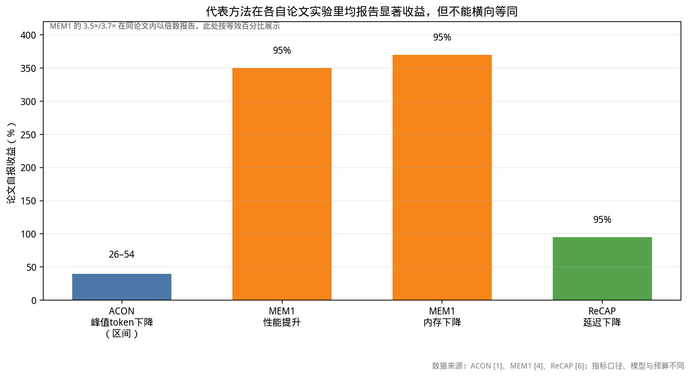
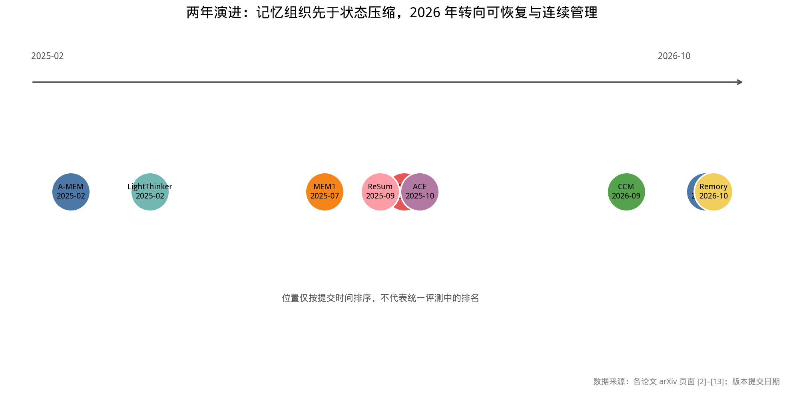

# 智能体上下文压缩近两年 SOTA 时间线调研

## 摘要

截至 2026 年 11 月 17 日，智能体上下文压缩没有统一 leaderboard；「SOTA」应按 token 级删减、query-aware 压缩、轨迹摘要、记忆组织与召回、结构化工作记忆、连续状态管理等子赛道分别理解。2025 年的主线是：A-MEM（2 月）把记忆做成可链接笔记；MEM1（7 月）以强化学习维持定长状态；ACON 与 ACE（均 10 月）则分别把失败轨迹变成压缩规则、把不断覆写的历史改成可增长的增量手册。2026 年则出现 CCM、ReCAP、Remory 与 PAIR 等工作，强调「压缩即可选择恢复」和「按执行结果诊断压缩」。其中 ACON 在三项长程基准上报告峰值 token 下降 26%–54%，同时保留任务表现，并把小压缩器蒸馏到保留教师 95% 以上精度；MEM1 报告性能提高 3.5 倍、内存降低 3.7 倍；ReCAP 报告压缩及冷恢复延迟约降低 95%，但其结果来自作者自家评测，不能据此宣布跨赛道冠军 [1][4][6]。对「1M 窗口 + 压缩后远小于 1M 且接近全量」的现实结论是：压缩能把常态工作上下文稳定压到远低于原始轨迹，却不能严格证明与全量同义；越是安全约束、精确 ID、跨轮状态或反事实分支，越需要不可变原文、可寻址恢复和预算外逃生机制。

## 口径、检索范围与证据等级

**这不是一个能排出总榜的方向。** 本报告把「智能体上下文压缩」限定为：在调用大模型 API 之前，对多轮用户消息、助手回复、工具调用与返回、计划或推理、文件和长期记忆进行选择、删减、摘要、结构化、外置及按需召回。若方法只是把上下文压成模型内部向量，却没有可用黑盒接口；或只扩展模型能接受的长度，而没有解决历史累积和调用成本，则不进入主体榜单。报告采用四级证据：A 为已发表论文、arXiv 正式论文或有可核验实验的官方技术材料；B 为框架实现或工程博客；C 为综述或立场性梳理；D 为基于上述事实的推断。正文中所有效果数字均保留论文自报口径，不把不同模型、窗口和预算下的结果拼成统一排名。

检索范围以 arXiv 页面为核心，辅以 ACL Anthology、框架仓库和相关机构材料；覆盖 2024 年 11 月至 2026 年 11 月，并把 2024 年末的 LLMLingua-2、LongLLMLingua、ICAE 等作为基线前史。2026 年候选不少，但本次可核查到的、提交日期不晚于 2026-11-17 的代表性工作仍集中在 2026 年 9—10 月；再往后月份若搜索记录与当前日期矛盾，宁可标为「公开证据不足」，也不倒填。报告主体共纳入 10 篇近两年论文，另将时间线论文以简表对照。

|子赛道|压缩对象|代表决策|黑盒 API 可用性|不能解决什么|
|---|---|---|---|---|
|Token/句子抽取|文档、历史片段|重要性、预算|通常可用|丢掉的 token 若后续关键，难无成本恢复|
|Query-aware 压缩|历史块、观察、记忆|当前问题与未来价值|通常可用|查询改写偏差；不能从摘要中还原原文|
|轨迹/摘要压缩|轮次、工具返回、推理|何时压缩、保留什么|取决于实现|累积漂移、上下文坍塌、丢失精确值|
|记忆组织与召回|事实、事件、经验|建索引、链接、检索|通常可用|召回不全；索引过期；存储成本|
|结构化工作记忆|目标、状态、约束、计划|状态读写、校验、恢复|通常可用|世界状态真值仍可能错；模式需维护|
|连续/可学习状态|内部隐状态、软记忆|状态更新或训练策略|通常不可用|跨模型不可移植；审计和可编辑性弱|

## 2024 年末：从文本删词走向「查询相关」与软状态

**LongLLMLingua 是近年应用侧压缩的分水岭，但它解决的仍是单段输入而非持续智能体轨迹。** 该工作由 Jiang 等提出，2024 年发表于 ACL，针对长上下文中的无关文本和位置偏差，以问题相关信息为条件压缩提示，显著改善了 LongBench 上的表现 [2]。它比不区分问题、只按困惑度删 token 的 LLMLingua 更进一步，但仍属于将一段输入压成较短输入：压缩发生在调用前，粒度是 token 或句子，不需要修改大模型权重，适合黑盒 API；代价是抽取天然有损，且对后续可能改变查询方向的智能体不提供可恢复性。

**LLMLingua-2 把可迁移的抽取器变成独立服务，却没有回答「智能体该何时压缩」。** Pan 等于 2024 年提出 ACL Findings 论文，以 GPT-4 蒸馏数据训练 token 分类器，在目标约 2,000 token 的 LongBench 设置中报告 39.1 分，而原始 10,295 token 提示为 44.0 分；它以较小的 token 预算换来明显压缩，但仍是同分布、同长度、同模型下的单点结果，不能直接推出长程智能体会保持成功率 [2]。它适合作为插件式预压缩器，而不适合独立承担跨轮状态维护。

**ICAE 代表另一条与 API 调用侧不兼容的路线。** Ge 等提出的 In-context Autoencoder（ICAE）把长上下文编码成若干记忆槽，再由 LoRA 适配的冻结语言模型消费；其压缩对象已是整段上下文，但必须训练模型以消费软记忆，黑盒 API 无法直接使用 [3]。它的重要性在于把「删 token」换成「学一个小的状态表示」；局限是状态不可读、跨模型难迁移、精确证据难还原。

|基线/前史|时间|核心粒度|训练需求|对近两年工作的意义|
|---|---|---|---|---|
|LLMLingua|2023，EMNLP|token 抽取|训练小模型|首次把预算控制压缩做成可用流程|
|AutoCompressor|2023，EMNLP|递归摘要向量|需训练|可学习长上下文状态的早期形式|
|Gist token|2023，NeurIPS|少量软 token|需训练|软压缩路线的代表，不属调用侧黑盒方案|
|ICAE|2024，ICLR|记忆槽|训练+LoRA|软状态与黑盒 API 边界的分水岭|
|LongLLMLingua|2024，ACL|token/句子|训练小模型|引入 query-aware，纠正长上下文位置偏差|
|LLMLingua-2|2024，ACL Findings|token 分类|训练蒸馏分类器|调用前抽取器，但只压单段输入|
|MemGPT / Letta|2023 起|分层记忆与系统提示|主要工程实现|把短期、长期记忆和回收作为运行时概念|

## 2025 年上半年：记忆从「一串摘要」变成可组织、可演化的对象

**A-MEM 的改进不是压缩率，而是让每条记忆知道它为何、如何与别的历史相连。** Wu 等提出 A-MEM: Agentic Memory for LLM Agents（arXiv:2502.12110，2025 年 2 月），受 Zettelkasten 启发的笔记构造、链接生成和记忆演化机制：原子笔记保存事实或经验，模型自动补写隐含知识，新笔记再链接到相关旧笔记，后续还能更新内容、关键词和标签 [3]。压缩粒度从「最近 N 轮」转为记忆笔记和边；它不需要改生成模型权重，可通过模型 API 与向量库实现。论文报告 A-MEM 每次记忆操作成本低于 0.0003 美元，每次约使用 1,200—2,500 token，而 LoCoMo、MemGPT 等比较设置使用约 16,900 token [3]。这更像资源与召回数据，不能称为通用压缩比。

**A-MEM 解决了单一摘要缺乏复用的问题，却把难度从压缩转移到索引质量和写冲突。** 早期记忆常把全部旧对话改写成连续段落，检索时通常只取 top-k，结果摘要中相邻但语义相近的句子相互覆盖，真正跨多轮的约束和失败经验又彼此孤立。A-MEM 的链接可把用户偏好、执行结果和计划更新串成子图，但链接本身是模型生成物，可能在多轮写回中形成陈旧依赖；图越大，检索、合并和一致性检查越贵。因此它是「组织层 SOTA 候选」，不是天然优于按轮摘要的 token 压缩器。

**LightThinker 把软压缩从文档上下文推进到推理链，但只适用于可训练模型。** Zhang 等提出 LightThinker（arXiv:2502.15589，EMNLP 2025 oral），训练模型决定何时把冗长中间思考压缩成 gist token，并通过专门注意力掩码抛弃原始思考链 [3]。它改善了峰值显存与延迟并维持竞争精度，解决的是推理 token 自身累积的问题。其增量是「压缩决策由模型在生成过程中学习」，而不是外部规则；代价是必须训练模型、必须使用对应模型与 gist 表示，无法嵌入任意黑盒 API。

## 2025 年下半年：失败驱动、计划感知与上下文工程系统化

**MEM1 第一次把「长期保持定长」做成端到端强化学习问题。** Zhou 等提出 MEM1: Learning to Synergize Memory and Reasoning for Efficient Long-Horizon Agents（arXiv:2506.15841，2025 年 7 月），每轮把既有内部状态与新观察合并为紧凑共享状态，同时决定保留、整合或丢弃内容；训练环境由已有数据集组合成任意复杂的多轮任务 [4]。它在内部检索 QA、开放域网页 QA 和多轮网页购物三类任务中，相对 Qwen2.5-14B-Instruct 在 16 目标多跳 QA 上报告性能提高 3.5 倍、内存使用下降 3.7 倍，并零样本迁移到未见设置 [4]。该状态可近似常数内存，避免轮数增长时 prompt 单调膨胀。

**MEM1 的范式变化是状态而非摘要，但其代价从 token 预算转移到奖励与环境构造。** 此前摘要法会周期性产生一个越来越大的文本检查点，仍面临上下文坍塌和写作误差；MEM1 则把记忆整合进策略，目标是长期任务回报。它显著减少需要塞回 prompt 的状态，但要求奖励可验证、轨迹可训练，黑盒 API 本身不能像可训练策略那样直接学习。论文也承认开放任务存在奖励稀疏、延迟或含噪的问题 [4]。故它更适合可训练智能体路线，而非「拿一个现成 API、加一段压缩中间件」的轻量部署。

**ReSum 把周期摘要变成可插拔工具，再用量化强化学习解决智能体不擅长读压缩状态的问题。** Zhang 等提出 ReSum（arXiv:2509.13313，2025 年 9 月），由外部工具周期性把交互历史浓缩成摘要；在此基础上，ReSum-GRPO 用 advantage broadcasting 把最终奖励传播到分段轨迹，使长程信用分配可行 [5]。作者报告训练自由版本比 ReAct 提高 4.5%，训练版本再提高 8.2%；有训练设置下，增强后的 30B 智能体只用 1K 样本即可与领先开源模型竞争 [5]。其关键改进不是「又一种摘要 prompt」，而是承认压缩后的状态本身改变了策略，需要专门适应，而不是假设任何模型都能无损理解摘要。

**ACON 把失败案例转化为可更新的自然语言压缩规范。** Kang 等提出 ACON: Optimizing Context Compression for Long-Horizon LLM Agents（arXiv:2510.00615，2025 年 10 月），收集「全量上下文成功、压缩后失败」的配对轨迹，让强模型分析失败原因，再更新一段自然语言压缩指南；同一指南约束环境观察和交互历史的压缩，并可把优化后的压缩器蒸馏到更小模型 [1]。论文报告在 AppWorld、OfficeBench 和 Multi-objective QA 上峰值 token 降低 26%–54%，同时基本保留任务表现；蒸馏压缩器保留教师 95% 以上精度，并使小语言模型在三项任务上分别提高 32%、20% 和 46% [1]。

**ACON 的核心优势是「为失败而非为文本统计做压缩」，但它不是免成本的无训练方案。** 传统 LLMLingua 类只看 token 重要性或相关性，容易误删未来决策所需的变量；ACON 通过真实执行反馈知道什么在下游失配。它不需要对生成模型做梯度更新，因而能配合 API 使用，但要求先运行轨迹、构造失败对、调用强模型分析并更新指南，属于离线环境相关优化。论文示例还显示历史压缩会把峰值 token 从 22,643 降到 7,200，但该数值是特定示例而非跨任务平均 [1]。

**ACE 指出反复全量重写会造成上下文坍塌，因此把上下文维护从摘要器升级为增长式手册。** Zhang 等提出 Agentic Context Engineering: Evolving Contexts for Self-Improving Language Models（arXiv:2510.04618，2025 年 10 月），用 Generator、Reflector、Curator 三角色：执行任务、从成败提炼经验、再把经验写成增量 delta；普通逻辑合并条目，并通过 grow-and-refine 限制冗余 [5]。论文报告智能体任务平均提高 10.6%、金融任务提高 8.6%；AppWorld 案例中，18,282 token 的上下文被改写成 122 token 后准确率由 63.7 降至 57.1，说明一次性压得过小会抹去已学信息 [5]。

**ACE 的相对改进是把「覆写」换成「追加式知识治理」。** 普通周期摘要会把旧上下文全部折叠进新段落，下一次再压缩时又读取自己的旧摘要，误差会链式累积；ACE 保存细粒度经验教训，以 delta 更新共享 playbook，更适合跨任务学习。它可以在黑盒 API 上运行，但上下文治理流程本身增加模型调用，且增量合并规则、命名冲突和去重仍是工程难题。

## 2026 年：从「压缩掉」转向「能恢复、能连续管理、能按结果校正」

**CCM 把压缩从阈值触发改成每轮默认状态更新。** Hoy 等提出 Continuous Context Management（arXiv:2609.35540，2026 年 9 月），每轮让智能体同时输出更新后的记忆和环境动作，下一轮只保留任务、保留记忆与最新观察，而非完整轨迹；作者随后以全历史特权蒸馏配合 GRPO 训练开放模型 [8]。在 TerminalBench-2 的多种模型上，CCM 明显降低了累计输入和活跃 prompt，但多数模型的任务成功率也下降，只有 Kimi K3 保持了表现；训练结果在 WebShop 和 Endless Terminals 上有所改善，但并非所有模型、规模都胜出 [8]。

**CCM 证明了「每轮压缩」的代价曲线，也暴露了从全历史直接改状态的脆弱性。** 传统方案等到历史超限再总结，平时积累、触发时陡降；CCM 平滑增长，减少 prefill 和输入 token，却使每轮的状态更新都成为潜在错误来源。其意义不是给出通用压缩比，而是把问题重新定义为持续策略学习。对黑盒 API，无训练版本可接入；若使用论文中的强化学习优化，则需训练并需要能重放轨迹的环境。

**ReCAP 把调用过程中的注意力变成可持久选择的上下文图。** Yang 等提出 Persistent Context Graphs for Efficient Memory Compaction in LLM Agents / ReCAP（arXiv:2609.40118，2026 年 10 月）：节点是带累积重要性的历史块，边记录依赖；新请求到达时，结合已存储重要性和标识符重合沿依赖边选择块，因此即使某块自身得分不高，也可能被其支持块拉回 [6]。图来自推理已经计算的注意力，选择只需图遍历和字符串匹配，无需额外模型调用；图独立于 KV cache，可在 cache 过期后选择而不重新编码全部历史。

**ReCAP 解决的是「请求改变后旧评分失效」和「cache 冷启动」两个相邻问题。** 与每轮重新调用模型识别依赖相比，它把推理时已经出现的注意力持久化；与 query embedding 单点召回相比，它利用历史依赖边恢复上下文。论文在 SWE-Together 106 个任务和 Lost-in-Conversation（LiC）100 个实例上比较 Qwen3-Coder-30B-A3B-Instruct 与 gpt-oss-20b，报告压缩与冷恢复延迟相对 Codex 默认摘要约降低 95%，SWE-Together 在相近质量下历史上下文约减半，LiC 准确率相对全历史分别提高 19.8 和 41.2 个百分点 [6]。但这些数值来自论文自身的统一实现和固定超参数，比较方法的目标压缩比例、KV 预算等并非完全逐项同预算，应作为强候选证据，而非跨论文排行榜。

**ReCAP 没有消除信息保留问题，只是把部分不可逆丢失改成了可重新选择的损失。** 论文未量化图本身的 token 或存储开销，评估主要限于 Qwen3 系列相关模型族，且对话历史任务中隐式检索仍可能占优 [6]。这意味着持久图更适合代码智能体、工具轨迹和显式依赖较强的场景；对高度口语化、实体关系稀疏的闲聊，它未必比简单摘要或向量检索便宜。

**Remory 承认文本摘要永远无法编码所有未来需求，于是给它补一个可学习的残差。** Xia 等提出 Remory: Learning Residual Memory for Context Compaction（arXiv:2610.11287，2026 年 10 月），让神经网络读历史与摘要后生成有界软记忆 token，附在文本摘要之后，帮助冻结 LLM 逼近全历史继续生成的分布 [7]。在 SummHay 上，它用 5.2% 的输入位置接近全上下文联合分数，并在 BrowseComp 与 Terminal-Bench 2.1 上报告更少重复工具输出和工具错误 [7]。

**Remory 的关键增量是「文本可审计层 + 软残差层」，但软记忆依赖模型版本。** 传统摘要可解释、可检索、可人工编辑；纯 gist/软记忆容量高却不可读；Remory 把二者结合，避免把未知未来需求完全托付给文本。它需训练且绑定特定冻结 LLM，不满足黑盒 API 直接可用；软状态也会带来跨模型迁移、失效文档更新和治理问题。

**PAIR 把评测重点从平均成功率改成压缩事件对后续可靠性的因果影响。** Min 等提出 Adapting Context Compression for Long-Horizon Agents with Counterfactual Continuations / PAIR（arXiv:2609.36526，2026 年 9 月），用匹配的反事实继续：同一智能体状态在有/无压缩下分别执行，发现严重退化集中在孤立压缩事件，而且可靠性常比可解性更早恶化 [9]。PAIR 定位这些压缩、诊断后果并修订固定压缩模板相应部分，不修改下游智能体，在多数评测中取得压缩方法中的最高跨运行可靠性，并有时数值上超过不压缩基线 [9]。

**PAIR 改变了优化信号：不是比较最终答案，而是比较同状态分叉。** 此前很多方法只比成功率和平均 token；PAIR 说明一次错误压缩可能在多个后续步骤中放大，平均值会掩盖低概率但致命的状态丢失。它需要可重复状态与继续执行能力，部署成本较高，但在高可靠场景可用来选择触发阈值、模板段落和召回策略。它更像评测/诊断框架，而非单一压缩算法。

## 统一比较矩阵

|方法|年份|子赛道|压缩对象|需训练|黑盒 API 可用|公开压缩/资源|主要收益|主要局限|
|---|---:|---|---|---:|---:|---|---|---|
|A-MEM|2025|记忆组织/召回|事实、经验、链接|否|是|约 1,200—2,500 token/操作|跨轮语义组织；低于 0.0003 美元/操作|链接质量、图维护、召回成本|
|LightThinker|2025|可学习推理压缩|思考链 token|是|否|未报告统一压缩比|降低峰值显存和延迟|改模型、绑定模型；不可读|
|MEM1|2025|连续状态管理|多轮观察/状态|是|否|内存降 3.7×|定长记忆、泛化到更长 horizon|需可验证奖励与训练环境|
|ReSum|2025|周期摘要+策略适配|历史轨迹|可选|训练自由版本可用|未报告统一压缩比|提高 4.5%，GRPO 再提高 8.2%|长程奖励传播与训练成本|
|ACON|2025|失败驱动压缩|观察、交互历史|否|是|峰值 token 降 26%–54%|保留任务表现；蒸馏保留 >95%|离线失败采集；环境相关|
|ACE|2025|上下文工程/增量手册|经验教训、领域规则|否|是|未报告统一压缩比|减少上下文坍塌；+10.6% 智能体任务|额外角色与合并逻辑|
|CCM|2026|连续压缩/强化学习|全轨迹→记忆+新观察|可选|无训练版可用|未报告统一压缩比|降低累计输入；Kimi K3 保持表现|多数模型成功率下降；训练提升不稳|
|ReCAP|2026|持久图/按需恢复|块、依赖、重要性|否|是|约 95% 延迟下降；上下文约减半|cache 冷启动可恢复|图开销未量化；模型族外推未证实|
|Remory|2026|文本摘要+软残差|历史与摘要|是|否|5.2% 输入位置接近全上下文|补足未知未来信息|绑定冻结模型；不可读|
|PAIR|2026|压缩诊断/干预评测|结构化压缩模板|否|是|未报告压缩比|定位单次压缩退化；提高可靠性|需反事实继续与更多执行成本|

*图 1：ACON、MEM1、ReCAP 在各自论文、模型与预算设置中的报告收益。MEM1 的 3.5×/3.7× 按等效百分比展示，不能与百分点指标直接比较。数据来源：ACON [1]、MEM1 [4]、ReCAP [6]。*

## 子赛道演进逻辑：从删 token 到治理状态

**token 级路线完成了「少送」但没完成「不丢」。**

2023—2024 的 Selective Context、LLMLingua、LongLLMLingua 和 LLMLingua-2 把 prompt 压缩变成可部署的抽取器：按 token 保留重要片段、按问题选择、训练轻量分类器。增量很清晰——从通用重要性到 query-aware、再到任务无关蒸馏。但 token 是最小粒度，一旦删掉精确 ID、错误栈、约束例外或用户否定的事实，后续很难无成本恢复。

**轨迹摘要路线解决了可读性，却引入了周期性写作误差。**

ReSum 式周期摘要把旧轮次折成段落，实现简单，也可由黑盒模型生成；ACON 再引入失败反馈，ACE 再引入增量 delta。演进逻辑是从「生成摘要」到「为失败写摘要」，再到「不要每次推翻手册」。当前瓶颈是摘要粒度、触发阈值、旧摘要版本与模型更新后的语义漂移；尤其在工具密集和代码任务中，把精确值折叠成自然语言是风险最高的环节。

**记忆组织路线把单一时间线改成可检索的多视图。**

A-MEM 的笔记与链接、向量库、图索引，以及后文 AgentMemBench 所示外部 KV，都属于这条线。其改进在于不再假设最近轮次永远最重要，而允许按问题检索长期事实。瓶颈转向索引质量、写入冲突、图膨胀和长距召回；检索到不等于能正确组合，也不等于摘要层和原文层保持一致。

**结构化状态与连续管理路线试图跳过不断增长的原始序列。**

MEM1、CCM 和 ReCAP 都试图让活跃上下文有界：MEM1 学习更新内部状态，CCM 把状态作为每轮共同输出，ReCAP 用持久依赖图选择块。前者是真正的范式变化——不再把全部历史放进 prompt；后两者仍可外置原文，因此更接近黑盒 API。共同瓶颈是状态真值、更新顺序、跨请求恢复和训练成本。

**2026 年的残差与干预路线承认压缩不完备。**

Remory 允许文本摘要之外保留模型可读软信息；PAIR 用反事实继续判断某次压缩是否应被修订。前者是表示层范式变化，后者是评测与优化范式变化。它们没有相互取代：一个回答「还能补什么」，一个回答「这次压缩是否值得做」。目前仍缺把二者与可寻址原文、跨模型、跨任务统一测量的公开基准。

*图 2：代表工作的提交时间轴，仅作时间排序，不代表同一评测中的排名。数据来源：各论文 arXiv 页面 [3]—[9]。*

## 支线对照：为什么软压缩、KV cache 与长上下文架构不能替代调用侧管理

**可学习软压缩更接近「改变模型」，而不是给 API 加中间件。** Gist token、AutoCompressor、ICAE、LightThinker 和 Remory 将上下文映射成少量连续状态或 gist token，可降低模型需要处理的序列长度。其优势是信息密度可以高于自然语言，还能保留模型内部关联；局限是必须训练、绑定特定模型版本、不可直接读取，且原始精确文本未必可恢复。对能够自行托管和微调模型的团队，它是独立子赛道；对只调用黑盒 API 的团队，它通常不可用。

**KV cache 压缩减少的是一次推理内的显存与计算，不是主动的历史治理。** 常见策略按注意力分数逐出旧 KV、量化为低位或分层 offload，可在长生成中显著节省资源；但很多黑盒 API 不允许读取、选择或替换 cache，跨请求 KV 复用也受服务实现控制。即使服务支持 prompt cache，旧 token 仍有前缀匹配、失效和成本规则限制。因此 KV 压缩适合底层推理系统，不天然解决「助手应该保留哪个工具返回值、何时更新长期目标」。

**长上下文架构与位置外推扩展容量，却不保证信息被正确使用。** RoPE 缩放、ALiBi、StreamingLLM、稀疏注意力及状态空间/混合架构让模型处理更长输入；其解决的问题是架构可扩展性和有效长度。1M 或更大窗口能推迟溢出，但 prefill 成本、注意力稀释、中间遗忘、状态维护和跨请求重复发送仍会保留。该路线可与调用侧压缩结合，却不能替代原文归档、状态校验和按需召回。

## 近两年评测进展与「接近全量」为何难证明

**AgentMemBench 把记忆策略放到同模型、同解码、同流程下比较，但规模有限。** Cherif 等提出 AgentMemBench（arXiv:2608.00009，2026 年 6 月），用 Qwen2.5-7B-Instruct（4-bit）、贪心解码评估五种策略，覆盖 LoCoMo、MultiDoc2Dial 与 MSC 的 491 个标注问句，并报告 Recall@k、MRR、nDCG@k、Answer F1、Faithfulness、内存占用和延迟 [10]。EKV 在多数质量指标领先（宏观 Recall@5 为 0.792，MRR 为 0.677），LoCoMo 上长距召回明显优于近邻窗口、摘要与实体图；CBS 是检索 runner-up（0.556），而 EKV 的内存占用约 5,100 token，近邻窗口与网络增强记忆约 300 token [10]。其贡献是首次系统比较策略，而不是证明某个策略在所有任务上最优。

**LongMemEval 把长期记忆评估从单次问答扩展到多轮互动。** 该基准聚焦聊天助手在多轮中的长期记忆、信息冲突、时间推理和工具使用；它对记忆系统比「长文档 needle」更有针对性。不过不同论文常选择不同模型、问题和评分方式，尚未形成统一 API 调用侧 leaderboard。

**Lost in Conversation 暴露「检索到也不代表会用」。**

Laban 等提出的 Lost in Conversation 把要求分散在用户多轮交互中。后续 2026 工作把它用于代码智能体评测：ReCAP 在其代码任务上报告相对全历史提高 19.8 和 41.2 个百分点 [6]。这说明多轮信息并非只在检索层丢失，模型对历史组合和任务转换的处理同样关键。

**「接近全量」通常只能在固定任务分布上成立。** 一个压缩器在任务成功率上等于全量，不代表它在安全规则、异常工具返回、跨 100 步状态或对抗查询下与全量等价。全量本身也可能因为上下文太长而注意力稀释；因此更严谨的表达应是「在给定预算、任务分布和失败代价下，压缩策略与全量全上下文的差值」，而非「完全无损」。ACBench 还提示，模型量化与训练压缩对工具使用和现实应用的影响并不一致，说明「压缩」这个词的口径本身会造成误读 [11]。

## 综述、SoK、Position 与 Survey 额外清单

**上下文工程综述已将压缩放入完整信息供应链。** Mei 等《A Survey of Context Engineering for Large Language Models》（arXiv:2507.13334，2025 年 7 月）覆盖超过 1,400 篇论文，把上下文工程拆为检索与生成、处理、管理三层，并把 RAG、记忆系统、工具推理和多智能体列为系统实现 [12]。相关章节包括 Context Compression、Memory Hierarchies、Structured Information Integration 与 Context Management；值得重点读第 4.3 节和全篇分类，以理解「压缩」不是孤立的 prompt 技巧，而是信息载荷优化的一环。

**记忆综述已从短期/长期二分转向表示、功能与动态三维分类。** Du 等《Rethinking Memory in LLM based Agents: Representations, Operations, and Emerging Topics》（arXiv:2505.00675，2025 年 5 月）区分参数记忆与上下文记忆，定义 Consolidation、Updating、Indexing、Forgetting、Retrieval、Condensation 六类操作 [13]，最适合作为近两年记忆论文的统一术语表。《Memory in the Age of AI Agents》（arXiv:2512.13564，2025 年 12 月）进一步把记忆分为 token、参数和 latent 三类，按事实、经验和工作记忆区分功能，并整理基准与框架；其中「记忆自动化、强化学习、可信性」值得重点读 [14]。另一篇《A Survey of Agent Memory in the Second Half》（arXiv:2602.06052，2026 年 2 月）把短期记忆门控、长期巩固和记忆操作的可学习策略连成闭环，适合跟踪 2026 年 RL 化趋势 [15]。

**长上下文综述负责说明「更长窗口仍不等于上下文已管理」。**

Liu 等《A Comprehensive Survey on Long Context Language Modeling》（arXiv:2503.17407，2025 年 3 月）覆盖位置编码、长度外推、注意力变体、线性/混合架构、训练、服务、评测与行为分析 [16]。应重点读长度外推、prompt compression/memory/agent 的分流，以及「宣称窗口 vs 有效上下文」部分。若关注 KV 侧，可参考《From Long Context to Selective Memory: A Survey of Memory-Centric Compression for Large Language Models》（arXiv:2610.21165，2026 年 10 月），它把 KV offload/recall、外部记忆 materialization 和智能体激活控制放在同一生命周期中讨论 [17]。

**Prompt/上下文压缩综述是调用侧工程的入口，但需优先看原始论文。** Sarkar《LLM Prompt Compression Techniques: A Comprehensive Survey》（2025，GitHub 持续文档）汇总 LLMLingua、LLMLingua-2、500xCompressor 等，优点是覆盖广、更新快；缺点是非会议/期刊出版物，且二手整理可能混入口径。适合作为论文目录，不应作为效果数字的唯一来源 [18]。

|主题|文献|年份|类型与覆盖|与本报告关系|值得读|
|---|---|---:|---|---|---|
|上下文工程|Mei 等，arXiv:2507.13334|2025|Survey；检索、处理、管理、RAG、记忆、工具、多智能体|给出压缩在上下文供应链中的位置|4.3 节；第 5.2 节|
|Agent 记忆|Du 等，arXiv:2505.00675|2025|SoK/分类；记忆表示、六类操作|统一 A-MEM、MEM1、ACON 的术语|第 3—5 节|
|Agent 记忆|Wang 等，arXiv:2512.13564|2025|Survey；token/参数/latent，事实/经验/工作记忆|用于区分「压缩」与「记忆」|基准与开放问题|
|Agent 记忆|Wang 等，arXiv:2602.06052|2026|Survey；记忆 substrate、认知层、跨智能体|解释 RL 化上下文治理趋势|评测与学习策略|
|长上下文|Liu 等，arXiv:2503.17407|2025|Survey；架构、训练、服务、评测|解释长窗口为何不替代调用侧压缩|有效长度与评测|
|记忆中心压缩|Liu 等，arXiv:2610.21165|2026|Survey；KV、外部记忆、激活控制|区分模型侧与智能体侧压缩|第 6.2—6.4 节|
|Prompt 压缩|Sarkar，GitHub|2025|持续整理；token/句级压缩器|快速索引早期方法|需回查原文数字|

## 2026 年判断与开放问题

**最值得追的是「可恢复压缩」，而非一味提高删减率。** 第一优先是完整历史外置、活跃上下文有界、精确证据可寻址召回，例如 ARC 式 ID 日志与 ReCAP 式依赖图；第二优先是结构化状态与上下文手册，减少自然语言摘要对变量和约束的反复转写；第三优先是把压缩、检索与工具加载放进预算协调，而不是分别做三个优化器；第四优先是跨运行可靠性、失败诊断和版本化评测。

**「1M 窗口 + 压缩后远小于 1M 且接近全量」可以实现，但只在明确条件下成立。** 对大多数 API 调用，活跃 prompt 应只放不可省略的当前任务、少量结构化状态、近期证据和检索到的原文；完整轨迹、工具返回、文件和长期经验外置。这样可以使常态活跃 token 远低于 1M，并在固定任务上接近全量表现。但「接近全量」不是信息论等价：安全规则、精确标识符、跨轮否定、环境变更和少样本反事实可能触发恢复；若恢复预算也受限，系统必须能够拒绝、澄清或执行逃生动作。

**目前缺乏证据的高承诺集中在三项。** 其一，宣称「保持全部能力」的摘要或软状态通常只在少数模型、任务和固定 horizon 上验证；其二，图记忆和关系链接是否比高质量语义检索更便宜，尚缺大尺度跨任务证据；其三，「上下文工程」常被视为系统优化，却缺少把 prompt 成本、执行成功率、可靠性、恢复率、隐私删除和人工审计统一报告的生产基准。上述三项应视为待验证判断，而非既成事实。

## 结论

近两年最清晰的进步不是某一种压缩算法突然统治全场，而是决策粒度从 token 上升到轨迹、状态、记忆和失败事件：A-MEM 让记忆可链接，MEM1 让状态定长，ACON 让失败定义保留什么，ACE 让上下文手册增量增长，ReCAP 让旧信息可重新进入请求，PAIR 则让单次压缩错误可被因果诊断。对黑盒 API 用户，最稳妥的组合是「原文不可变归档 + 结构化状态卡 + query-aware 召回 + 按需原文恢复 + 关键约束直传」，必要时才调用摘要器。对可训练智能体，连续状态、策略适配和软残差值得试验，但必须接受模型绑定和跨版本迁移成本。若目标是接近 1M 全量，合理指标应是任务效果差、关键状态恢复率、成本与跨运行可靠性的帕累托前沿，而不是单一压缩比。

## 引用来源

[1] https://arxiv.org/pdf/2510.00615v2
> “ACON reduces memory usage by 26-54% (peak tokens) while largely maintaining task performance”

[2] https://www.arxiv.org/abs/2403.12968
> “LLMLingua-2: Data Distillation for Efficient and Faithful Task-Agnostic Prompt Compression”

[3] https://www.arxiv.org/abs/2502.12110
> “A-MEM: Agentic Memory for LLM Agents”

[4] https://arxiv.org/html/2506.15841v2
> “MEM1-7B improves performance by 3.5x while reducing memory usage by 3.7x”

[5] https://arxiv.org/pdf/2510.04618
> “ACE: Agentic Context Engineering: Evolving Contexts for Self-Improving Language Models”

[6] https://arxiv.org/html/2609.40118
> “Persistent Context Graphs for Efficient Memory Compaction in LLM Agents”

[7] https://arxiv.org/html/2610.11287v2
> “Remory: Learning Residual Memory for Context Compaction”

[8] https://arxiv.org/abs/2609.35540
> “Continuous Context Management”

[9] https://arxiv.org/abs/2609.36526
> “Adapting Context Compression for Long-Horizon Agents with Counterfactual Continuations”

[10] https://fr.arxiv.org/abs/2608.00009
> “AgentMemBench: A Systematic Benchmark for Evaluating Long-Term Memory Management Strategies in Conversational AI Agents”

[11] https://arxiv.org/pdf/2505.19433
> “Can Compressed LLMs Truly Act? An Empirical Evaluation of Agentic Capabilities in LLM Compression”

[12] https://arxiv.org/pdf/2507.13334v1
> “A Survey of Context Engineering for Large Language Models”

[13] https://www.arxiv.org/abs/2505.00675
> “Rethinking Memory in LLM based Agents: Representations, Operations, and Emerging Topics”

[14] https://arxiv.org/abs/2512.13564
> “Memory in the Age of AI Agents”

[15] https://arxiv.org/abs/2602.06052
> “A Survey of Agent Memory in the Second Half: Towards Self-Evolving and Long-Horizon Agents”

[16] https://arxiv.org/abs/2503.17407
> “A Comprehensive Survey on Long Context Language Modeling”

[17] https://arxiv.org/pdf/2610.21165
> “From Long Context to Selective Memory: A Survey of Memory-Centric Compression for Large Language Models”

[18] https://github.com/llmprogram/llm-prompt-compression
> “LLM Prompt Compression Techniques: A Comprehensive Survey”

[19] https://arxiv.org/abs/2307.06945
> “In-context Autoencoder for Context Compression in a Large Language Model”
